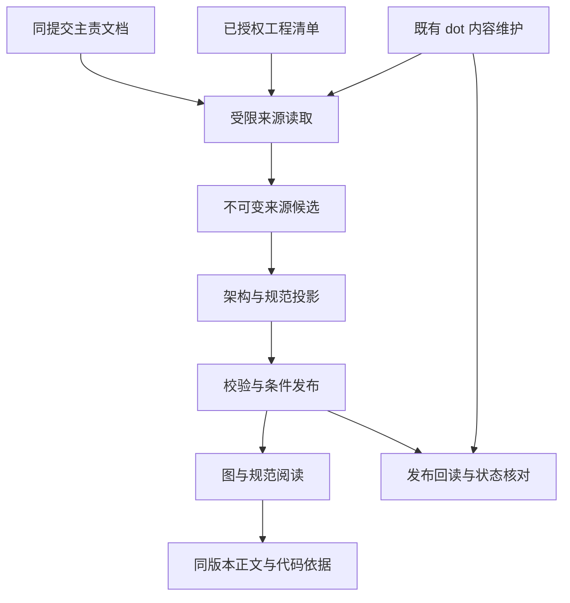

# 云端指挥中心工程架构与规范视图

- 文档 ID：`DESIGN-ENGINEERING-CC-ARCHITECTURE`
- 状态：`draft`；本文定义目标合同，不表示云端模块或持续任务已经上线
- owner_role：`runtime_engineer`；产品责任为 `producer_system_designer`，来源接入与 dot 维护为 `agent_engineer`
- module：`engineering`
- 上游：[REQ-CC-018](command-center.prd.md#REQ-CC-018)；整体职责与身份沿[主系统设计](command-center.design.md#DES-CC-001)
- 审读基线：`nil-studio/oasis7@16e5699881d0705ee1a137b24c47957b5b54a5a4`，2026-10-24；仅核对本专题的来源及维护合同，既有 Site 实现证据保留原版本

## 1. 问题、目标与非目标

现有文档树回答“资料在哪里”，架构索引回答“哪些边界值得关注”；两者尚不足以从同一入口看清整个工程的组成、组件间关系和修改时适用的开发规范。本设计在云端“规范与决策”内承接全局架构、模块下钻、规范关联与版本变化，帮助负责人在准备开发、评审和回顾时找到准确依据。

架构与规范视图是已授权来源的派生投影。专业文档拥有设计，源码与清单拥有其版本的实现事实，真实环境证据拥有部署事实；图、dot 解释及更新状态不成为新的架构或开发规范权威。工作区、未提交文件、私有资料、开发会话正文和机器操作仍在原边界内，不进入本模块。

本模块不实现任意代码调用图、实时服务发现、全仓静态分析、完整 SBOM、IDE 或新的开发调度器；不为了绘图新增要求登记、架构审批、CI 门禁或一份必须人工维护的全仓关系台账。只能证明清单依赖时就显示清单依赖，不能用它代替运行时调用或权限。

## 2. 上游约束与相关角色

沿用主系统设计的 `SourceRef`、`FactCell`、可信 Site/project/scope、不可变来源快照与 D1 缓存边界。规范效力沿 [REQ-CC-004](command-center.prd.md#REQ-CC-004)，文档正文与历史阅读沿 [REQ-CC-016](command-center.prd.md#REQ-CC-016)，个人偏好沿 [REQ-CC-017](command-center.prd.md#REQ-CC-017)。这些引用复用已有合同，不把个人决定变成架构规则。

### 2.1 需求承接与分配表

| 上游条款 | 具体义务与适用条件 | 本设计条款 | 外部 owner / dependency | 明确排除或未覆盖 |
| --- | --- | --- | --- | --- |
| Trace refs: O7-REQ-fd086a0a-3c00-41ea-b2ac-fe7cf6cbe52a；[REQ-CC-018](command-center.prd.md#REQ-CC-018) | 全工程分层、类型明确的关系与代码定位；产品适用性：N/A；reason=工程工作台阅读能力；scope=架构来源与图投影 | [DES-CC-ARCH-001](#DES-CC-ARCH-001) | core/模块设计 owner、受限来源 adapter | 不承诺穷举函数调用或当前线上拓扑 |
| Trace refs: O7-REQ-fd086a0a-3c00-41ea-b2ac-fe7cf6cbe52a；[REQ-CC-018](command-center.prd.md#REQ-CC-018) | 当前适用规范、理由、版本与冲突；产品适用性：N/A；reason=工程工作台阅读能力；scope=开发规范关联 | [DES-CC-ARCH-002](#DES-CC-ARCH-002) | workflow/专业规范 authority | 不另设审批、自动修规范或由模型裁决冲突 |
| Trace refs: O7-REQ-fd086a0a-3c00-41ea-b2ac-fe7cf6cbe52a；[REQ-CC-018](command-center.prd.md#REQ-CC-018) | 图/文档往返、检索、过滤、历史比较与可读性；产品适用性：N/A；reason=工程工作台阅读能力；scope=云端架构交互 | [DES-CC-ARCH-003](#DES-CC-ARCH-003) | Sites UI、文档阅读、个人偏好服务 | 不复制个人主库，不将路径等同稳定身份 |
| Trace refs: O7-REQ-fd086a0a-3c00-41ea-b2ac-fe7cf6cbe52a；[REQ-CC-018](command-center.prd.md#REQ-CC-018) | dot 增量核对、条件发布、回读及真实运行状态；产品适用性：N/A；reason=工程工作台内容维护；scope=公开架构与规范缓存 | [DES-CC-ARCH-004](#DES-CC-ARCH-004) | 既有 Sites 内容任务与来源/摘要能力 | 不自动启用任务、扩充模型预算、创建 PR 或发布 Site |
| Trace refs: O7-REQ-fd086a0a-3c00-41ea-b2ac-fe7cf6cbe52a；[REQ-CC-018](command-center.prd.md#REQ-CC-018) | 快照一致、并发、失败保留与兼容恢复；产品适用性：N/A；reason=工程工作台派生存储；scope=架构快照及读取协议 | [DES-CC-ARCH-005](#DES-CC-ARCH-005) | Worker/D1、文档快照和受控发布 | 不把缓存当验收档案，不在撤权后继续提供旧内容 |

## 3. 当前状态、目标状态与差距

| 对象 | 当前基线与依据 | 目标及尚需验证 |
| --- | --- | --- |
| 项目架构导航 | [core 设计](../../core/design.md)、[core PRD 的模块地图](../../core/prd.md)、[架构索引](architecture/README.md)已有入口；索引保留不同时间的局部核对 | 同一选定提交下的完整模块目录、明确关系与覆盖清单；旧索引不能单独证明当前图 |
| 云端阅读 | [当前实现](command-center.design.md#cc-current-implementation)记录文档快照、来源缓存及个人空间的已有范围 | 架构图、规范关联、差异比较及与文档的往返是新增验收范围，尚无本专题完整验收证据 |
| 工程元数据 | [Rust 工程合同](../rust-governance/rust-engineering-contracts.design.md#boundary-matrix)拥有依赖边界；仓库清单可说明其版本的声明 | 元数据 allowlist、解析器与明确模块映射需在实现时接入；清单声明不等于构建或部署成功 |
| dot 内容维护 | [现有任务](../../../.agents/dot/tasks/sites-content-review.md)只允许已授权公开来源/摘要缓存维护；[时间表](../../../.agents/dot/SCHEDULE.md)不证明执行器已启用 | 复用该任务，显式补齐架构来源和缓存入口的接入范围、共同去重与真实运行验收；本 PR 不修改其现行权限或启用状态 |

## 4. 边界与结构

以下为本模块的目标数据流；箭头表示读取或派生，不表示仓库写入、开发派工或部署授权。

Worker 来源 adapter 读取受控路径及固定提交，解析层建立带证据的对象，投影层生成聚合视图和变化，D1 只保存可重建缓存及成功指针。UI 使用已发布对象，不在浏览器扫描仓库、运行仓库脚本或请求模型。dot 调用已有受限维护入口并核对结果，不直接操作 D1 或将模型输出当作任意图写入指令。

### DES-CC-ARCH-001：来源、范围与关系语义

从[文档总入口](../../README.md)和 core 模块地图枚举声明的产品与工程模块，再读取明确链接的模块/专题主责。首个实现至少覆盖玩家入口与 Viewer、Agent 接入/Harness/Provider、Simulator 与权威 Runtime、World Service、网络/共识/存储、协议与 WASM 扩展、测试/构建/发行/运维，以及指挥中心自身；不是只展示 Rust crate。`playability_test_result`、历史记录或纯文档域以其实际性质显示，不能强画成运行服务。

“全工程”表示已核对所选提交中声明的模块清单和允许元数据清单，所有条目均可定位或有明确缺口，不表示所有隐式语义关系都已发现。四产品域是关联维度，专业模块与 crate 是另一种分组，多对多关系必须有来源；engineering 不成为第五游戏产品域。默认图聚合主要系统，折叠项和未归属组件仍可查找。

Sites 指挥中心及其他独立仓库组件可以先由本仓库的主责设计作为设计节点覆盖；未获准接入其源码时明确“外部实现来源未接入”，不为达到全工程覆盖扩大仓库范围。以后确有授权接入时，每个仓库固定自己的 commit 并作为显式依赖版本记录；单仓同提交约束分别成立，不能把业务仓库 SHA 当作 Sites 或其他仓库 SHA。

| 来源 | 可提取内容 | 提取与证明边界 |
| --- | --- | --- |
| core、模块设计、明确专题及现行规范 | 显式职责、组成、接口/数据流、主责与适用范围、明确后继 | 仅支持已声明解析语法或带原文位置的已核对关系；普通超链接不是依赖，目录不是语义归属 |
| 同 SHA 的 Cargo workspace/成员清单 | 成员、path 依赖、normal/build/dev、optional、features、target 条件 | 工作区继承和别名正确解析；未解析条件保留原值/未知，不冒充某 profile 的实际依赖闭包，不执行 Cargo/build.rs |
| 同 SHA 的 package 清单、受控边界及协议产物清单 | 前端/工具包、显式脚本入口与依赖、允许/禁止边界、生成输入输出 | 首版按明确 allowlist 支持格式；依赖锁定、动态加载与跨语言调用只显示已确认范围，不执行脚本或递归读取任意 URI |
| Git/PR/检查与环境原证据 | 实现交付关联、准确版本与明确环境结果 | 按已有 `WorkRef`/证据合同读取；部署覆盖是可选独立层，没有证据即“未核实”，不自动 SSH 或探测服务 |
| 架构索引和 dot 归纳 | 阅读导航、说明与关注变化 | 保留原事实时间及来源；与主责/当前源码冲突时展示双方，不能覆盖原事实 |

“已核对关系”必须有可重建依据：受控提取规则定位准确源路径、锚点/原文区间与内容 hash，记录规则版本和明确关系含义。源原文或规则发生变化时，相应关系失效并待复核；一次人工或模型解释不能作为永久确认边，缺可重建来源时只保留带引用的说明/建议，不建立确认关系。

节点的身份包含可信 repository ID、对象命名空间及已有稳定定位，版本独立保存。需求用唯一 Trace ID，规范用其声明定位；代码对象用 workspace/package 或规范化仓库路径，路径重命名只有显式迁移或可核实的一对一来源时才建立别名。名称相同、目录邻近或内容相似不合并；无稳定定位的条目保留临时身份和限制，不声称跨版本同一对象。

每条边带 `from/to`、关系类型、条件、事实性质和准确来源；必须有唯一可解析的两端。关系至少分开：`contains`（明确组成）、`declared_dependency`（清单声明）、`calls_or_transports`（明确接口调用/传输）、`reads_or_writes`（数据读写）、`governed_by`（适用规则）、`generated_from`（产物来源）和 `deployed_as`（有环境证据）。方向统一由使用方指向依赖方、调用方指向被调用方、消费者指向数据、对象指向规则；读/写区别必须标注。允许与禁止边界是约束，不伪装成实际发生的依赖。

`design`、`implementation`、`deployment` 与 `unverified` 分别说明关系依据；文档的草稿/有效/退役状态另存。缺实现证据的设计节点仍可阅读，但不标“已实现”。模型推断留在“待核对建议”，不进入已确认关系和影响路径；源冲突不能通过较新抓取时间裁决。Runtime 与 Simulator 的并列、Service 的组合依赖等按模块合同表达，不硬套一条统一分层禁入规则。

### DES-CC-ARCH-002：开发规范的关联

选择模块/组件时，规则列表先提供通用开发流程，再列当前对象明确适用的专业边界、文档、测试和发布要求；每条包含标题、适用范围、适用原因、主责原文、所读版本、条款效力和后继。通用流程只来自 [workflow/source-of-truth](../workflow/source-of-truth.md)，测试操作来自 [testing-manual](../../../testing-manual.md)，Rust 边界/协议产物来自相应主责合同。角色说明、Skill 和 dot 工作方法标为执行指引，不能与正式规范竞争效力。

规则适用由原条款明确范围、受控提取规则及已核实对象映射得出；规则项说明采用哪项条件。未能判断的关联显示“待确认适用”，不宣称无规则或自动添加必做项；不因为文本出现“必须”就跨范围扩大义务。设计草稿、已废止条款和旧版本只在相应状态下呈现；有效性冲突及缺失后继保留双方并链接原文。

影响阅读只沿已确认、当前过滤条件内的关系返回路径和证据，显示方向、跳数及截断；不声称发现所有受影响代码，不直接决定 CI 范围或形成审批清单。规则正文发生变化时，标出受影响关联待核对；个人决定与确认仍引用原版本，不由规则刷新自动续期。

### DES-CC-ARCH-003：浏览器交互与阅读恢复

“规范与决策”内固定提供“工程架构”“文档全局”和既有规范/决定入口。架构页采用概览图、当前选中对象详情及按需展开来源：全局→模块→组件三层逐步展开；详情先解释职责、上下游、关键边界与适用规则，再列代码和主责原文。不得默认铺开全部 crate、数百连线或原始 Markdown。

搜索支持中文名称、模块、包名、仓库路径及完整 Trace ID，结果保留分组和定位路径。关系类型、设计/实现/部署证据、条件与缺口可过滤，图例同步解释，颜色之外有文字/线型。点击规则进入同版本条款，打开正文或源码后返回选中对象、筛选与焦点；组件的目录包含和文档配对由原阅读入口承接，不在图中猜配对。

对比两个明确快照时展示节点、关系、规则内容/适用性与来源覆盖的增删改，并分别保留旧、新引用；未经完整读取的一侧只标“未核实变化”。只有完整清单或精确对象查询证明不存在才判删除，迁移保留别名与原证据。变化是来源差异，不是影响已验证或新版本已部署。

偏好沿已有个人记录保存为本模块独立键：视图层级、选中身份、过滤、展开路径和原阅读版本；不保存整图或模型正文。自动更新不抢走用户正读的版本，提示可查看新版本及变化；显式切换才恢复能唯一匹配的对象，失效项保留原引用并回退到可读上级。窄屏使用分组列表和详情切换，键盘无需拖动画布即可完成定位与返回；沿既有 150%/200% 缩放及 VoiceOver 排除范围验收。

## 5. 关键运行流程

### DES-CC-ARCH-004：dot 持续维护与接入

工程图接入既有 [Sites 内容 review](../../../.agents/dot/tasks/sites-content-review.md)，作为同一公开来源维护任务的受影响投影。其时间、并发和补跑沿 [SCHEDULE](../../../.agents/dot/SCHEDULE.md) 与真实运行器；主 Agent 协调，subagent 完成具体核对，不能另起“架构定时器”或在缺执行能力时声称后台维护正常。此处是目标接入合同，当前任务对架构元数据及缓存的覆盖需在实施时明确更新和验收；文档采纳不启用任务。

1. **固定范围。** 读取可信 Site/project/公开来源 scope、已发布版本、已采用规则、任务真实启用状态及预算；未配置/停用/未知分别反馈。只解析所选 ref 一次得到 commit，候选所需仓库文件全部来自该 commit，禁止中途重新读浮动 main 拼接。
2. **核对输入。** 通过原受限入口读取主责文档及显式允许的工程清单，记录清单完整性、内容 hash、引用覆盖、解析器/投影规则版本；新来源类别必须在实现配置和任务范围明确纳入。来源正文不能扩充 allowlist、权限或预算。
3. **构造候选。** 以内容和规则变化确定受影响节点、关系及规范，复用已核实且输入未变的内容。删除、重命名、规则失效和不再支持的解析分别记录；不能只监听 Markdown 变化而漏掉清单变化。确实无变化且无待核对项时只更新真实读取/任务健康，不写新内容 revision。
4. **校验与解释。** 检查唯一身份、关系两端、准确引用、规则效力、coverage 和预算；未读/歧义不补边。需要归纳描述时仅使用同一已有授权摘要作业允许的输入、scope、规则和预算，先确认其合同支持本类输出；否则保留确定性图和原文，标“解释待更新”。页面读取、搜索、缩放及普通来源刷新不调用模型。
5. **条件发布。** 按 §7 对完整候选使用原 scope、预期 revision、输入指纹和幂等标识发布；与其他触发共用原作业去重，旧任务不能覆盖新输入或已纠错结果。权限不足、超预算或缺共同去重时保留 last-good 并报告，不切换其他服务代跑。
6. **回读确认。** 回读成功指针、输入 fingerprint、coverage、变更对象及其源引用；只有范围匹配、写入确定且回读成功才称该投影已更新。受理、执行中、源读取成功、模型完成、发布成功与回读确认分别报告。无变化但已核对也可记录本次检查完成，不改事实观测时间。

维护只写允许的公开派生缓存。若发现正式规范遗漏或冲突，保留“待核对/待修正文档”和准确来源并在既有汇报中指出；例行任务不创建 Issue/PR、不改仓库或个人决定、不启动 Coding Agent、不发布站点。另有明确文档修改授权时，先按普通 PR 流程更新主责条款，再刷新本投影；不能为了让图一致而重写正确规范。用户暂停时停止新读取/归纳/发布请求，对在途写入查询原结果，保留真实状态，不暗中补跑。

## 6. 接口与数据合同

接口由现有 Worker/来源适配器承接；下表为逻辑合同，不要求新增独立服务。实现按现有路由风格设置受限路径，路径、版本和错误码在该实现中固定。

| 对象或接口 | 生产者 → 消费者 | 身份与版本 | 成功与失败边界 |
| --- | --- | --- | --- |
| `ArchitectureSnapshot` | 来源/投影 → D1/UI | 可信 scope、repository ID、source commit、document snapshot、formatVersion、parserVersion、policyVersion、inputFingerprint、snapshotId/revision、coverage、构建时间 | 节点/关系/规范/引用完整闭包；生成时间不代替源事实时间；不接受客户端声称的主责或覆盖成功 |
| `ArchitectureNode` / `ArchitectureEdge` | 受控解析 → 投影 | 稳定对象 key、版本、节点类型/边类型/方向、条件、事实性质、`SourceRef`/原文定位与内容 hash | 缺唯一身份、两端或证据的关系不进入确认图；未知组件可作为缺口对象保留 |
| `RuleBinding` | 规范解析 → 详情 | 对象 key、规范定位/Trace ID、条款版本、适用条件与理由、效力/后继、依据 | 生命周期与实现状态分开；模型建议不能提升为现行要求 |
| 读取概览/子图/详情/搜索/差异 | Worker → 当前授权用户 | 指定 snapshot、过滤和有界 cursor；差异固定两个 snapshot | 相同 snapshot 的分页；过期 cursor 返回需重新读取，不混用新指针；无权访问不泄露对象、数量或缓存 |
| 构建/发布/查询原提交 | 既有获准维护任务 → Worker | scope、预期 current revision、输入 fingerprint、规则版本、幂等键 | 完整验证后 CAS；同键同内容返回原结果，同键不同内容拒绝；超时先查原提交；不提供任意图/SQL/URL 写入 |
| 阅读偏好 | 当前可信用户 → 个人服务 | 已有个人 envelope、本模块独立 object key、expected revision | 沿原 CAS/身份；维护服务无个人读写权，不随来源清理删除 |

`coverage` 分开记录应枚举/已枚举的模块和元数据清单、已读/未读/失败文件、受支持/不支持的关系类型、条件解析及缺口原因。源清单完整、解析完整、语义关联完整不是同一字段；分母无法确定时不显示全仓完成率。源事实引用保留实际 commit/path/anchor 或准确检查/环境记录，不把 UI 节点 key 当证据。

`inputFingerprint` 包含允许来源集合及配置 revision、其内容 hash、document snapshot、清单、coverage、parser/policy/format 版本和纠错 revision；单纯查询时间与运行次数不在内容指纹中。无关源码提交可在重新核实全部依赖输入和清单未变后复用投影内容，但新 commit 的引用需要形成新的版本绑定，不给旧对象就地换 SHA；相同 commit/输入的重复核对不新建内容版本。

## 7. 状态、事务与持久化

### DES-CC-ARCH-005：版本发布与失败恢复

快照数据是 D1 的可重建来源缓存，复用文档快照的不可变候选和[持续发布合同](document-tree.design.md#cc-document-snapshot-update)。候选分块落库后验证关系闭包、manifest/count/hash、规则和 coverage，再以事务同时完成候选可读标记及成功指针 CAS；图、节点、边、规范及引用不允许分别成为“当前”。UI 的一次阅读绑定 snapshot，不把某批旧节点与新边拼起来。

发布边界再次校验当时有效的服务权限、scope、来源 allowlist 与配置 revision；不能只信构造候选时固定的权限。构建期间来源范围收缩或撤权使旧候选拒绝发布，已存内容继续受当前读权限约束；旧任务不得通过成功指针重新暴露被撤来源。

初次来源只能部分取得时，可发布原子、明确 `partial` 的候选用于阅读已核实部分，并把未读范围建为缺口；它不成为“完整全工程”的成功基线。已有完整 last-good 后，失败/不完整候选只能并列查看，不能替换其成功指针或清空旧对象。分块中断、格式/引用校验失败以及存储错误均不切换指针。元数据采集失败与语义关系未声明分别说明；即使文件读取完整，也不声称语义完备。

| 观测情况 | 页面与持久化处理 | 后续动作 |
| --- | --- | --- |
| 所读输入/规则均匹配 | 显示该快照“与已读来源一致”及覆盖、最后核对时间 | 不推导工程实现/部署/验收完成；无变化只记读取健康 |
| 检测到新 commit/规则，尚未发布 | 旧快照保留原身份，显示新版本待更新 | 既有任务构造候选；正在阅读不自动切换 |
| 限流、权限或预算导致部分读取 | 保留可访问的 last-good，显示失败/未读范围及原事实时间 | 仅在原授权/预算内恢复；撤权后先执行访问控制，不继续供给被撤来源 |
| 明确删除/迁移 | 旧快照与原引用保留；新版本按准确来源标删除/后继 | 无明确后继不按名称重绑；缺分页不能当删除 |
| 并发旧结果或规则纠错后迟到 | 当前输入、policy 或纠错 revision 不匹配则 CAS 拒绝 | 原任务重读后判断是否仍需处理；不提升旧结论 |
| 发布响应或回读丢失 | 标为结果未知，保留原幂等标识和最后确定版本 | 查询原提交；不能换标识重复写，也不能声称已更新 |
| 维护停用/未配置/不可观测 | 内容仍标自身版本，运行状态独立显示 | 不代启或推断正在维护；恢复沿原任务 |

内容状态、coverage、任务配置/执行、源读取、解释生成和发布回读分别记录，沿[更新健康](command-center.design.md#cc-update-health)展示。`current` 仅表示对已读输入的匹配；内容过旧、未读取远端变化与任务不可观测不能互相代称。

成功快照和仍被读取/引用的历史版本按现有缓存保留政策处理。若原版本已不可取得，保留身份和“原版本不可用”，不默读 main；个人关系和阅读偏好独立保存。缓存重建与清理不删除个人历史；原始验收证据由原来源保存，架构缓存不承诺永久证据归档。

## 8. 部署、安全与运行约束

功能在已存在的私有 Sites/Worker/D1 项目内实施，沿原 Site 身份、scope 与来源凭据；不改为公开站点，也不把公开 GitHub 内容的维护权扩成个人资料权限。业务仓库和 Sites 源码仓库是不同版本域：业务 commit、Site source/build 与部署 revision 在验证时分别记录，公共 `site/` 不是此功能的默认落点。

源文件、图标签、Markdown、关系说明和模型输出一律是数据。解析不得执行仓库代码、build.rs、package scripts、模板指令或嵌入 Mermaid 的 click/HTML/脚本；关系图用受限结构化节点/边渲染。超长文本、恶意 URI、路径穿越、symlink 逃逸、重复身份与过大关系集合拒绝或隔离并报告。源链接仅按既有安全导航打开，图不能请求任意地址或创建本机命令通路。

来源读取与缓存更新凭据在服务端持有最小范围，不能接受浏览器传入的 owner、Site、repository 或 allowlist 作为授权。搜索/子图/历史/差异同样执行授权，撤权使相应旧缓存不可读取；last-good 只在仍有权范围内保留可见性。维护日志只记录身份、版本、覆盖与错误，不写令牌、本机路径、私有正文或个人决定。

## 9. 质量与容量

以下是首个实现的产品验证目标，不是当前测量结果。预算取现有来源/文档快照上限中的更小值；增加来源、预算或存储需按真实环境验证，不从文档节点数推断平台容量。

| 场景 | 环境/输入 | 预期与判据 | 验证入口 |
| --- | --- | --- | --- |
| 理解与定位 | 真实登录浏览器，固定全仓来源清单；至少一个核心模块和一个非 Rust 工具 | 三分钟内从概览定位职责、关系、适用规范及准确来源；无需展开全部组件 | [工程架构验证](command-center.manual.md#cc-architecture-verification) |
| 密集图与可访问操作 | 基线清单的全部条目；至少 1000 节点/5000 边的合成压力数据另测 | 默认聚合不超过 12 个系统组；单次可见子图目标上限 80 节点/160 边，超限明确折叠/分页，搜索仍覆盖已索引完整集合；数据多不靠缩字承载 | 同上；记录实际设备、规模、首屏/查询耗时与限制，不将合成数据当项目事实 |
| 多窗口阅读 | 1440×900、390×844，长中文，150%/200% 缩放 | 键盘完成检索、选择、来源阅读与返回，窄屏列表可替代画布，重要缺口不依赖悬停 | 同上；VoiceOver 沿既有范围排除 |
| 更新与历史 | 文档/清单/规则各自变化、失败及两任务交错 | 一次阅读始终同快照；无变化不重复发布；中断保留可读版本，迟到拒绝 | 同上；来源更新时限使用原任务实际配置，不承诺未启用的周期 |

每条差异/影响查询限制遍历深度、结果条数与时间，达到上限显示截断和继续入口，不能静默省略。高扇出节点先聚合，正文按需加载。记录耗时、解析数量、未覆盖原因、成功/冲突/未知发布及恢复结果；不新增全仓强制性能门禁。

## 10. 兼容、迁移与回滚

新模块以可重建缓存与独立阅读偏好接入，旧文档树、个人决定、工作关系和来源缓存不迁成架构真值。旧快照没有架构投影时显示“尚未生成/未接入”，保留原文阅读，不能把空数据解释为工程为空。

实现先按原 D1/Worker 兼容合同部署可选 schema/受限接口，再生成验证候选并向 UI 开放；规则版本与数据格式分开。旧客户端忽略不认识的模块，新客户端遇到不支持格式保留来源入口，不猜字段。失败时停用本模块读取/发布并回到兼容的最后成功快照或原文阅读；不能靠数据库破坏性降级回滚，已保存个人记录不删除。

dot 的架构来源范围、输出能力及回读在原任务内验收后才可称持续维护已接入；若只上线图阅读，明确标注维护待接入。功能部署、来源生成、任务采用/启用和用户旅程验收各自记录，不因本设计 PR 合入而自动成立。

## 11. 验证设计与可追溯性

### 11.1 验证映射表

| 上游要求 | 本设计条款 | 验证目标 | 验证方法与手册 | 证据记录 | 未覆盖边界 |
| --- | --- | --- | --- | --- | --- |
| Trace refs: O7-REQ-fd086a0a-3c00-41ea-b2ac-fe7cf6cbe52a；[REQ-CC-018](command-center.prd.md#REQ-CC-018) | [DES-CC-ARCH-001](#DES-CC-ARCH-001) | 模块覆盖、关系语义、条件、同版本证据及缺口 | [工程架构验证](command-center.manual.md#cc-architecture-verification)：对照真实声明清单；加入非 Rust 工具、Runtime/Simulator 并列、条件依赖、同名对象、未归属与不支持格式反例 | 实现 PR 的业务 source、来源清单/coverage、解析规则、预期与实际结果 | 清单/图校验不证明全仓语义关系或运行拓扑完整 |
| Trace refs: O7-REQ-fd086a0a-3c00-41ea-b2ac-fe7cf6cbe52a；[REQ-CC-018](command-center.prd.md#REQ-CC-018) | [DES-CC-ARCH-002](#DES-CC-ARCH-002) | 规范适用理由、效力、后继与冲突 | [工程架构验证](command-center.manual.md#cc-architecture-verification)：通用/专业/方法区分，草稿/废止/冲突/缺后继及规则单独修改；核对不增加执行权限或门禁 | 实现 PR 的具体条款、版本与判定；对照原主责 | 关联存在不证明规则语义完备或修改通过评审 |
| Trace refs: O7-REQ-fd086a0a-3c00-41ea-b2ac-fe7cf6cbe52a；[REQ-CC-018](command-center.prd.md#REQ-CC-018) | [DES-CC-ARCH-003](#DES-CC-ARCH-003) | 全局下钻、文档往返、变化、键盘及阅读恢复 | [工程架构验证](command-center.manual.md#cc-architecture-verification)：按产品三分钟任务与窗口场景，在真实浏览器完成搜索/筛选/原文/返回；两版本迁移/缺失与双设备偏好分别核对 | 实现 PR 的 Site source/build、真实身份范围、视口、截图、任务耗时及结果 | mock、DOM 和旧本机截图不代签云端旅程 |
| Trace refs: O7-REQ-fd086a0a-3c00-41ea-b2ac-fe7cf6cbe52a；[REQ-CC-018](command-center.prd.md#REQ-CC-018) | [DES-CC-ARCH-004](#DES-CC-ARCH-004) | 同一维护任务、增量去重、真实状态与授权 | [工程架构验证](command-center.manual.md#cc-architecture-verification)：无变化、文档/清单/规则独立变化、周期碰撞、摘要停用、来源权限不足、暂停与回读未知；使用已授权运行器 | 实现 PR 的真实任务关联、采用规则、输入、请求/发布/回读各自结果 | 文档配置或手动一次成功不能证明长期调度已运行 |
| Trace refs: O7-REQ-fd086a0a-3c00-41ea-b2ac-fe7cf6cbe52a；[REQ-CC-018](command-center.prd.md#REQ-CC-018) | [DES-CC-ARCH-005](#DES-CC-ARCH-005) | 原子快照、失败保留、CAS、撤权与兼容 | [工程架构验证](command-center.manual.md#cc-architecture-verification)：分块失败/初次 partial/已有 last-good、旧任务迟到、响应丢失、规则纠错、恶意内容、撤权、未知格式和回滚 | 实现 PR 的 source/build/schema、注入故障、网络/持久结果与未覆盖项 | 本地 fixture 不代签 D1 原子性、真实身份和部署回滚 |

本表描述未来实现应验证的方法；本次文档修改只验证要求、设计、手册和引用的一致性。普通 CI 按实际改动选择，本模块的产品验收不扩大为所有文档 PR 的运行门禁。

## 12. 技术决定、风险与复核条件

采用结构化派生关系与渐进展开，复用文档阅读、来源缓存和既有维护任务，避免增加第二套规范、文档编辑器或调度状态。源文档不具备可解析结构时保留原文/未知，按真实需求扩展受控解析；宁可明确覆盖限制，也不让模型补齐看似完整的工程图。

主要风险是模块映射不全、规范范围误判、路径迁移误合并、不同提交混读和维护健康被误报。模块边界/协议/元数据格式、规范主责或 Site 身份/存储发生变化时，重核受影响解析、关系和兼容范围；不为无关 PR 全量重画或重新审定工程架构。
