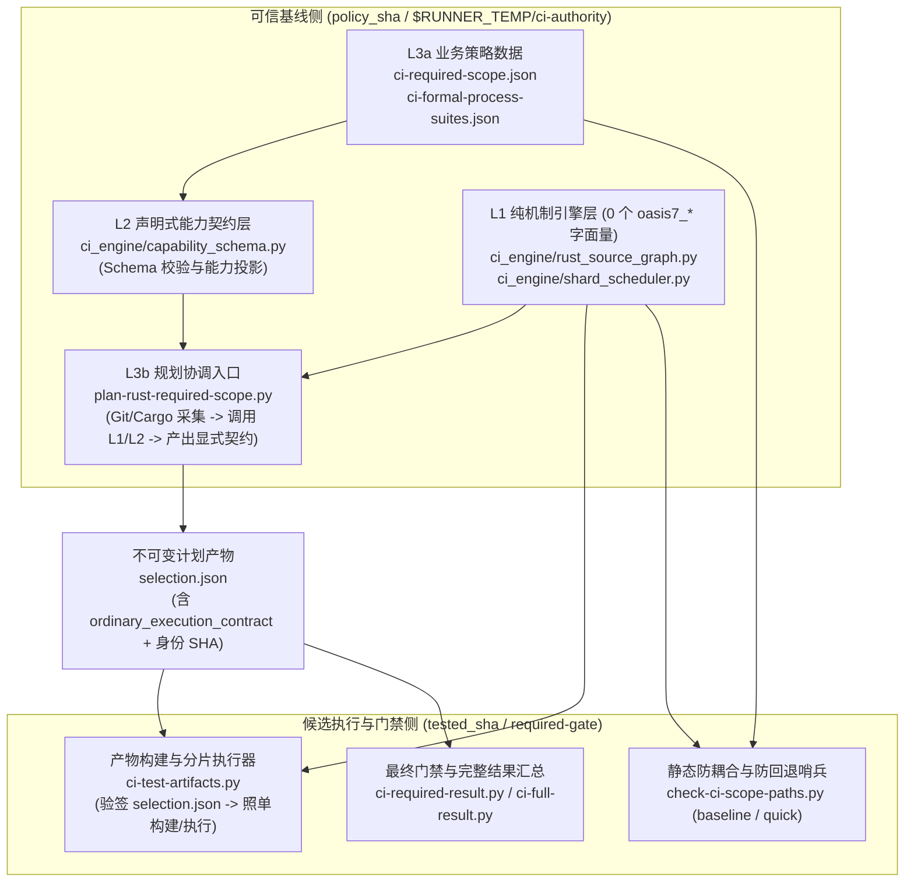

# CI 控制面通用引擎与业务策略解耦设计

- 状态：target execution contract（系统设计已拟定，实现与迁移由 [#7344](https://github.com/nil-studio/oasis7/issues/7344) 分片承接；文档合入本身不改变当前生效的 CI 执行路径）
- 专业 owner：`repository_health_engineer`；安全、受信基线与容器隔离边界由独立评审者审读
- 固定审读基线：`nil-studio/oasis7@e1d796bdc71e42f0627ac2e53e38813c6f8f266c`
- 上游要求：[PR 快速反馈与四小时完整回归](ci-tiered-execution.prd.md#ci-fast-pr-periodic-full)、[未登记路径门禁](ci-tiered-execution.prd.md#ci-unknown-inputs)
- 配套设计：[CI 分级执行设计](ci-tiered-execution.design.md)、[PR 快速反馈与周期完整回归分册](ci-pr-fast-and-periodic-full-design.md)、[CI 基础镜像](ci-base-images.design.md)
- 通用流程权威：[开发流程规范](../../engineering/workflow/source-of-truth.md)、[测试手册](../../../testing-manual.md#local-check-entry)

## 1. 问题、目标与非目标

### 1.1 问题与可量化基线

当前仓库 CI Python 控制面将**与业务无关的通用机制算法**（Rust 源码词法扫描、静态 `mod`/`#[path]`/`include!` 模块树解析、`cfg` 谓词求值、LPT 分片装箱、子进程测试监督）与**高度易变的 Oasis7 业务包拓扑配置**（包名集合、Docker 附属构建依赖、Clippy 转交目标、超大库拆批白名单）混写在超长过程式单文件中：

| 控制面文件 | 基线规模（`e1d796bd`） | 硬编码业务包名数 | 核心耦合痛点 |
| --- | ---: | ---: | --- |
| [`scripts/plan-rust-required-scope.py`](../../../scripts/plan-rust-required-scope.py) | `6,017` 行 | `41` 个 | 单文件混合词法/图引擎与 `ORDINARY_PARTITION_PACKAGES`、`DISTFS_CLIPPY_TARGETS`、`SUPPORT_PROFILES`（24 包硬编码元组）、`new_pixel_platform_statement`、`oasis7_custody_worker` 等包名分支；仅 `changed_test_policy` 单个嵌套函数即达 `1,500+` 行 |
| [`scripts/ci-test-artifacts.py`](../../../scripts/ci-test-artifacts.py) | `4,321` 行 | `21` 个 | 作为构建与测试执行器，再次硬编码 `ORDINARY_PARTITION_PACKAGES`、`PORTABLE_REQUIRED_PACKAGES`、`oasis7_runtime` Docker 准入、`oasis7_chain_runtime` `runtime-tests` 双子批切分等策略，与规划器形成双端重复推导 |
| [`scripts/ci-required-scope.json`](../../../scripts/ci-required-scope.json) | `3,200+` 行 | 全仓配置 | 仅承载一半路径与目标规则，另一半同源包级能力特征隐式散落在 Python 条件分支与 [`rust.yml`](../../../.github/workflows/rust.yml) 表达式中 |

这种耦合直接引发三类高频工程故障：
1. **架构重构期单侧漏改引发静默慢速回退**：当工作区拆分新包（如从 `oasis7` 迁出 `oasis7_runtime_host`）、下线模块（如 `oasis7_custody_worker`、`launcher_web`）或归并集成测试目录时，修改 `Cargo.toml` 与 JSON 配置后极易遗漏 Python 脚本内部的硬编码包名集合，导致普通 PR 静默跌落 `test_policy_changed=true` 或宿主 `v1` 单分片（耗时从 `~7–8m` 退化至 `40m–50m`）。
2. **大闭包高耦合放大局部修改副作用**：通用 Rust 语法分析逻辑与特定业务包的豁免钩子交织在同一函数作用域内，修复一处词法边界极易误触另一业务包的隐式假设，且单测被迫每次拉起完整临时 Git 仓与 `cargo metadata` 子进程（全套回归耗时数分钟）。
3. **业务属性微调被迫触碰共享控制代码**：调整单个包的容器准入或分片拆批属性需要直接编辑核心 Python 脚本，无法复用受控配置快速切片，增加并发 PR 变基冲突与 `policy_sha` 双版本兼容负担。

### 1.2 设计目标

1. **三层单向解耦（引擎零业务标识）**：将 CI 控制面拆分为 **L1 纯机制引擎层（`scripts/ci_engine/`）** → **L2 声明式能力契约层（Capability Schema）** → **L3 业务策略配置与协调执行层**；强制 `scripts/ci_engine/*.py` 中业务包名字面量（`oasis7_*`、`pixel_world_bridge` 等）出现次数严格为 **`0`**。
2. **能力特征替代包名特判**：将硬编码在 Python 条件分支中的六类包级特判抽象为受 Schema 校验的声明式能力属性（Capability Traits），使引擎按“目标具备何种物理能力特征”决策，而非按“包名叫什么”分支。
3. **一次规划、显式交付、验签执行**：由运行在受信 `policy_sha` 的规划器一次产出显式执行契约（`ordinary_execution_contract`），下游 `ci-test-artifacts.py` 仅校验身份摘要并按契约执行，消除规划器与执行器的重复策略推导。
4. **毫秒级纯内存单测与静态防腐门禁**：L1 引擎支持纯内存源码/图字典输入（`< 0.5s` 完成全部词法/模块/`cfg`/装箱单测）；在 `baseline` 与 `check-local.py --profile quick` 必跑的 [`scripts/check-ci-scope-paths.py`](../../../scripts/check-ci-scope-paths.py) 中固化 AST/字面量静态门禁，永久阻断业务包名回流引擎层。

### 1.3 非目标（Non-Goals）

- **不在 JSON 中发明图灵完备规则 DSL**：通用 Rust 词法分析、模块路径解析、布尔 `cfg` 求值与 LPT 算法保留在类型清晰、可静态检查的纯 Python 引擎模块中，配置层仅声明结构化事实与枚举型能力特征。
- **不放宽 `policy_sha` 与 `tested_sha` 信任边界**：候选分支（`tested_sha`）仍无权自授门禁豁免、篡改受信选择器或为包含宿主 Docker 依赖的构建打开非隔离容器权限。
- **不改变外部 GitHub 分支保护接口**：`required-gate`、`explicit-full-gate` 的外部检查名称、失败阻断语义与 `periodic-full` 四小时全量回归覆盖范围保持不变。

---

## 2. 上游约束与需求承接

### 2.1 需求承接与分配表

| 上游条款（`path#fragment`） | 本设计条款（`#anchor`） | 具体 obligation 与适用条件 | 验证方法与证据 | 未覆盖范围与产品适用性 |
| --- | --- | --- | --- | --- |
| Trace refs: `O7-REQ-a34ef03b-c8ee-4988-af23-67ad20e65e29`；[PR 快速反馈与四小时完整回归](ci-tiered-execution.prd.md#ci-fast-pr-periodic-full) | [三层解耦架构](#three-layer-architecture) | 剥离零业务包名字面量的纯机制引擎层（`scripts/ci_engine/`）与薄协调入口，保持 Rust 静态模块图、`cfg` 求值与 LPT 装箱语义等价 | 自动化单测与历史提交回放对比：[`scripts/plan-rust-required-scope.test.py`](../../../scripts/plan-rust-required-scope.test.py) 及 `#7344` `PR 2/5–3/5` 新增纯内存单测 `scripts/ci-engine-unit.test.py` | 产品适用性：N/A；reason=纯 CI 控制面架构分层与通用引擎抽离，不涉及游戏规则、玩家客户端或世界状态；scope=CI Python 规划引擎与分片调度器。Hosted 十分钟 P95 仍由生产窗口遥测独立验收 |
| Trace refs: `O7-REQ-a34ef03b-c8ee-4988-af23-67ad20e65e29`；[PR 快速反馈与四小时完整回归](ci-tiered-execution.prd.md#ci-fast-pr-periodic-full) | [声明式能力契约](#capability-schema-contract) | 将双端硬编码的六类包级特判收敛为 `ci-required-scope.json` 的受校验声明式能力特征（`ordinary_package_capabilities`），防止模块演进单侧漏改 | Schema 正负例单测与选测回归：[`scripts/plan-rust-required-scope.test.py`](../../../scripts/plan-rust-required-scope.test.py)（待 `#7344` `PR 2/5–3/5` 实施验证） | 产品适用性：N/A；reason=CI 包级能力声明与 Schema 校验治理，不改变业务 crate 运行态行为；scope=`scripts/ci-required-scope.json` 与 `capability_schema.py` |
| Trace refs: `O7-REQ-a34ef03b-c8ee-4988-af23-67ad20e65e29`；[PR 快速反馈与四小时完整回归](ci-tiered-execution.prd.md#ci-fast-pr-periodic-full) | [显式执行契约](#explicit-execution-contract) | 由规划器在 `selection.json` 产出版本化 `ordinary_execution_contract`，下游执行器验签直读而不再二次重复推导分片、Clippy 委派与容器准入 | 产物构建与分片回归测试：[`scripts/ci-formal-process.test.py`](../../../scripts/ci-formal-process.test.py)（待 `#7344` `PR 3/5–4/5` 实施验证） | 产品适用性：N/A；reason=CI 规划产物到测试执行器的内部数据接口治理；scope=`selection.json` 与 `scripts/ci-test-artifacts.py` |
| Trace refs: `O7-REQ-4e7f2e0d-9147-43d9-a593-00a8db9b21df`；[未登记路径门禁](ci-tiered-execution.prd.md#ci-unknown-inputs) | [权威隔离与完整性](#authority-and-digest-isolation) | `scripts/ci_engine/` 受 `CONTROL` 与 `python_control_contracts` 严格纳管，未登记输入抛 `UnknownInputsError`；`select` 仅从 `policy_sha` 提取引擎包并纳入 `DefinitionDigest` | 工作流与完整结果摘要单测：[`scripts/ci-workflow.test.py`](../../../scripts/ci-workflow.test.py)、[`scripts/ci-full-result.test.py`](../../../scripts/ci-full-result.test.py)（待 `#7344` `PR 2/5` 实施验证） | 产品适用性：N/A；reason=CI 控制路径登记、受信基线提取与定义摘要完整性保护；scope=`scripts/ci_engine/**`、`scripts/ci-full-result.py` 与 `.github/workflows/rust.yml` |
| Trace refs: `O7-REQ-4e7f2e0d-9147-43d9-a593-00a8db9b21df`；[未登记路径门禁](ci-tiered-execution.prd.md#ci-unknown-inputs) | [防耦合门禁与演进](#anti-coupling-gate-and-rollout) | 在 `baseline` 与 `quick` 固化 AST 静态检查，强制引擎层零业务包名字面量并对协调层硬编码实施只减不增棘轮，保障五切片可回滚演进 | 静态门禁与治理单测：[`scripts/ci-workflow-cache-and-local-check.test.py`](../../../scripts/ci-workflow-cache-and-local-check.test.py) 与 `scripts/check-ci-scope-paths.py`（待 `#7344` `PR 2/5–5/5` 实施验证） | 产品适用性：N/A；reason=CI 静态防耦合门禁与分片演进策略；scope=`scripts/check-ci-scope-paths.py` |

---

## 3. 当前状态、目标状态与差距

| 维度 | 当前状态（基线 `e1d796bd`） | 目标状态 | 核心差距与实施承接 |
| --- | --- | --- | --- |
| **Rust 静态源码与 `cfg` 分析** | 内嵌于 `plan-rust-required-scope.py`（约 `1,800` 行嵌套闭包），夹杂 `oasis7_custody_worker` 与 `pixel_world_bridge` 特判 | 独立为 `scripts/ci_engine/rust_source_graph.py`，零业务包名，纯内存接口，特定平台钩子通过参数化规则注入 | 抽离词法、模块挂载、`type_body`/`body` 属性归属与 `cfg` 求值器，剥离硬编码钩子（`PR 2/5`、`PR 3/5`） |
| **分片装箱与子批调度** | 分散在 `plan-rust-required-scope.py` 与 `ci-test-artifacts.py`，硬编码 `oasis7_chain_runtime` `runtime-tests` 奇偶切分 | 独立为 `scripts/ci_engine/shard_scheduler.py`，按声明的 `splittable_lib_harness` 与成本表通用计算 | 统一规划与执行侧 LPT 分片及子批切分算法（`PR 2/5`、`PR 4/5`） |
| **包级能力与特判表达** | `ORDINARY_PARTITION_PACKAGES`、`DISTFS_CLIPPY_TARGETS`、`SUPPORT_PROFILES`、`WORKSPACE_SUPPORT_HOST_PROFILES` 等常量双端硬编码 | 集中在 `ci-required-scope.json` 的声明式能力字段，由 `scripts/ci_engine/capability_schema.py` 强校验 | 建立向后兼容的能力 Schema 并迁移 6 类硬编码表（`PR 2/5`–`PR 5/5`） |
| **规划器 → 执行器契约** | `selection.json` 仅传粗粒度标志，`ci-test-artifacts.py` 重新读取包名推导容器准入、Clippy 与分片角色 | `selection.json` 包含版本化 `ordinary_execution_contract`，显式给出执行模式、容器资格、Clippy 归属与分片目标描述 | 规划器双写新旧字段平滑过渡，执行器改为验签直读（`PR 3/5`、`PR 4/5`） |
| **`policy_sha` 提取与防腐门禁** | `rust.yml` 逐文件手写 `git show "${policy_sha}:scripts/<file>"`；缺少阻止业务包名回流引擎的静态检查 | `rust.yml` 原子提取 `policy_sha:scripts/ci_engine` 并锁定相对导入路径；`check-ci-scope-paths.py` 强制引擎 `0` 业务包名 | 先落地提取、摘要绑定与静态 AST 棘轮，再切换调用方（`PR 2/5`、`PR 5/5`） |

---

## 4. 三层解耦架构与单向依赖边界

控制面按职责严格划分为单向依赖的三层（低层严禁反向引用高层或包含高层领域标识符）：

### 4.1 各层职责与硬边界

1. **L1 纯机制引擎层（`scripts/ci_engine/`）**：
   - 仅依赖 Python 3.12 标准库；输入输出均为纯不可变数据结构（`dict`、`frozenset`、`dataclass(frozen=True)`）。
   - **硬禁令（MUST NOT）**：不得出现任何业务仓库包名/目录字面量（如 `oasis7_*`、`pixel_world_bridge`、`wasm_build_suite`）；不得直接调用 `git`、`cargo` 或网络 I/O；不得读取全局环境变量改变选测结论。
   - 包含三个内聚子模块：
     - `rust_source_graph.py`：Rust 源码词法分词、`include!` / `include_bytes!` / `include_str!` 调用提取、静态 `mod` / `#[path]`（含内联字面量路径与父模块目录上下文校验）路由闭合、结构体/枚举 `type_body` 与函数 `body` 稳定词法归属、以及参数化平台/feature 集合上的三值（`True` / `False` / `None`）`cfg` 布尔求值。
     - `shard_scheduler.py`：基于成本映射表与预算阈值的确定性 LPT 分片装箱、可切分库目标的奇偶无交子批生成（保持全分片 `(binary, case)` 双射覆盖）及双 worker 任务排序。
     - `capability_schema.py`：校验并解析 L3 配置中的包级/目标级能力特征声明，拒绝未知键、非法类型、路径逃逸或相互冲突的能力组合。

2. **L2 声明式能力契约层（Capability Schema）**：
   - 将原本隐含在 Python `if/elif` 中的业务特例显式建模为可组合的布尔/枚举/列表特征（详见 §6.2）。
   - 新增业务包或下线旧模块时，只需在配置中增删对应包的能力条目，L1 引擎代码零改动。

3. **L3 业务策略数据与协调执行层（Coordinators & Policy Data）**：
   - `scripts/ci-required-scope.json` 成为所有包归属、路径规则、快速目标库存、SHA-256 锚点与包级能力特征的**唯一数据真值源**。
   - `scripts/plan-rust-required-scope.py` 收敛为薄协调层：负责读取受控 Git 比较树与 `cargo metadata`，组装输入交给 `ci_engine` 计算，并将最终决策编码为 `selection.json`。
   - `scripts/ci-test-artifacts.py` 收敛为受控执行器：核验 `selection.json`、`source_sha`、`tested_sha`、工具链与环境摘要后，直接消费计划中的显式分片与目标指令并调用 `ci_process_runner.py` 监督进程树。

---

## 5. 权威隔离、提取流程与状态完整性

模块拆分绝不能削弱现有的 `policy_sha` 权威边界或引入“可信入口误加载候选模块”的供应链风险。完整运行链路遵循以下五步安全契约：

1. **`select` 作业从 `policy_sha` 原子提取完整权威闭包**：
   - 在 [`.github/workflows/rust.yml`](../../../.github/workflows/rust.yml) 的 `select` 步骤中，除提取顶层受信脚本外，当 `${policy_sha}:scripts/ci_engine` 存在时，通过 `git archive --format=tar "${policy_sha}" scripts/ci_engine | tar -x -C "$authority" --strip-components=1` 将该固定提交下的整个 `ci_engine/` 目录原样提取至 `$RUNNER_TEMP/ci-authority/ci_engine`（旧 `policy_sha` 尚无该目录时保持兼容跳过，不报错中断）。
2. **锁定脚本同源导入路径（严禁候选目录污染）**：
   - `plan-rust-required-scope.py`、`ci-required-result.py` 与 `ci-full-result.py` 加载 `ci_engine` 时，必须显式将 `Path(__file__).resolve().parent` 作为唯一包搜索根（或在导入前清理指向工作区候选目录的非受信 `sys.path` 项），确保 `$authority/plan-rust-required-scope.py` **只能**加载 `$authority/ci_engine/*.py`（`policy_sha` 版本），即使候选 PR 修改甚至恶意替换了工作区 `scripts/ci_engine/`，也无法影响本轮 `select` 的门禁规划。
3. **`DefinitionDigest` 全集哈希绑定**：
   - [`scripts/ci-full-result.py`](../../../scripts/ci-full-result.py) 在计算完整回归定义摘要（`DefinitionDigest`）时，除哈希既有 `POLICY_FILES` 外，动态列举并按路径字典序纳入 `git ls-tree -r "${revision}" -- scripts/ci_engine` 下的全部受管文件 blob。任何对 `scripts/ci_engine/*.py` 的修改都会确定性地更新定义摘要，杜绝旧全量证据跨引擎逻辑变更被误复用。
4. **配置项双层权限分级（防自授豁免 vs 免微 PR 演进）**：
   - **缩减覆盖类策略（仅认 `policy_sha`）**：决定哪些测试可跳过、哪些反向消费者可延期到 `periodic-full`、哪些目标免除宿主 Docker 隔离的字段（如 `ordinary_fast_component_rules`、`requires_host_docker_in_full_tier: false`、`clippy_delegations`），在 PR 运行中一律以 `policy_sha` 的配置为准；候选分支自改此类字段不会缩小本轮门禁范围。
   - **单调增补/重平衡元数据（支持单 PR 快速切片）**：不削弱基线覆盖的 `ordinary_harness_costs` 权重校准、保序新增非空路径规则及同 PR 新增治理单测登记，继续沿用 `ordinary_scope_config_slice_version=2` 单 PR 快速收敛，无需拆前置微 PR。
5. **失败与异常处置（Fail-Closed）**：
   - Schema 校验失败、未知能力版本、`selection.json` 中 `ordinary_execution_contract` 与顶层字段不一致、或 `$authority/ci_engine` 文件缺失/包含符号链接时，规划器与执行器立即以非零退出码硬失败，由 `required-gate` 确定性阻断，禁止静默降级为跳过。

---

## 6. 跨层接口与声明式数据合同

### 6.1 六类硬编码特判向声明式 Capability Schema 的映射

在 `scripts/ci-required-scope.json` 新增受 `capability_schema.py` 严格校验的顶层键 `ordinary_package_capabilities`（版本字段 `ordinary_package_capabilities_version: 1`），逐一收编散落在双端脚本中的硬编码常量：

| 原硬编码位置 | 原硬编码标识 | 迁移后的声明式配置字段（位于 `ci-required-scope.json`） | 引擎消费语义 |
| --- | --- | --- | --- |
| `plan-rust-required-scope.py` & `ci-test-artifacts.py` 双处重复 | `ORDINARY_PARTITION_PACKAGES` (`oasis7_runtime`, `oasis7_world_state`) | `ordinary_package_capabilities.<pkg>.inline_dedicated_partition: true` | 当有界 `inline` 计划选中的快速目标包集合全部声明该特征且包数 `>= 2` 时，按包名拆分为独立并行 `inline` 分区；否则走 `["all"]` |
| `plan-rust-required-scope.py` & `ci-test-artifacts.py` | `DISTFS_CLIPPY_TARGETS` & `ORDINARY_GROUP_LIBRARIES` | `ordinary_package_capabilities.<pkg>.group_library_proof` 与顶层 `clippy_delegation_contracts` | 按声明的源包组合、目标集合与组共现条件判定是否将指定严格 Clippy 命令委派给 `rust_baseline`，消除硬编码四元组 |
| `plan-rust-required-scope.py` | `SUPPORT_PROFILES`（24 包元组）与 `WORKSPACE_SUPPORT_HOST_PROFILES` | 统一收敛至 `workspace_support_profiles_config.<pkg>: {"requires_host_runner": bool, ...}` | 单一数据源声明全部 support profile 及其是否依赖宿主机内核/跨 UID 能力（替代 `L140` 与 `L4820` 硬编码集合） |
| `ci-test-artifacts.py` | `PORTABLE_REQUIRED_PACKAGES` 兜底常量 | 直接以 `ci-required-scope.json` 既有 `oasis7_required_wasm_packages` 为唯一权威（仅在无配置快照的纯历史兼容入口保留显式旧表回退） | 消除新旧 WASM 包列表漂移 |
| `ci-test-artifacts.py` | 硬编码判断 `package == "oasis7_runtime"` 与 `local_test_provider` 决定 `ordinary_candidate_image_eligible` | `ordinary_package_capabilities.<pkg>.full_tier_requires_host_docker: true` 及目标级 `requires_host_docker_material: true` | 任何被选中的全量策略包或风险目标声明需宿主 Docker 物化 WASM 材料时，自动禁止进入 `--user 1001:1001` 无 Docker socket 候选容器并回退宿主 runner |
| `ci-test-artifacts.py` & `plan-rust-required-scope.py` | 硬编码 `('oasis7_chain_runtime', ('lib',), ...): 'runtime-tests'` 拆批及 `new_pixel_platform_statement` / `oasis7_custody_worker` `cfg` 特例 | `ordinary_package_capabilities.<pkg>.splittable_lib_harness`、`wasm_known_features`、`scoped_platform_hook_rules` | `shard_scheduler` 对任意声明了 `splittable_lib_harness` 的重型库目标执行奇偶无交拆批；`rust_source_graph` 通过显式传入的规则表求值平台钩子，内部保留零包名 |

### 6.2 规划器到执行器的显式执行契约（`ordinary_execution_contract`）

为消除 `ci-test-artifacts.py` 对业务规则的二次推导，启用新能力后，`plan-rust-required-scope.py` 在 `selection.json` 中输出自包含的 `ordinary_execution_contract` 对象（同时保留顶层旧字段，确保与工作流 YAML 投影及历史消费者 100% 兼容）：

| 接口/契约 | Producer → Consumer | 身份与版本绑定 | 排序与幂等性 | 成功/失败边界 | 跨版本兼容策略 |
| --- | --- | --- | --- | --- | --- |
| `rust_source_graph.analyze_policy_diff(...)` | `plan-rust-required-scope.py` / `check-ci-scope-paths.py` → `ci_engine.rust_source_graph` | 纯函数接口，绑定传入源码字节与显式 `CargoTargetSpec` | 输入路径与输出列表严格按字典序确定性排列 | 遇到无法证明的动态路径或未覆盖 feature 抛 `TestPolicyError` 或返回保守集合 | 仅在同版本进程内调用，无跨提交序列化偏移 |
| `selection.json` 内的 `ordinary_execution_contract` | `select`（`policy_sha`）→ `oasis7-test-build-*` / `oasis7-required` / `rust-baseline`（`ci-test-artifacts.py`） | `version: 1`，与顶层 `source_sha`、`tested_sha`、`policy_sha` 共同受 selection artifact SHA-256 保护 | `partitions`、`clippy_commands`、`splittable_harnesses` 均按稳定键排序，重跑完全幂等 | 若契约字段与顶层 `ordinary_partitions` / `ordinary_execution` 矛盾，消费者立即报错退出（退出码非零） | 当旧 `policy_sha` 产出的 `selection.json` 不含 `ordinary_execution_contract` 时，`ci-test-artifacts.py` 走受限兼容垫片读取顶层旧字段；新计划下直接照单执行 |

`ordinary_execution_contract` 核心字段定义如下：
- `version`: 固定整数 `1`；
- `mode`: `"inline"` | `"artifact-v1"` | `"artifact-v2"`；
- `candidate_container_eligible`: 布尔值，由规划器结合 `test_policy_changed`、`ordinary_risk_targets` 及包级 `full_tier_requires_host_docker` 特征一次性裁定；
- `partitions`: 字典 `{"<partition_id>": {"packages": [...], "fast_targets": [...], "splittable_harnesses": [...]}}`；
- `delegated_clippy`: 归属 `rust_baseline` 执行的显式目标与 feature 元组清单。

> **工作流 YAML 投影边界说明**：`ordinary_execution_contract` 仅通过完整的 `selection.json` 文件传递给 Python 执行器；若未来确需将其中子字段暴露给 `.github/workflows/rust.yml` 的 `${{ fromJSON(needs.select.outputs.plan).* }}` 表达式，必须同步更新 `workflow-plan` 与 `&validate-complete-selection` 双处投影白名单及 `ci-workflow.test.py` 契约单测。

---

## 7. 防耦合回退门禁、分片演进与回滚验证

### 7.1 静态防耦合门禁与硬编码棘轮

仅有代码重构不足以阻止后续开发重新把业务包名写回通用逻辑。在每次 PR `baseline` 与本地 `python3 scripts/check-local.py --profile quick` 必跑的 [`scripts/check-ci-scope-paths.py`](../../../scripts/check-ci-scope-paths.py) 中新增两项 `< 0.2s` 的 AST 静态门禁：

1. **L1 引擎零业务标识硬红线**：使用 Python `ast.parse` 扫描 `scripts/ci_engine/**/*.py` 的全部标识符、字符串常量与注释外代码 token，凡匹配 `\boasis7_[a-z0-9_]*\b`、`\bpixel_world_bridge\b` 或 `crates/` 具体子包路径（测试夹具文件除外），直接判红阻断。
2. **L3 协调/执行脚本硬编码棘轮（只减不增）**：对 `scripts/plan-rust-required-scope.py` 与 `scripts/ci-test-artifacts.py` 中出现的不同业务包名字面量集合设置单调递减上限（迁移完成后锁死在仅剩必要的兼容垫片最小值），任何新增包名特判必须改为在 `ci-required-scope.json` 声明能力特征，否则在 `baseline` 阶段即刻拦截。
3. **与快速路径防回退哨兵联动**：保持既有 `check_ci_fast_path_health()`（SHA-256 锚点新鲜度、全仓 `OUT_DIR`/不确定模块路径扫描、生产文件 `test_tier_full` 棘轮与 `Adapter`/`Cutover` 活体探针）全程运行，确保每一步重构切片均不破坏现有 `~7–8m` `targeted-inline` 快速路径。

### 7.2 五切片平滑演进与回滚路径（对应 [#7344](https://github.com/nil-studio/oasis7/issues/7344)）

为严格遵守 `policy_sha` 混合版本窗口与 PR 爆炸半径上限，实施按以下五个正交切片串行推进，**同一时刻至多保持 1 个在途开放 PR**：

1. **`PR 1/5 [Slice: Docs]`（本设计）**：合入本设计文档并挂接索引，零运行态变更。
2. **`PR 2/5 [Slice: Dark]`（纯引擎与 `$authority` 提取前置）**：新增 `scripts/ci_engine/` 三模块与 `< 0.5s` 纯内存单测 `scripts/ci-engine-unit.test.py`；在 `rust.yml` `select` 接入 `policy_sha` `scripts/ci_engine/` 提取、在 `ci-full-result.py` 纳入 `DefinitionDigest`、在 `check-ci-scope-paths.py` 开启 `ci_engine` 零业务字面量门禁。此片合入后，`main`（即后续 PR 的 `policy_sha`）已具备提取 `ci_engine` 的完整能力，彻底消除 `ModuleNotFoundError` 跨版本断裂风险。
3. **`PR 3/5 [Slice: Adapter]`（规划器切换与契约双写）**：在 `ci-required-scope.json` 落地 `ordinary_package_capabilities`，将 `plan-rust-required-scope.py` 内部通用逻辑委托给 `ci_engine` 并在 `selection.json` 双写 `ordinary_execution_contract`，通过全部 527+ 项规划器单测与真实历史提交等价回放。
4. **`PR 4/5 [Slice: Adapter]`（执行器去重切换）**：改造 `ci-test-artifacts.py` 消费 `ordinary_execution_contract` 与 `ci_engine.shard_scheduler`（保留无新字段旧计划回退分支），通过全部产物、分片与容器隔离单测。
5. **`PR 5/5 [Slice: Chore]`（清理旧重复代码与收紧棘轮）**：删除 `plan-rust-required-scope.py` 与 `ci-test-artifacts.py` 中已被替代的内联重复代码和硬编码包名表，收紧 `check-ci-scope-paths.py` 的硬编码包名上限棘轮，并同步更新 `.agents/skills/optimizing-ci/` 参考分册。

**单片回滚保证**：每个切片均保持 `selection.json` 顶层既有字段与 `required-gate` 接口向后兼容；任一切片合入后若在生产运行观测到异常，可直接单提交 `git revert` 该切片而无需级联回退前置切片（例如回退 `PR 4/5` 时，`ci-test-artifacts.py` 自动继续读取 `PR 3/5` 保留的顶层字段；回退 `PR 3/5` 时，`PR 2/5` 的 `ci_engine` 作为未挂载库静默保留，零副作用）。

### 7.3 重要风险与残余边界

- **兼容垫片保留期**：在 `periodic-full` 与在途长分支完成一个完整轮换窗口前，`ci-test-artifacts.py` 仍需保留对不含 `ordinary_execution_contract` 的旧版 `selection.json` 的最小只读回退垫片；该垫片集中在单一隔离兼容函数中，不在主流程散落包名分支。
- **不替代真实 Hosted 耗时验收**：纯内存单测（`< 0.5s`）与静态门禁仅证明选测等价性、权威隔离与代码解耦质量；PR 端到端墙钟耗时仍以 GitHub-hosted 标准 Runner 的真实生产遥测为准。
