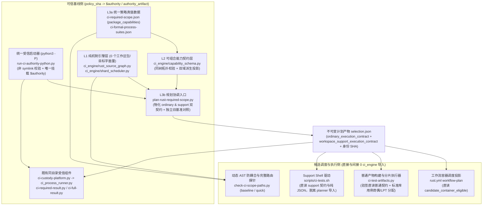

# CI 控制面通用引擎与业务策略解耦设计

- 状态：target execution contract（系统设计已定稿，实现与迁移由 [#7344](https://github.com/nil-studio/oasis7/issues/7344) 及其原生子任务分片承接；文档合入本身不改变当前生效的 CI 执行路径）
- 专业 owner：`repository_health_engineer`；安全、受信基线与容器隔离边界经独立审读闭环
- 固定审读基线：`nil-studio/oasis7@e1d796bdc71e42f0627ac2e53e38813c6f8f266c`
- 上游要求：[PR 快速反馈与四小时完整回归](ci-tiered-execution.prd.md#ci-fast-pr-periodic-full)、[未登记路径门禁](ci-tiered-execution.prd.md#ci-unknown-inputs)
- 配套设计：[CI 分级执行设计](ci-tiered-execution.design.md)、[PR 快速反馈与周期完整回归分册](ci-pr-fast-and-periodic-full-design.md)、[CI 基础镜像](ci-base-images.design.md)
- 通用流程权威：[开发流程规范](../../engineering/workflow/source-of-truth.md)、[测试手册](../../../testing-manual.md#local-check-entry)

## 1. 问题、目标与非目标

### 1.1 问题与可量化基线

当前仓库 CI 控制面将**与业务无关的通用机制算法**（Rust 源码词法扫描、静态 `mod`/`#[path]`/`include!` 模块树解析、`cfg` 谓词求值、分片预算装箱、子进程测试监督）与**高度易变的 Oasis7 业务包拓扑配置**（包归属、双域覆盖责任、宿主 Docker 附属构建依赖、Clippy 转交目标、重型库拆批别名）混写在超长过程式脚本与工作流内联片段中：

| 控制面文件 | 基线规模（`e1d796bd`） | 硬编码业务包名数 | 核心耦合痛点 |
| --- | ---: | ---: | --- |
| [`scripts/plan-rust-required-scope.py`](../../../scripts/plan-rust-required-scope.py) | `6,017` 行 | `41` 个 | 单文件混合词法/图引擎与 `ORDINARY_PARTITION_PACKAGES`、`DISTFS_CLIPPY_TARGETS`、`SUPPORT_PROFILES`（27 包硬编码元组）、`WORKSPACE_SUPPORT_HOST_PROFILES`、`new_pixel_platform_statement`、`oasis7_custody_worker` 等包名分支；仅 `changed_test_policy` 单个嵌套函数即达 `1,500+` 行 |
| [`scripts/ci-test-artifacts.py`](../../../scripts/ci-test-artifacts.py) | `4,321` 行 | `21` 个 | 作为构建与测试执行器，再次硬编码 `ORDINARY_PARTITION_PACKAGES`、`PORTABLE_REQUIRED_PACKAGES`、`oasis7_runtime` / `oasis7_chain_runtime` 宿主 Docker WASM 夹具与容器准入、`runtime-tests` 奇偶切分等策略，与规划器形成双端重复推导 |
| [`scripts/ci-tests.sh`](../../../scripts/ci-tests.sh) & [`rust.yml`](../../../.github/workflows/rust.yml) | `1,894` / `6,486` 行 | 多处散落 | 候选侧 `ci-tests.sh` 动态 `importlib` 加载工作区 `plan-rust-required-scope.py` 读取 `SUPPORT_PROFILES` 与 `WORKSPACE_SUPPORT_HOST_PROFILES`；`rust.yml` `workflow-plan` 再次硬编码 `oasis7_chain_runtime` 裁定 `ordinary_candidate_image` |
| [`scripts/ci-required-scope.json`](../../../scripts/ci-required-scope.json) | `3,200+` 行 | 全仓配置 | 仅承载部分路径与目标列表，同源包级物理能力散落在上述四处，模块拆分/下线极易单侧漏改 |

这种耦合直接引发三类高频工程故障：
1. **架构重构期单侧漏改引发静默慢速回退或容器路由分裂**：当工作区拆分新包（如从 `oasis7` 迁出 `oasis7_runtime_host`）、下线模块（如 `oasis7_custody_worker`、`launcher_web`）或调整双域包（如 `oasis7_game_client`）时，遗漏任一脚本的硬编码集合会导致普通 PR 静默跌落 `test_policy_changed=true` / 宿主单分片（耗时从 `~7–8m` 退化至 `40m–50m`），或使 `rust.yml` 容器调度与 `ci-test-artifacts.py` 预检冲突。
2. **大闭包高耦合放大局部修改副作用**：通用 Rust 语法分析逻辑与特定业务包的豁免钩子交织在同一函数作用域内，修复词法边界易误触业务包隐式假设，且单测被迫频繁拉起临时 Git 仓与 `cargo metadata` 子进程。
3. **业务属性微调被迫触碰共享控制代码**：调整包的容器准入、support host 路由或拆批属性需直接修改核心 Python/Shell 脚本，增加并发 PR 冲突与跨 `policy_sha` 演进摩擦。

### 1.2 设计目标

1. **三层单向解耦（引擎零业务标识）**：将 CI 控制面拆分为 **L1 纯机制引擎层（`scripts/ci_engine/`）** → **L2 可组合能力契约层（Capability Schema）** → **L3 统一策略真值与物化执行层**；强制 `scripts/ci_engine/*.py` 对全仓动态提取的 package 名、target 名与目录名保持 **`0`** 字面量引用。
2. **单一主键可组合注册表无损承接双域与多组拓扑**：以 `<pkg>` 为唯一主键建立 `package_capabilities` 注册表，支持 `ordinary` 与 `workspace_support` 可组合双域责任（无损保留 `oasis7_game_client` / `oasis7_browser_game_client` 完整覆盖与有界快速交接）及跨版本增删改名规则。
3. **一次物化规划、全执行侧零引擎导入耦合**：由运行在受信 `policy_sha` 的规划器一次物化 `ordinary_execution_contract` 与 `workspace_support_execution_contract`；下游 `rust.yml` `workflow-plan`、`ci-test-artifacts.py` 与 `scripts/ci-tests.sh` 均按契约直读，实现候选执行侧直接与间接 **`0` `ci_engine` 导入**。
4. **受信启动隔离、独立等价基准与动态 AST 防腐门禁**：通过统一受信启动器保留 `$authority` 同目录可信 helper 导入同时阻断候选目录污染；迁移期以保留的独立旧算法/固定基线快照做行为等价校验；在 `check-ci-scope-paths.py` 固化全仓 `Cargo.toml` 动态词表门禁与分片路由场景探针。

### 1.3 非目标（Non-Goals）

- **不在 JSON 中发明图灵完备规则 DSL 或换皮单包钩子**：通用词法分析、模块路径解析、布尔 `cfg` 求值与分片预算算法留在标准库 Python 引擎模块；配置层仅声明通用物理能力特征，严禁传入业务函数名、宏名或 AST 谓词。
- **不放宽 `policy_sha` 与 `tested_sha` 信任边界**：候选分支（`tested_sha`）无权通过修改候选配置自授 `excluded`、跳过反向消费者或为需宿主 Docker 的构建解除容器隔离限制。
- **不改变外部 GitHub 分支保护接口**：`required-gate`、`explicit-full-gate` 的外部检查名称、失败阻断语义与 `periodic-full` 四小时全量回归覆盖范围保持不变。

---

## 2. 上游约束与需求承接

### 2.1 需求承接与分配表

| 上游条款（`path#fragment`） | 本设计条款（`#anchor`） | 具体 obligation 与适用条件 | 验证方法与证据 | 未覆盖范围与产品适用性 |
| --- | --- | --- | --- | --- |
| Trace refs: `O7-REQ-a34ef03b-c8ee-4988-af23-67ad20e65e29`；[PR 快速反馈与四小时完整回归](ci-tiered-execution.prd.md#ci-fast-pr-periodic-full) | [三层解耦架构](#three-layer-architecture) | 剥离零业务标识的纯机制引擎层（`scripts/ci_engine/`），同时切断 `ci-test-artifacts.py` 与 `ci-tests.sh` 对引擎的直接/间接导入依赖 | 自动化单测与直接/间接导入审查：[`scripts/plan-rust-required-scope.test.py`](../../../scripts/plan-rust-required-scope.test.py)、[`scripts/ci-support-profiles.test.py`](../../../scripts/ci-support-profiles.test.py) 及 `#7344` 新增 `scripts/ci-engine-unit.test.py` | 产品适用性：N/A；reason=纯 CI 控制面架构分层与通用引擎抽离，不涉及游戏规则、玩家客户端或世界状态；scope=CI Python 规划引擎、产物执行器与 shell 驱动。Hosted 十分钟 P95 由生产窗口遥测独立验收 |
| Trace refs: `O7-REQ-a34ef03b-c8ee-4988-af23-67ad20e65e29`；[PR 快速反馈与四小时完整回归](ci-tiered-execution.prd.md#ci-fast-pr-periodic-full) | [声明式能力契约](#capability-schema-contract) | 以 `<pkg>` 为唯一主键建立可组合 `package_capabilities` 注册表（保留双域包语义）并定义跨版本包增删改名配对规则 | 双域与包增删改名正反例单测：[`scripts/plan-rust-required-scope-native-contracts.test.py`](../../../scripts/plan-rust-required-scope-native-contracts.test.py)、[`scripts/plan-rust-required-scope.test.py`](../../../scripts/plan-rust-required-scope.test.py) | 产品适用性：N/A；reason=CI 包级能力声明、双域覆盖与跨版本拓扑配对治理；scope=`scripts/ci-required-scope.json` 与 `capability_schema.py` |
| Trace refs: `O7-REQ-a34ef03b-c8ee-4988-af23-67ad20e65e29`；[PR 快速反馈与四小时完整回归](ci-tiered-execution.prd.md#ci-fast-pr-periodic-full) | [显式执行契约](#explicit-execution-contract) | 物化 `ordinary_execution_contract` 与 `workspace_support_execution_contract`，对齐 `rust.yml` 容器路由、`ci-test-artifacts.py` 与 `ci-tests.sh` 并执行独立基准等价校验 | 产物、容器路由与 support 回归测试：[`scripts/ci-formal-process.test.py`](../../../scripts/ci-formal-process.test.py)、[`scripts/ci-workflow.test.py`](../../../scripts/ci-workflow.test.py) | 产品适用性：N/A；reason=CI 规划产物到工作流、产物执行器及 support 驱动的内部契约治理；scope=`selection.json`、`rust.yml`、`ci-test-artifacts.py`、`ci-tests.sh` |
| Trace refs: `O7-REQ-4e7f2e0d-9147-43d9-a593-00a8db9b21df`；[未登记路径门禁](ci-tiered-execution.prd.md#ci-unknown-inputs) | [权威隔离与完整性](#authority-and-digest-isolation) | 子树精确解包至 `$authority/ci_engine`、覆盖本地 `ci-local-check-plan.py` 提取、通过统一受信启动器保留 `$authority` 同目录 helper 导入并纳入 `DefinitionDigest` | 跨目录启动、artifact 往返与摘要单测：[`scripts/ci-workflow.test.py`](../../../scripts/ci-workflow.test.py)、[`scripts/ci-full-result.test.py`](../../../scripts/ci-full-result.test.py)、[`scripts/ci-python-control-contracts.test.py`](../../../scripts/ci-python-control-contracts.test.py) | 产品适用性：N/A；reason=CI 控制路径登记、跨入口安全提取与受信同目录导入隔离；scope=`scripts/ci_engine/**`、`scripts/run-ci-authority-python.py`、`ci-local-check-plan.py`、`ci-full-result.py` |
| Trace refs: `O7-REQ-4e7f2e0d-9147-43d9-a593-00a8db9b21df`；[未登记路径门禁](ci-tiered-execution.prd.md#ci-unknown-inputs) | [防耦合门禁与演进](#anti-coupling-gate-and-rollout) | 动态解析全仓 `Cargo.toml` 词表执行 L1 AST 禁令，补齐完整计划防回退探针，并按显式版本支持矩阵约束回滚顺序与垫片退出条件 | 静态门禁、路由探针与混合版本矩阵单测：[`scripts/ci-workflow-cache-and-local-check.test.py`](../../../scripts/ci-workflow-cache-and-local-check.test.py) 与 `scripts/check-ci-scope-paths.py` | 产品适用性：N/A；reason=CI 动态防耦合门禁、混合版本支持矩阵与 Hosted 遥测收口；scope=`scripts/check-ci-scope-paths.py` 及 `#7344` 生产验收 |

---

## 3. 当前状态、目标状态与差距

| 维度 | 当前状态（基线 `e1d796bd`） | 目标状态 | 核心差距与实施承接 |
| --- | --- | --- | --- |
| **Rust 静态源码与 `cfg` 分析** | 内嵌于 `plan-rust-required-scope.py`（约 `1,800` 行闭包），夹杂 `oasis7_custody_worker` 与 `pixel_world_bridge` 特判 | 独立为 `scripts/ci_engine/rust_source_graph.py`，零业务标识，纯内存接口，平台假定通过闭合枚举配置传入 | 抽离词法、模块挂载、`type_body`/`body` 属性归属与 `cfg` 求值器，剥离硬编码钩子（`PR 2/5`、`PR 3/5`） |
| **包能力建模与多版本拓扑配对** | 包归属分散在 `oasis7_required_packages`、`SUPPORT_PROFILES`（27 包）、`WORKSPACE_SUPPORT_HOST_PROFILES` 等多处；双域包耦合在过程分支 | 单一 `<pkg>` 主键表 `package_capabilities` 可组合声明 `ordinary_package` 与 `support_profile`；同树配对校验并明确新包保守覆盖与删改名规则 | 建立可组合能力 Schema 与跨版本 add/remove/rename 校验及单测（`PR 2/5`、`PR 3/5`） |
| **全链路执行消费者解耦** | `rust.yml` `workflow-plan`、`ci-test-artifacts.py` 与 `ci-tests.sh`（动态 import planner）各自重复推导容器资格、分片与 support 路由 | `selection.json` 物化 `ordinary_execution_contract` 与 `workspace_support_execution_contract`；三处消费者全部改为直读物化契约（候选侧直接与间接 `0` 引擎导入） | 对齐 `rust.yml` 容器输出、改造 `ci-test-artifacts.py` 与 `ci-tests.sh` 脱离 planner 动态导入（`PR 3/5`、`PR 4/5`） |
| **受信提取布局与同目录启动** | `rust.yml` 与 `ci-local-check-plan.py` 仅单文件拷贝顶层脚本；裸加 `python3 -P` 会打断 `ci-custody-platform.py -> ci_process_runner` 同目录导入 | `git archive "${policy_sha}:scripts" ci_engine` 精确落盘 `$authority/ci_engine`（覆盖 GHA 与 `ci-local-check-plan.py`）；统一受信启动器在 `-P` 下仅挂载已验非 symlink 的 `$authority` | 落地统一启动器、双提取器同步与跨目录真实入口启动单测（`PR 2/5`） |
| **独立等价校验、回滚矩阵与防回退** | 缺少新旧算法独立对照与混合版本矩阵；`check_ci_fast_path_health()` 仅测 `changed_test_policy()` 局部抽样 | `PR 3/5` 对照保留的独立旧算法与固定历史快照校验；`check-ci-scope-paths.py` 补齐完整路由探针与动态 `Cargo.toml` AST 禁令；按显式支持矩阵管理回滚与垫片退出 | 落地动态 AST 门禁、完整路由场景探针、版本支持矩阵测试与 Hosted 遥测收口（`PR 2/5`–`PR 5/5`） |

---

## 4. 三层解耦架构与单向依赖边界

控制面按职责与信任域严格划分为单向依赖的三层；**`scripts/ci_engine/` 仅被受信规划侧（`$RUNNER_TEMP/ci-authority` 及本地 `ci-local-check-plan.py` 隔离提取目录）与静态门禁加载，候选构建/执行侧（`ci-test-artifacts.py` 与 `ci-tests.sh`）对 `ci_engine` 保持直接与间接零导入**：

### 4.1 各层职责与硬边界

1. **L1 纯机制引擎层（`scripts/ci_engine/`）**：
   - 仅依赖 Python 3.12 标准库；输入输出均为纯不可变数据结构（`dict`、`frozenset`、`dataclass(frozen=True)`）。
   - **硬禁令（MUST NOT）**：不得出现仓库内任何 workspace/standalone package 名、`lib`/`bin`/`test` target 名或 `crates/*`、`tools/*` 子目录字面量（涵盖 `oasis7_*`、`launcher_web`、`wasm_build_suite`、`pixel_world_bridge` 等全部存量与未来新增包）；不得直接调用 `git`、`cargo` 或网络 I/O；不得读取全局环境变量改变选测结论。
   - 包含三个内聚子模块：
     - `rust_source_graph.py`：Rust 源码词法分词、`include!` / `include_bytes!` / `include_str!` 调用提取、静态 `mod` / `#[path]` 路由闭合、结构体/枚举 `type_body` 与函数 `body` 稳定词法归属、以及参数化平台/feature 集合上的三值（`True` / `False` / `None`）`cfg` 布尔求值。
     - `shard_scheduler.py`：基于成本映射表、预算阈值与可切分库能力特征，在规划期一次性计算紧凑分片集合（`artifact_partitions`）、`universal-v2` 资格、重型库逻辑别名与 support 分区映射。
     - `capability_schema.py`：对照同版本根 `Cargo.toml` 成员清单校验并解析 `package_capabilities`，拒绝未知键、非法类型、路径逃逸或物理冲突组合，并派生 `ordinary`、`workspace_support` 与 `wasm` 视图。

2. **L2 可组合能力契约层（Capability Schema）**：
   - 将原本隐含在 Python `if/elif` 中的业务特例显式建模为以 `<pkg>` 为唯一主键的可组合能力声明（详见 §6.1）。
   - **跨包通用性准入准则**：新增的每一个 capability 字段必须表达可复用的物理构建、运行环境或隔离属性；严禁为单一业务模块定制一次性布尔开关或将业务函数/宏标识符编码进配置。

3. **L3 统一策略真值与物化执行层（Coordinators & Executors）**：
   - `scripts/ci-required-scope.json` 作为包能力注册表（`package_capabilities`）、路径规则、快速目标库存与 SHA-256 锚点的**唯一数据真值源**。
   - `scripts/plan-rust-required-scope.py` 读取各相关 Git 比较树与 `cargo metadata`，调用 `ci_engine` 计算并在 `selection.json` 中同时物化 `ordinary_execution_contract` 与 `workspace_support_execution_contract`。
   - `rust.yml` `workflow-plan`、`scripts/ci-test-artifacts.py` 与 `scripts/ci-tests.sh` 均按物化契约直读执行，不在候选侧直接或经 `importlib` 间接导入 `plan-rust-required-scope.py` / `ci_engine`。

---

## 5. 权威隔离、精确提取布局与受信启动契约

模块拆分必须严守 `policy_sha` 权威边界，并保证跨提取入口、跨 Runner Job 与既有同目录受信脚本的 100% 启动兼容：

1. **以 `scripts` 子树为根的精确解包布局与全提取入口覆盖**：
   - **精确归档前缀与前置树校验**：直接执行 `git archive "${policy_sha}" scripts/ci_engine` 会生成带 `scripts/` 前缀的条目（落盘至错误的 `$authority/scripts/ci_engine`）。因此，在 [`.github/workflows/rust.yml`](../../../.github/workflows/rust.yml) `select` 步骤及本地受信任规划入口 [`scripts/ci-local-check-plan.py`](../../../scripts/ci-local-check-plan.py)（`check-local.py --profile affected`）中，当目标提交下 `scripts/ci_engine` 存在时，必须：
     1) **先**扫描 `git ls-tree -r "${ref}:scripts/ci_engine"`，确认全部条目 mode 严格为 `100644` 或 `100755`（发现 `120000` symlink 或 `160000` gitlink 在解包前立即硬失败）；
     2) 以 **`${ref}:scripts` 子树对象**作为归档根执行 `git archive --format=tar "${ref}:scripts" ci_engine`，在 Python 解包循环中逐项断言 `(member.isfile() or member.isdir()) and member.name.startswith("ci_engine")` 后调用 `tarfile.extractall(authority_dir, filter="data")`，确保精确生成 **`$authority/ci_engine/__init__.py`**（与 `$authority/plan-rust-required-scope.py` 严格同级）；`ci-local-check-plan.py` 同步将 `ci_engine` 各文件 SHA-256 纳入 `result["planner"]` 证据。
     3) 对把单文件 `plan-rust-required-scope.py` 复制到临时目录测试的基线夹具（[`scripts/ci-support-profiles.test.py`](../../../scripts/ci-support-profiles.test.py)、[`scripts/plan-rust-required-scope-selection-part6.test.py`](../../../scripts/plan-rust-required-scope-selection-part6.test.py)），在 `PR 2/5` 同步支持将存在的同级 `ci_engine/` 一并拷入临时夹具目录。
   - **跨 Runner Job `authority_artifact` 往返**：`select` 既有的 `actions/upload-artifact`（上传 `${{ runner.temp }}/ci-authority`）与下游 `workflow-governance`、`formal-*`、`required-gate`、`explicit-full-gate` 的 `actions/download-artifact` 原样保持 `$RUNNER_TEMP/ci-authority/ci_engine` 相对层级。

2. **统一受信启动器 `run-ci-authority-python.py`（兼顾 `-P` 隔离与同目录 helper 兼容）**：
   - Python 3.12 的 `python3 -P <script.py>` 不仅排除当前工作目录（CWD），还会将 `<script.py>` 自身所在目录从 `sys.path` 移除；若直接对所有入口裸加 `-P`，会打断既有 `$authority/ci-custody-platform.py` 对同目录 `$authority/ci_process_runner.py` 的 `from ci_process_runner import run` 导入（影响 `rust.yml` 的 `select` inventory 导出与 `required-gate` validate）。
   - 因此，新增极简统一受信启动器 `scripts/run-ci-authority-python.py`（随 `select` 一并提取至 `$authority/run-ci-authority-python.py`；旧 `policy_sha` 尚无该文件时回退原调用以保持历史基线兼容）：
     - 工作流统一以 `env -u PYTHONPATH python3 -P "$authority/run-ci-authority-python.py" "$authority/<entry>.py" [args...]` 启动**全部** `$authority` Python 入口（涵盖 `plan-rust-required-scope.py`、`ci-custody-platform.py`、`ci-formal-plan.py`、`ci-python-control-contracts.py`、`ci-required-result.py`、`ci-full-result.py`）；
     - 启动器在 `.resolve()` 之前递归校验 `$authority` 根目录、目标 `<entry>.py` 及 `$authority` 下全部 `.py` / 子目录均非符号链接（`not p.is_symlink()`），随后将 `str(authority.resolve())` 作为**唯一非标准库搜索路径**插入 `sys.path[0]`（严格剔除 CWD 与 `GITHUB_WORKSPACE`），再通过 `runpy.run_path` 执行目标脚本。这样既保留 `$authority` 内部 `ci_engine`、`ci_process_runner` 等可信同目录模块导入，又彻底阻断候选工作区代码注入。

3. **`DefinitionDigest` 全集哈希绑定**：
   - [`scripts/ci-full-result.py`](../../../scripts/ci-full-result.py) 计算 `DefinitionDigest` 时保持零 `ci_engine` 运行时导入，除哈希既有 `POLICY_FILES`（含新增 `scripts/run-ci-authority-python.py` 存在性感知）外，通过 `git ls-tree -r "${revision}" -- scripts/ci_engine` 按路径字典序纳入全部引擎文件 blob（旧提交无该目录时树查询为空，历史摘要保持兼容）。

4. **符合现有门禁不变量的控制面归属与单测登记**：
   - 严格遵循 `validate_python_control_contracts` 的代码级不变量（`python_control_contracts` 的键集合必须与 `scoped_control_paths` 中 `.py` 路径集合精确相等，且不得放入仅面向 YAML/JSON/Shell 总控文件的 `FORBIDDEN_SCOPED_CONTROL_PATHS`）：将 `'scripts/ci_engine/**'` 与 `'scripts/run-ci-authority-python.py'` 纳入 `CONTROL`，并将各 `.py` 模块与 `plan-rust-required-scope.py` 同级登记入 `scoped_control_paths`（`["workflow_governance"]`）与 `python_control_contracts`（其 `tests` 同时绑定 `ci-engine-unit.test.py`、`plan-rust-required-scope*.test.py` 与 `ci-workflow*.test.py`，防止单独修改引擎绕过规划器基线契约）。
   - `scripts/ci-engine-unit.test.py` 使用标准库 `unittest.TestCase` 编写；遵循 [`scripts/ci-python-control-contracts.test.py`](../../../scripts/ci-python-control-contracts.test.py) 的 `set(EVOLVING_POLICY_TESTS) <= set(FIXED_TESTS)` 红线，在 `FIXED_TESTS["scripts/ci-engine-unit.test.py"]` 登记非空的核心安全不变量测试方法，同时纳入 `EVOLVING_POLICY_TESTS` 支持后续纯增量用例演进。

5. **配置项双层权限分级与跨版本拓扑配对规则**：
   - **同树配对校验（Same-Tree Pairing）**：`capability_schema.py` 始终将某一提交的 `ci-required-scope.json` 与**同一提交树**的根 `Cargo.toml` 成员列表配对校验（`select` 中校验 `policy_sha` 配置 ↔ `policy_sha` `Cargo.toml`；候选 `baseline` 的 `check-ci-scope-paths.py` 与 `scoped_scope_config_groups` 校验候选配置 ↔ 候选 `Cargo.toml`），绝不拿旧 `policy_sha` 注册表直接硬套候选新增成员后的新 `Cargo.toml`。
   - **旧 `policy_sha` 下候选包新增 / 删除 / 重命名的单调安全规则**：
     - **新增成员（`pkg in candidate_members - policy_members`）**：`policy_sha` 规划器识别到工作区新增未见于 `policy_sha.package_capabilities` 的成员包时，禁止将其视为忽略或免检，自动按**保守单调覆盖**纳入必跑构建/测试与宿主安全默认（不允许候选配置自授跳过或放宽容器隔离），同时候选 `baseline` 的 `check-ci-scope-paths.py` 强制校验候选 `package_capabilities` 已为该新包补齐合法声明（合入 `main` 后下一轮 `policy_sha` 即原生生效，无需拆两步前置 PR）。
     - **删除成员（`pkg in policy_members - candidate_members`）**：保留对 `base`/`policy` 侧该旧包全部反向消费者的完整覆盖与 `rust_baseline` / `workflow_governance` 检查，仅在生成针对 `tested_sha` 源码树的 `cargo` 目标参数时过滤已不存在的旧 manifest 目标；候选 `check-ci-scope-paths.py` 校验候选注册表已同步移除残留键。
     - **重命名成员**：等价于旧名删除 + 新名新增的双端并集覆盖，两端反向消费者与新包目标均不得遗漏。
   - **缩减覆盖与隔离类字段仅认 `policy_sha`**：对既有成员修改 `ordinary_fast_component_rules`、关闭 `full_tier_requires_host_docker`、移除 `ordinary_package`/`support_profile` 或调整 `clippy_delegation_contracts`，在当次 PR `select` 中一律以 `policy_sha` 为准；仅单调增补的 `ordinary_harness_costs`、保序非空路径规则及受控治理单测登记沿用 `ordinary_scope_config_slice_version=2` 单 PR 快速收敛。

---

## 6. 跨层接口与声明式数据合同

### 6.1 单一主键可组合注册表 `package_capabilities`（无损支持双域包）

所有工作区成员包的策略特征收敛至 `scripts/ci-required-scope.json` 的单一顶层字典 `package_capabilities`（伴随 `package_capabilities_version: 1`，键按 `<pkg>` 字节字典序严格排列）：

- **可组合双域覆盖模型（解决 `tier_role` 互斥失真）**：实仓中 `oasis7_game_client` 与 `oasis7_browser_game_client` 同时承担 `oasis7_required_packages`（含快速目标与有界 private adapter inline 交接）与 `SUPPORT_PROFILES`（含宿主 runner 与 portable/host/security 混改保护）双重职责；`oasis7_consensus` / `oasis7_distfs` / `oasis7_net` / `oasis7_node` 则属于独立组件组。因此，**不采用二选一互斥枚举**，而是通过正交可组合字段声明各包覆盖责任：
  - `ordinary_package`: `bool`（必选；唯一权威派生 `oasis7_required_packages` 集合）；
  - `support_profile`: 可选闭合对象 `{"profile_id": str, "partition": "custody" | "other", "requires_host_runner": bool, "extra_features": list[str]}` 或 `null`（唯一权威派生 27 包 `SUPPORT_PROFILES`、`support_partitions()` 与 `WORKSPACE_SUPPORT_HOST_PROFILES`；允许与 `ordinary_package: true` 同时启用以无损表达双域包，保持 `full_plan()` 双侧完整库存及 `5202–5228` 有界快速交接语义不变）；
  - `inline_dedicated_partition`: `bool`（可选，默认 `false`；物理约束：仅当 `ordinary_package == true` 时允许为 `true`）；
  - `compact_non_runtime_excluded`: `bool`（可选，默认 `false`；仅 `ordinary_package == true` 有效，声明该重型包被选中时禁止收缩为紧凑 `artifact_partitions`）；
  - `required_wasm_build`: `bool`（可选，默认 `false`；唯一权威派生 `oasis7_required_wasm_packages`，支持 `oasis7_agent_api` 等非 `ordinary` 包开启）；
  - `full_tier_requires_host_docker`: `bool`（可选，默认 `false`；声明全量测试或风险目标需宿主机 Docker 守护进程，禁止进入 `--user 1001:1001` 无 Docker socket 容器）；
  - `host_docker_wasm_fixtures`: 可选枚举列表 `list["builtin_test_modules" | "provider_preview_wasm"]`（默认 `[]`；声明测试运行前需由宿主 Docker `build-wasm-module.sh` 物化的内置 WASM 夹具，与 `full_tier_requires_host_docker` 同源校验）；
  - `splittable_lib_harness`: 可选闭合对象 `{"logical_alias": str, "universal_v2_anchor": bool}`（声明库测试二进制逻辑别名及 `universal-v2` 奇偶拆批锚点）；
  - `group_library_proof`: 可选闭合对象 `{"group": str}`（配合顶层 `clippy_delegation_contracts` 裁定组件组证明与严格 Clippy 委派）；
  - `platform_cfg_assumptions`: 可选闭合对象，**仅限标准 Cargo/rustc 平台与 feature 事实**（`assumed_target_archs`: `["x86_64" | "aarch64" | "wasm32"]` 子集、`known_target_features`: 真实存在于该包 `Cargo.toml` `[features]` 的列表、`external_ffi_bridge_group`: 有效组名；严禁传入业务函数名、宏名或 AST 片段）。
  - **全覆盖准入不变量**：每个工作区成员包必须至少命中 `ordinary_package == true`、`support_profile != null` 或 `package_groups.<pkg>` 非空有效业务组之一，禁止通过配置制造无门禁归属的孤儿工作区包。

存量硬编码向统一 Schema 的映射如下：

| 原硬编码位置 | 原硬编码标识 | 统一 Schema 字段（`ci-required-scope.json`） | 引擎与全链路消费者语义 |
| --- | --- | --- | --- |
| `plan-rust-required-scope.py` & `ci-test-artifacts.py` | `ORDINARY_PARTITION_PACKAGES` (`oasis7_runtime`, `oasis7_world_state`) | `package_capabilities.<pkg>.inline_dedicated_partition: true` | 有界 `inline` 选中的快速目标包全部具备该特征且包数 `>= 2` 时按包并行分区，否则 `["all"]` |
| `plan-rust-required-scope.py` & `ci-test-artifacts.py` | `DISTFS_CLIPPY_TARGETS` & `ORDINARY_GROUP_LIBRARIES` | `package_capabilities.<pkg>.group_library_proof` + `clippy_delegation_contracts` | 规划期一次性算出委派列表写入 `ordinary_execution_contract.delegated_clippy` |
| `plan-rust-required-scope.py` & `ci-tests.sh` | `SUPPORT_PROFILES`（27 包元组）、`support_partitions`、`WORKSPACE_SUPPORT_HOST_PROFILES` | `package_capabilities.<pkg>.support_profile` (`profile_id`, `partition`, `requires_host_runner`, `extra_features`) | 规划期物化写入 `workspace_support_execution_contract`，`ci-tests.sh` 直读契约与纯 JSON，脱离动态导入 planner |
| `ci-test-artifacts.py` | `PORTABLE_REQUIRED_PACKAGES` 兜底常量 | `package_capabilities.<pkg>.required_wasm_build: true` | 规划期写入 `ordinary_execution_contract.required_wasm_packages`，执行器零硬编码兜底表 |
| `rust.yml` (`workflow-plan`)、`plan-rust-required-scope.py`、`ci-test-artifacts.py` | `oasis7_runtime` / `oasis7_chain_runtime` / `local_test_provider` 容器准入与 `BuiltinTestArtifact` / `ProviderArtifact` | `full_tier_requires_host_docker`、`host_docker_wasm_fixtures` 及目标级 `requires_host_docker_material` | 规划器一次性裁定 `candidate_container_eligible` 与 `required_host_docker_wasm_fixtures`；`rust.yml` 作业容器路由与 `ci-test-artifacts.py` 预检/夹具物化 100% 同源 |
| `plan-rust-required-scope.py` & `ci-test-artifacts.py` | `runtime-tests` / `oasis7-lib-tests` 别名、`{'oasis7', 'oasis7_world_state'}` 紧凑分片排除及平台 `cfg` 特例 | `splittable_lib_harness`、`compact_non_runtime_excluded`、`platform_cfg_assumptions` | 规划期物化 `artifact_partitions`、`supports_universal_v2`、`logical_harness_aliases`；`rust_source_graph` 按闭合平台枚举求值 `cfg` |

### 6.2 覆盖全消费者的双物化执行契约（`ordinary` + `workspace_support`）

为同时切断 `rust.yml` `workflow-plan`、`ci-test-artifacts.py` 与 `scripts/ci-tests.sh` 的重复策略推导及间接引擎导入，`plan-rust-required-scope.py` 在 `selection.json` 中物化两份显式执行契约：

| 契约对象（位于 `selection.json`） | Producer → 真实 Consumers | 核心物化字段（`version: 1`） | 排序、幂等性与失败边界 |
| --- | --- | --- | --- |
| `ordinary_execution_contract` | `select`（`policy_sha`）→ 1. `rust.yml` `workflow-plan`（读取 `$RUNNER_TEMP/selection.json` 输出 `ordinary_candidate_image`） 2. `ci-test-artifacts.py`（`oasis7-test-build-*` / `oasis7-required` / `rust-baseline`） | `version`、`mode` (`"inline"` \| `"artifact-v1"` \| `"artifact-v2"`)、`supports_universal_v2`、`candidate_container_eligible`、`artifact_partitions`、`partitions`、`logical_harness_aliases`、`required_wasm_packages`、`required_host_docker_wasm_fixtures`、`deferred_cases`、`delegated_clippy` | 所有列表与字典键严格稳定排序；若契约字段与顶层兼容字段冲突，或 `candidate_container_eligible == false` 时被传入 `--forbid-docker`，立即非零退出阻断 |
| `workspace_support_execution_contract` | `select`（`policy_sha`）→ `scripts/ci-tests.sh`（`workspace-support` / `workspace-support-other` / `full-regression`） | `version`、`selected_profiles`、`partitions` (`{"custody": [...], "other": [...]}`)、`host_profiles`、`image_profiles`、`expanded_targets_by_profile`、`complete_features_by_profile` | `ci-tests.sh` 在 `--support-plan-file` 模式下直读该契约（若 `scope == "full"` 则用纯标准库 `json` 读取候选 `ci-required-scope.json` 的 `package_capabilities` 合并新增 support 包，彻底消除 `importlib` 动态加载 `plan-rust-required-scope.py` 与 `ci-test-artifacts.py`）；本地无计划单跑模式同样直读纯 JSON 配置 |

> **工作流投影边界说明**：`rust.yml` 的 `workflow-plan` 步骤直接从本地文件 `$RUNNER_TEMP/selection.json` 读取 `ordinary_execution_contract.candidate_container_eligible` 生成布尔型 Job output `ordinary_candidate_image`（无需将该大对象塞入 `outputs.plan` JSON 字符串投影）；若未来需新增 `outputs.plan` 顶层投影键，仍须同步更新 `workflow-plan` 与 `&validate-complete-selection` 双白名单。

---

## 7. 防耦合门禁、版本支持矩阵与演进验收

### 7.1 动态 AST 防耦合门禁、独立等价基准与完整路由探针

1. **动态绑定全仓 `Cargo.toml` 的 L1 零业务标识红线**：[`scripts/check-ci-scope-paths.py`](../../../scripts/check-ci-scope-paths.py) 直接解析根 `Cargo.toml` 及全部 workspace/standalone `Cargo.toml`，动态收集**全体 package 名、`lib`/`bin`/`test` target 名与 `crates/*`、`tools/*` 子目录名**作为实时禁用词表（仅排除经显式受审枚举的通用短词如 `test`、`main`），用 `ast.parse` 扫描 `scripts/ci_engine/**/*.py` 的标识符与字符串常量，命中即判红；同时静态验证候选执行侧（`ci-test-artifacts.py`、`ci-tests.sh` 内联 Python）对 `ci_engine` 的直接与传递导入数为 **`0`**。
2. **`package_capabilities` 同树完整性与字典序门禁**：`check-ci-scope-paths.py` 对照当前工作区 `Cargo.toml` 校验 `package_capabilities` 全成员覆盖、有效归属不变量与 `<pkg>` 严格字节字典序排列。
3. **独立的旧算法基准对照与完整计划防回退探针**：
   - **避免同源错误自证**：`PR 3/5` 双写期的等价校验不能只比对同一新算法产出的两份序列化字段，必须在过渡模块中保留未改动的旧版过程式参考计算（配合固定历史提交 `5173a13`、`506202b` 等黄金快照），逐项比对选测集合、分区、双域 `game_client` 交接、`candidate_container_eligible`、Clippy 委派与 WASM/Docker 夹具归属 100% 一致；
   - **完整路由场景探针**：在保留既有 `check_ci_fast_path_health()` 活体探针基础上，补充覆盖**单包 inline、双包并行 inline、重型库拆批、宿主 Docker 风险目标回退与严格 Clippy 委派**五类完整计划端到端路由断言，补齐原探针只测 `changed_test_policy()` 的盲区。
4. **L3 协调/执行脚本硬编码棘轮**：对 `plan-rust-required-scope.py`、`ci-test-artifacts.py` 与 `ci-tests.sh` 中残留的工作区包名字面量设置单调递减上限，在 `PR 5/5` 锁死在契约规定的最小值（普通分片/容器/Clippy/support 路由包名硬编码清零）。

### 7.2 五切片演进、跨版本支持矩阵与阶段受限回滚契约

实施按以下五个有序切片串行推进（对应 [#7344](https://github.com/nil-studio/oasis7/issues/7344) 及其原生子 Issue，同一时刻至多 1 个在途开放 PR）：

1. **`PR 1/5 [Slice: Docs]`（本设计）**：合入本设计文档并挂接索引，零运行态变更。
2. **`PR 2/5 [Slice: Dark]`（纯引擎、精确子树解包、统一受信启动器与动态 AST 门禁）**：新增 `scripts/ci_engine/`、`scripts/run-ci-authority-python.py` 与 `< 0.5s` `unittest.TestCase` 单测 `scripts/ci-engine-unit.test.py`（同步登记 `FIXED_TESTS` + `EVOLVING_POLICY_TESTS` + `scoped_control_paths` + `python_control_contracts`）；在 `rust.yml` `select` 与 `scripts/ci-local-check-plan.py`（及两处临时目录基线测试夹具）落地 `ls-tree` 无 symlink 校验、`git archive "${ref}:scripts" ci_engine` 解包与 `-P` 统一启动器（覆盖 `ci-custody-platform.py` 等同目录 helper 启动回归测试）；在 `ci-full-result.py` 纳入 `DefinitionDigest`；在 `check-ci-scope-paths.py` 开启全仓动态词表 AST 门禁。
3. **`PR 3/5 [Slice: Adapter]`（可组合 `package_capabilities`、规划器切换、双契约物化与独立基准校验）**：在 `ci-required-scope.json` 落地可组合 `package_capabilities`（含双域包与跨版本包 add/remove/rename 规则），将 `plan-rust-required-scope.py` 切换至 `ci_engine` 并物化双写 `ordinary_execution_contract` 与 `workspace_support_execution_contract`；同步将 `rust.yml` `workflow-plan` 的 `ordinary_candidate_image` 切换为优先读取新契约；内置对照独立旧参考实现的等价断言并补齐五类完整路由探针。
4. **`PR 4/5 [Slice: Adapter]`（`ci-test-artifacts.py` 与 `ci-tests.sh` 零引擎依赖切换）**：改造 `ci-test-artifacts.py` 与 `scripts/ci-tests.sh` 全面消费物化双契约及纯 JSON 配置（脱离 `importlib` 动态加载 planner，仅对不含物化契约的 `S2` 旧计划保留单函数只读兼容垫片），通过候选侧直接与传递零 `ci_engine` 导入验证。
5. **`PR 5/5 [Slice: Chore]`（旧参考代码与兼容垫片清理、棘轮锁死及 Hosted 遥测收口）**：满足下方支持矩阵验证与生产观察门槛后，删除过渡期冻结的旧参考实现与 `S2` 兼容垫片，收紧 `check-ci-scope-paths.py` 硬编码棘轮至 `0`，刷新 `.agents/skills/optimizing-ci/` 文档并归档 `#7344` 生产遥测对比。

#### 显式跨版本支持矩阵与回滚边界（LIFO 逆序回滚合同）

定义各阶段控制面状态：`S0`（当前基线）、`S2`（`PR 2/5` 合入：具备 `$authority/ci_engine` 与统一启动器，旧计划输出）、`S3`（`PR 3/5` 合入：新规划器产出双契约 + 保留顶层旧字段）、`S4`（`PR 4/5` 合入：执行器与 `ci-tests.sh` 消费双契约 + 保留 `S2` 旧计划兼容垫片）、`S5`（`PR 5/5` 合入：移除旧参考与 `S2` 垫片，强制要求双契约 `v1`）：

| Producer（`policy_sha` `select`） | Consumer（`tested_sha` `artifacts` + `ci-tests.sh`） | 是否必须支持 | 行为与验证方式 |
| --- | --- | :---: | --- |
| `S2`（旧计划，无物化契约） | `S0` / `S2` / `S3` | 是 | 原顶层字段路径，零行为变化 |
| `S2`（旧计划，无物化契约） | `S4`（含兼容垫片） | 是 | 命中 `S4` 单函数兼容垫片（覆盖手动用旧基线验证 `PR 4/5` 候选的场景，由混合版本单测验证） |
| `S3` / `S4` / `S5`（含物化双契约） | `S0` / `S2` / `S3`（未变基在途旧候选分支） | 是 | 旧候选脚本忽略未知新键、消费保留的顶层兼容字段，且无 `ci_engine` 导入，在途分支零中断 |
| `S3` / `S4` / `S5`（含物化双契约） | `S4` / `S5`（新执行器与新 `ci-tests.sh`） | 是 | 验签直读物化双契约，候选侧直接/传递 `0` 引擎导入 |
| `S2`（无物化契约） | `S5`（已移除垫片） | **否（显式拒绝）** | `S5` fail-closed 报缺失 `version: 1` 物化契约 |

- **阶段受限回滚规则**：**仅当前最新已合入且尚无下游切片依赖的叶子切片支持单提交直接 `git revert`**（即处于 `S2` 可单退 `PR 2/5`；处于 `S3` 可单退 `PR 3/5` 至 `S2`，但禁止保留 `PR 3/5` 单独回退 `PR 2/5`；处于 `S4` 可单退 `PR 4/5` 至 `S3`）。进入 `S5`（`PR 5/5` 移除兼容垫片）后，不恢复垫片前提下的**最低单步安全回滚基线为 `S4`（回退 `PR 5/5`）**；若需从 `S5` 进一步退回 `S2`，必须按 **`PR 5/5 → PR 4/5 → PR 3/5` 逆依赖顺序（LIFO）** 执行。
- **`PR 5/5` 垫片退出条件**：必须同时满足（1）上表全部“是/否”组合均由自动化契约单测显式覆盖通过；（2）`S4` 合入 `main` 后至少完成 1 次绿色 `periodic-full` 及常规 `pr-fast` / `main-fast` 生产运行（作为 `S4` 当次运行态证据，不替代矩阵单测）。

### 7.3 残余边界与生产效率验收口径

- **区分开发指标与 Hosted 生产效率证据**：`< 0.5s` 纯内存单测与 `0` 业务包字面量属于代码可维护性与快速本地反馈指标，本身不直接证明云端墙钟耗时。
- **#7344 结项生产遥测口径**：在全部切片收口时，对照迁移前后可比样本窗口（区分热缓存与冷缓存，绑定具体 `source_sha` / `tested_sha` / `policy_sha` 与 GitHub Actions Run ID），核验同类普通代码 PR 的端到端 P95 耗时、单次运行总计费 Runner 分钟数以及慢路径回退原因计数（`test_policy_changed=true` / `full`）无劣化并消除因包名漏改触发的回退。
