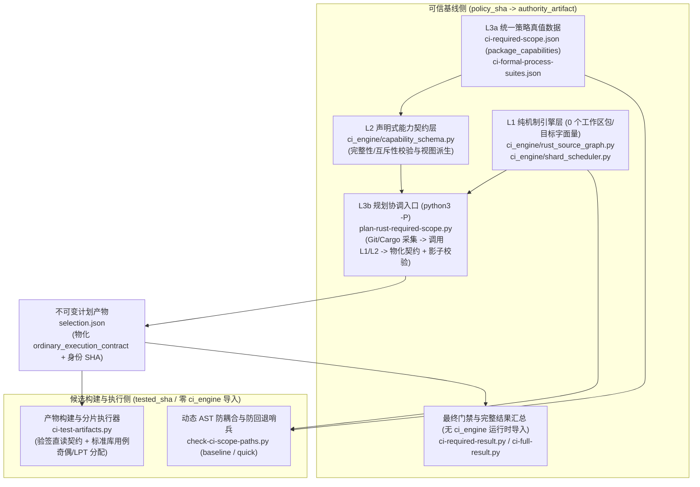

# CI 控制面通用引擎与业务策略解耦设计

- 状态：target execution contract（系统设计已拟定，实现与迁移由 [#7344](https://github.com/nil-studio/oasis7/issues/7344) 分片承接；文档合入本身不改变当前生效的 CI 执行路径）
- 专业 owner：`repository_health_engineer`；安全、受信基线与容器隔离边界由独立评审者审读
- 固定审读基线：`nil-studio/oasis7@e1d796bdc71e42f0627ac2e53e38813c6f8f266c`
- 上游要求：[PR 快速反馈与四小时完整回归](ci-tiered-execution.prd.md#ci-fast-pr-periodic-full)、[未登记路径门禁](ci-tiered-execution.prd.md#ci-unknown-inputs)
- 配套设计：[CI 分级执行设计](ci-tiered-execution.design.md)、[PR 快速反馈与周期完整回归分册](ci-pr-fast-and-periodic-full-design.md)、[CI 基础镜像](ci-base-images.design.md)
- 通用流程权威：[开发流程规范](../../engineering/workflow/source-of-truth.md)、[测试手册](../../../testing-manual.md#local-check-entry)

## 1. 问题、目标与非目标

### 1.1 问题与可量化基线

当前仓库 CI Python 控制面将**与业务无关的通用机制算法**（Rust 源码词法扫描、静态 `mod`/`#[path]`/`include!` 模块树解析、`cfg` 谓词求值、LPT 分片装箱、子进程测试监督）与**高度易变的 Oasis7 业务包拓扑配置**（包名集合、Docker 附属构建依赖、Clippy 转交目标、超大库拆批白名单）混写在超长过程式单文件中：

| 控制面文件 | 基线规模（`e1d796bd`） | 硬编码业务包名数 | 核心耦合痛点 |
| --- | ---: | ---: | --- |
| [`scripts/plan-rust-required-scope.py`](../../../scripts/plan-rust-required-scope.py) | `6,017` 行 | `41` 个 | 单文件混合词法/图引擎与 `ORDINARY_PARTITION_PACKAGES`、`DISTFS_CLIPPY_TARGETS`、`SUPPORT_PROFILES`（24 包硬编码元组）、`new_pixel_platform_statement`、`oasis7_custody_worker` 等包名分支；仅 `changed_test_policy` 单个嵌套函数即达 `1,500+` 行 |
| [`scripts/ci-test-artifacts.py`](../../../scripts/ci-test-artifacts.py) | `4,321` 行 | `21` 个 | 作为构建与测试执行器，再次硬编码 `ORDINARY_PARTITION_PACKAGES`、`PORTABLE_REQUIRED_PACKAGES`、`oasis7_runtime` Docker 准入、`oasis7_chain_runtime` `runtime-tests` 双子批切分等策略，与规划器形成双端重复推导 |
| [`scripts/ci-required-scope.json`](../../../scripts/ci-required-scope.json) | `3,200+` 行 | 全仓配置 | 仅承载一半路径与目标规则，另一半同源包级能力特征隐式散落在 Python 条件分支与 [`rust.yml`](../../../.github/workflows/rust.yml) 表达式中 |

这种耦合直接引发三类高频工程故障：
1. **架构重构期单侧漏改引发静默慢速回退**：当工作区拆分新包（如从 `oasis7` 迁出 `oasis7_runtime_host`）、下线模块（如 `oasis7_custody_worker`、`launcher_web`）或归并集成测试目录时，修改 `Cargo.toml` 与 JSON 配置后极易遗漏 Python 脚本内部的硬编码包名集合，导致普通 PR 静默跌落 `test_policy_changed=true` 或宿主 `v1` 单分片（耗时从 `~7–8m` 退化至 `40m–50m`）。
2. **大闭包高耦合放大局部修改副作用**：通用 Rust 语法分析逻辑与特定业务包的豁免钩子交织在同一函数作用域内，修复一处词法边界极易误触另一业务包的隐式假设，且单测被迫每次拉起完整临时 Git 仓与 `cargo metadata` 子进程（全套回归耗时数分钟）。
3. **业务属性微调被迫触碰共享控制代码**：调整单个包的容器准入或分片拆批属性需要直接编辑核心 Python 脚本，无法复用受控配置快速切片，增加并发 PR 变基冲突与 `policy_sha` 双版本兼容负担。

### 1.2 设计目标

1. **三层单向解耦（引擎零业务标识）**：将 CI 控制面拆分为 **L1 纯机制引擎层（`scripts/ci_engine/`）** → **L2 声明式能力契约层（Capability Schema）** → **L3 业务策略配置与协调执行层**；强制 `scripts/ci_engine/*.py` 对全仓动态提取的 package 名、target 名与目录名保持 **`0`** 字面量引用。
2. **统一能力注册表替代跨表与包名特判**：将散落在双端脚本与多张配置表中的六类包级特判收敛为以 `<pkg>` 为唯一主键的统一 `package_capabilities` 声明（受跨包通用物理语义约束与完整性/互斥性校验），使引擎按“目标具备何种物理能力特征”决策，而非按“包名叫什么”分支。
3. **一次物化规划、跨版本零模块耦合执行**：由运行在受信 `policy_sha` 的规划器一次计算出完整的显式执行契约（`ordinary_execution_contract`），下游候选侧 `ci-test-artifacts.py` 不导入 `ci_engine`，仅校验身份摘要并按物化契约执行，消除双端重复推导与在途分支跨版本缺包风险。
4. **毫秒级纯内存单测与动态 AST 防腐门禁**：L1 引擎支持纯内存源码/图字典输入（`< 0.5s` 完成全部词法/模块/`cfg`/分片策略单测）；在 `baseline` 与 `check-local.py --profile quick` 必跑的 [`scripts/check-ci-scope-paths.py`](../../../scripts/check-ci-scope-paths.py) 中绑定工作区 `Cargo.toml` 动态禁用词表与协调层硬编码棘轮，永久阻断业务包名回流引擎层。

### 1.3 非目标（Non-Goals）

- **不在 JSON 中发明图灵完备规则 DSL 或换皮单包钩子**：通用 Rust 词法分析、模块路径解析、布尔 `cfg` 求值与分片预算算法保留在纯 Python 引擎模块中；配置层仅声明通用物理能力特征，严禁把业务函数名、特定宏名或表达式谓词塞入配置参数。
- **不放宽 `policy_sha` 与 `tested_sha` 信任边界**：候选分支（`tested_sha`）仍无权自授门禁豁免、篡改受信选择器或为包含宿主 Docker 依赖的构建打开非隔离容器权限。
- **不改变外部 GitHub 分支保护接口**：`required-gate`、`explicit-full-gate` 的外部检查名称、失败阻断语义与 `periodic-full` 四小时全量回归覆盖范围保持不变。

---

## 2. 上游约束与需求承接

### 2.1 需求承接与分配表

| 上游条款（`path#fragment`） | 本设计条款（`#anchor`） | 具体 obligation 与适用条件 | 验证方法与证据 | 未覆盖范围与产品适用性 |
| --- | --- | --- | --- | --- |
| Trace refs: `O7-REQ-a34ef03b-c8ee-4988-af23-67ad20e65e29`；[PR 快速反馈与四小时完整回归](ci-tiered-execution.prd.md#ci-fast-pr-periodic-full) | [三层解耦架构](#three-layer-architecture) | 剥离零业务标识的纯机制引擎层（`scripts/ci_engine/`）与薄协调入口，切断候选执行器对引擎包的跨版本导入依赖，保持模块图与分片语义等价 | 自动化单测与历史提交回放对比：[`scripts/plan-rust-required-scope.test.py`](../../../scripts/plan-rust-required-scope.test.py) 及 `#7344` `PR 2/5–3/5` 新增纯内存单测 `scripts/ci-engine-unit.test.py` | 产品适用性：N/A；reason=纯 CI 控制面架构分层与通用引擎抽离，不涉及游戏规则、玩家客户端或世界状态；scope=CI Python 规划引擎与分片策略模块。Hosted 十分钟 P95 仍由生产窗口遥测独立验收 |
| Trace refs: `O7-REQ-a34ef03b-c8ee-4988-af23-67ad20e65e29`；[PR 快速反馈与四小时完整回归](ci-tiered-execution.prd.md#ci-fast-pr-periodic-full) | [声明式能力契约](#capability-schema-contract) | 以 `<pkg>` 为唯一主键建立统一 `package_capabilities` 注册表并对照工作区 `Cargo.toml` 做完整性/互斥性校验，消除跨脚本与同文件多表漂移 | Schema 正负例单测与选测回归：[`scripts/plan-rust-required-scope.test.py`](../../../scripts/plan-rust-required-scope.test.py)（待 `#7344` `PR 2/5–3/5` 实施验证） | 产品适用性：N/A；reason=CI 包级能力声明与 Schema 校验治理，不改变业务 crate 运行态行为；scope=`scripts/ci-required-scope.json` 与 `capability_schema.py` |
| Trace refs: `O7-REQ-a34ef03b-c8ee-4988-af23-67ad20e65e29`；[PR 快速反馈与四小时完整回归](ci-tiered-execution.prd.md#ci-fast-pr-periodic-full) | [显式执行契约](#explicit-execution-contract) | 在 `selection.json` 物化自包含的 `ordinary_execution_contract` 并在双写期执行影子等价断言，使 `ci-test-artifacts.py` 零 `ci_engine` 依赖验签直读 | 产物构建与分片回归测试：[`scripts/ci-formal-process.test.py`](../../../scripts/ci-formal-process.test.py)（待 `#7344` `PR 3/5–4/5` 实施验证） | 产品适用性：N/A；reason=CI 规划产物到测试执行器的内部数据接口治理；scope=`selection.json` 与 `scripts/ci-test-artifacts.py` |
| Trace refs: `O7-REQ-4e7f2e0d-9147-43d9-a593-00a8db9b21df`；[未登记路径门禁](ci-tiered-execution.prd.md#ci-unknown-inputs) | [权威隔离与完整性](#authority-and-digest-isolation) | `scripts/ci_engine/` 纳入 `CONTROL` 与 `python_control_contracts` 严格纳管；解包前校验无符号链接、通过 `authority_artifact` 跨 Job 传递、`python3 -P` 锁定导入并纳入 `DefinitionDigest` | 工作流与完整结果摘要单测：[`scripts/ci-workflow.test.py`](../../../scripts/ci-workflow.test.py)、[`scripts/ci-full-result.test.py`](../../../scripts/ci-full-result.test.py)（待 `#7344` `PR 2/5` 实施验证） | 产品适用性：N/A；reason=CI 控制路径登记、跨 Job 受信提取与定义摘要完整性保护；scope=`scripts/ci_engine/**`、`scripts/ci-full-result.py` 与 `.github/workflows/rust.yml` |
| Trace refs: `O7-REQ-4e7f2e0d-9147-43d9-a593-00a8db9b21df`；[未登记路径门禁](ci-tiered-execution.prd.md#ci-unknown-inputs) | [防耦合门禁与演进](#anti-coupling-gate-and-rollout) | 动态解析工作区 `Cargo.toml` 全体 crate/target 名执行 L1 零业务标识 AST 门禁，明确 `periodic-full` 轮换后的垫片清零条件与棘轮收口 | 静态门禁与治理单测：[`scripts/ci-workflow-cache-and-local-check.test.py`](../../../scripts/ci-workflow-cache-and-local-check.test.py) 与 `scripts/check-ci-scope-paths.py`（待 `#7344` `PR 2/5–5/5` 实施验证） | 产品适用性：N/A；reason=CI 动态防耦合门禁与分片演进策略；scope=`scripts/check-ci-scope-paths.py` |

---

## 3. 当前状态、目标状态与差距

| 维度 | 当前状态（基线 `e1d796bd`） | 目标状态 | 核心差距与实施承接 |
| --- | --- | --- | --- |
| **Rust 静态源码与 `cfg` 分析** | 内嵌于 `plan-rust-required-scope.py`（约 `1,800` 行嵌套闭包），夹杂 `oasis7_custody_worker` 与 `pixel_world_bridge` 特判 | 独立为 `scripts/ci_engine/rust_source_graph.py`，零业务标识，纯内存接口，平台假定通过受限枚举配置传入 | 抽离词法、模块挂载、`type_body`/`body` 属性归属与 `cfg` 求值器，剥离硬编码钩子（`PR 2/5`、`PR 3/5`） |
| **分片拓扑与别名调度** | `targeted_ordinary_artifact_partitions`、`_ordinary_packages_support_universal_v2`、`runtime-tests` 别名在双端脚本重复硬编码 | 规划侧由 `scripts/ci_engine/shard_scheduler.py` 统一计算并物化至 `ordinary_execution_contract`；执行侧仅保留零外部依赖的标准库用例哈希奇偶/LPT 分配 | 消除双端重复函数与候选侧跨版本模块依赖（`PR 2/5`、`PR 4/5`） |
| **包级能力与特判表达** | `ORDINARY_PARTITION_PACKAGES`、`DISTFS_CLIPPY_TARGETS`、`SUPPORT_PROFILES`、`PORTABLE_REQUIRED_PACKAGES` 分散在 Python 与多张 JSON 表 | 收敛为 `ci-required-scope.json` 单一主键表 `package_capabilities.<pkg>`（字典序排列），由 `capability_schema.py` 对照 `Cargo.toml` 强校验并派生各视图 | 建立统一能力 Schema，消除脚本内与 JSON 内多表同步漂移（`PR 2/5`–`PR 5/5`） |
| **规划器 → 执行器契约** | `selection.json` 仅传粗粒度标志，`ci-test-artifacts.py` 重新读取包名推导容器准入、Clippy 与分片角色 | `selection.json` 物化版本化 `ordinary_execution_contract`（双写期内置影子等价断言），执行器验签直读 | 规划器双写与影子校验，执行器去重切换并在 1 个 `periodic-full` 周期后清零垫片（`PR 3/5`–`PR 5/5`） |
| **`policy_sha` 提取与防腐门禁** | `rust.yml` 逐文件手写 `git show`；无符号链接前置校验或动态包名 AST 禁令 | 解包前校验 `ls-tree` 无 symlink、`tarfile(..., filter="data")` 提取并随 `authority_artifact` 跨 Job 传递、`python3 -P` 锁定导入；动态提取全仓 crate/target 名做零耦合 AST 门禁 | 先落地安全提取、摘要绑定与动态 AST 门禁，再切换调用方（`PR 2/5`、`PR 5/5`） |

---

## 4. 三层解耦架构与单向依赖边界

控制面按职责与信任域严格划分为单向依赖的三层；**`scripts/ci_engine/` 仅存在于可信规划侧（`$RUNNER_TEMP/ci-authority`）与静态门禁检查中，候选执行侧（`tested_sha`）不导入 `ci_engine`**：

### 4.1 各层职责与硬边界

1. **L1 纯机制引擎层（`scripts/ci_engine/`）**：
   - 仅依赖 Python 3.12 标准库；输入输出均为纯不可变数据结构（`dict`、`frozenset`、`dataclass(frozen=True)`）。
   - **硬禁令（MUST NOT）**：不得出现仓库内任何 workspace/standalone package 名、`lib`/`bin`/`test` target 名或 `crates/*`、`tools/*` 子目录字面量（涵盖 `oasis7_*`、`launcher_web`、`wasm_build_suite`、`pixel_world_bridge` 等全部存量与未来新增包）；不得直接调用 `git`、`cargo` 或网络 I/O；不得读取全局环境变量改变选测结论。
   - 包含三个内聚子模块：
     - `rust_source_graph.py`：Rust 源码词法分词、`include!` / `include_bytes!` / `include_str!` 调用提取、静态 `mod` / `#[path]`（含内联字面量路径与父模块目录上下文校验）路由闭合、结构体/枚举 `type_body` 与函数 `body` 稳定词法归属、以及参数化平台/feature 集合上的三值（`True` / `False` / `None`）`cfg` 布尔求值。
     - `shard_scheduler.py`：基于成本映射表、预算阈值与可切分库能力特征，在规划期一次性计算紧凑分片集合（`artifact_partitions`）、`universal-v2` 准入资格、重型库别名与预算权重校验（确定性纯函数）。
     - `capability_schema.py`：对照根 `Cargo.toml` 成员清单校验并解析 `package_capabilities`，拒绝未知键、缺失成员、非法类型、路径逃逸或互斥的能力组合，并派生下游所需的分类集合视图。

2. **L2 声明式能力契约层（Capability Schema）**：
   - 将原本隐含在 Python `if/elif` 中的业务特例显式建模为以 `<pkg>` 为唯一主键的通用物理特征（详见 §6.1）。
   - **跨包通用性准入准则**：新增的每一个 capability 字段必须表达可复用的物理构建、运行环境或隔离属性（如“全量测试需宿主 Docker 守护进程”、“库目标支持奇偶拆批”、“依赖宿主内核特权 runner”）；严禁为单一业务模块定制一次性布尔开关或将业务函数/宏标识符编码进配置。

3. **L3 业务策略数据与协调执行层（Coordinators & Policy Data）**：
   - `scripts/ci-required-scope.json` 成为包能力注册表（`package_capabilities`）、路径规则、快速目标库存与 SHA-256 锚点的**唯一数据真值源**。
   - `scripts/plan-rust-required-scope.py` 收敛为薄协调层：读取受控 Git 比较树与 `cargo metadata`，调用 `ci_engine` 完成分析并在 `selection.json` 中物化完整的 `ordinary_execution_contract`。
   - `scripts/ci-test-artifacts.py` 收敛为零 `ci_engine` 依赖的受控执行器：核验 `selection.json`、`source_sha`、`tested_sha`、工具链与环境摘要后，直接读取物化契约构建二进制，并用内置标准库逻辑对编译产出的测试二进制用例表执行 SHA-256 确定性轮询/奇偶切分与 LPT 分发。

---

## 5. 权威隔离、跨 Job 提取流程与状态完整性

模块拆分绝不能削弱现有的 `policy_sha` 权威边界、造成跨 Job 缺包、或引入“可信入口误加载候选模块”的供应链风险。完整运行链路遵循以下六项安全契约：

1. **前置无符号链接校验、安全解包与 `authority_artifact` 跨 Job 传递**：
   - **解包前树对象强校验**：在 [`.github/workflows/rust.yml`](../../../.github/workflows/rust.yml) 的 `select` 步骤中，当 `${policy_sha}:scripts/ci_engine` 存在时，**先**扫描 `git ls-tree -r "${policy_sha}" -- scripts/ci_engine`，验证全部条目 mode 严格属于常规文件（`100644` 或 `100755`），一旦发现 `120000`（symlink）或 `160000`（submodule）立即在落盘前硬失败退出；随后通过 `git archive --format=tar "${policy_sha}" scripts/ci_engine` 传入 Python 3.12 标准库 `tarfile.extractall(authority, filter="data")` 安全解包至 `$RUNNER_TEMP/ci-authority/ci_engine`（旧 `policy_sha` 无该目录时兼容跳过；`bootstrap_full=true` 候选手动演练分支若复制工作区文件亦先递归校验无 symlink）。
   - **跨 Runner Job 闭环传递**：`select` 末尾既有的 `actions/upload-artifact` 步骤（`authority_artifact = ci-authority-${GITHUB_RUN_ID}-${GITHUB_RUN_ATTEMPT}`，上传 `${{ runner.temp }}/ci-authority`）自动包含 `ci_engine/` 子目录；下游所有下载 `authority_artifact` 的独立作业（`workflow-governance`、`formal-*`、`required-gate`、`explicit-full-gate`）恢复后均在同一相对层级拥有 `$RUNNER_TEMP/ci-authority/ci_engine`。
   - **门禁与执行脚本零跨版本模块耦合**：`ci-required-result.py` 与 `ci-full-result.py` 保持标准库自包含，不导入 `ci_engine`（`periodic-admission` 与 `main-fast-admission` 在 `main` 检出树上调用 `ci-full-result.py` 亦无额外依赖）；候选侧 `ci-test-artifacts.py` 仅读取 `selection.json` 物化契约且不导入 `ci_engine`，因此即使未 rebase 的在途分支（`tested_sha` 早于 `PR 2/5`）运行候选构建/测试作业，也绝不会发生 `ModuleNotFoundError`。

2. **`python3 -P` 安全路径锁定与解引用前非符号链接断言**：
   - `rust.yml` 调用 `$RUNNER_TEMP/ci-authority/*.py` 的全部命令统一加上 Python 3.12 `-P` 标志（等价于 `PYTHONSAFEPATH=1`），从解释器层面禁止把当前候选工作目录（CWD）自动注入 `sys.path[0]` 并配合受控环境阻断 `PYTHONPATH` 污染。
   - `plan-rust-required-scope.py` 在导入 `ci_engine` 前，必须先对未解析路径显式断言 `not Path(__file__).is_symlink()` 且 `not Path(__file__).parent.is_symlink()`（以及 `ci_engine` 目录非 symlink），通过后再执行 `authority_dir = Path(__file__).resolve().parent` 并将 `sys.path` 精确收敛为 `[str(authority_dir), *(p for p in sys.path if p and not Path(p).is_relative_to(workspace_root))]`，确保只加载 `policy_sha` 版本的 `$authority/ci_engine/*.py`。

3. **`DefinitionDigest` 全集哈希绑定**：
   - [`scripts/ci-full-result.py`](../../../scripts/ci-full-result.py) 在计算完整回归定义摘要（`DefinitionDigest`）时，除哈希既有 `POLICY_FILES` 外，通过 `git ls-tree -r "${revision}" -- scripts/ci_engine` 按路径字典序纳入全部引擎文件 blob（含文件 mode 检查）。任何对 `scripts/ci_engine/*.py` 的修改都会确定性地更新定义摘要，杜绝旧全量证据跨引擎逻辑变更被误复用。

4. **控制面归属与治理单测分级登记**：
   - `scripts/ci_engine/__init__.py`、`rust_source_graph.py`、`shard_scheduler.py`、`capability_schema.py` 作为共享核心控制模块，纳入 `CONTROL` 通配、`FORBIDDEN_SCOPED_CONTROL_PATHS`（禁止降级为局部跳过）及 `python_control_contracts`。
   - 新增纯内存单测 `scripts/ci-engine-unit.test.py` 登记入 `workflow_governance_python_tests`、`scoped_control_paths`（`["workflow_governance"]`）及 [`scripts/ci-python-control-contracts.py`](../../../scripts/ci-python-control-contracts.py) 的 `EVOLVING_POLICY_TESTS`，既保证引擎变更必跑单测，又允许后续随引擎演进同步扩充断言而不触发 `FIXED_TESTS` 跨基线回放死锁。

5. **配置项双层权限分级（防自授豁免 vs 免微 PR 演进）**：
   - **缩减覆盖与隔离类策略（仅认 `policy_sha`）**：决定哪些测试可跳过、哪些反向消费者可延期到 `periodic-full`、哪些包免除宿主 Docker 隔离的字段（如 `ordinary_fast_component_rules`、`full_tier_requires_host_docker`、`clippy_delegation_contracts`），在 PR 运行中一律以 `policy_sha` 的配置为准；候选分支自改此类字段不会缩小本轮门禁范围或打开非隔离执行权限。
   - **单调增补/重平衡元数据（支持单 PR 快速切片）**：不削弱基线覆盖的 `ordinary_harness_costs` 权重校准、保序新增非空路径规则及同 PR 新增治理单测登记，继续沿用 `ordinary_scope_config_slice_version=2` 单 PR 快速收敛，无需拆前置微 PR。

6. **失败与异常处置（Fail-Closed）**：
   - Schema 校验失败、工作区存在未登记进 `package_capabilities` 的成员包、未知能力版本、`ordinary_execution_contract` 与顶层兼容字段影子断言不一致、或发现任何符号链接时，规划器与执行器立即以非零退出码硬失败，由 `required-gate` 确定性阻断。

---

## 6. 跨层接口与声明式数据合同

### 6.1 统一主键注册表 `package_capabilities` 与闭合能力 Schema

为避免把“跨多个 Python 文件同步包名”变成“在同一 `ci-required-scope.json` 内跨三张平行包表同步包名”，所有工作区成员包的策略特征统一收敛至单一顶层字典 `package_capabilities`（伴随版本字段 `package_capabilities_version: 1`）：

- **单一真值与派生投影**：`package_capabilities` 以工作区 `<pkg>` 为唯一主键，**强制按 `<pkg>` 字节字典序严格递增排列**（降低 `3,200+` 行 JSON 的并发分支邻近行冲突）。`capability_schema.py` 读取根 `Cargo.toml` 成员列表执行全集对齐校验（新增成员未登记或已删除成员残留立即报错），并在内存中确定性派生 `ordinary` 包集合、`workspace_support` profile 字典与 `oasis7_required_wasm_packages` 列表，配置层不再维护重复的平行包清单。
- **`package_capabilities.<pkg>` 闭合字段契约**（未知字段一律拒绝）：
  - `tier_role`: `"ordinary"` | `"workspace_support"` | `"excluded"`（必选，互斥决定包所属顶层调度域）；
  - `inline_dedicated_partition`: `bool`（可选，默认 `false`；仅 `tier_role == "ordinary"` 允许为 `true`）；
  - `compact_non_runtime_excluded`: `bool`（可选，默认 `false`；声明该重型包被选中时禁止收缩为紧凑 `artifact_partitions`）；
  - `required_wasm_build`: `bool`（可选，默认 `false`；唯一权威派生 `oasis7_required_wasm_packages`）；
  - `full_tier_requires_host_docker`: `bool`（可选，默认 `false`；声明全量测试层或风险目标需宿主机 Docker 物化 WASM 材料，禁止进入无 Docker socket 的 `--user 1001:1001` 候选容器）；
  - `support_profile`: 可选闭合对象 `{"profile_id": str, "requires_host_runner": bool, "extra_features": list[str]}`（仅 `tier_role == "workspace_support"` 允许且必填，替代硬编码 `SUPPORT_PROFILES` 与 `WORKSPACE_SUPPORT_HOST_PROFILES`）；
  - `splittable_lib_harness`: 可选闭合对象 `{"logical_alias": str, "universal_v2_anchor": bool}`（声明库测试二进制的逻辑别名及是否锚定 `universal-v2` 奇偶拆批）；
  - `group_library_proof`: 可选闭合对象 `{"group": str}`（声明组件组证明关联的目标组名，配合顶层 `clippy_delegation_contracts` 裁定严格 Clippy 委派）；
  - `platform_cfg_assumptions`: 可选闭合对象，**仅允许声明标准 Cargo/rustc 物理平台与 feature 边界**：
    - `assumed_target_archs`: `["x86_64" | "aarch64" | "wasm32", ...]` 枚举子集；
    - `known_target_features`: `list[str]`（必须真实存在于该包 `Cargo.toml` 的 `[features]` 表中）；
    - `external_ffi_bridge_group`: 可选字符串（必须属于顶层有效 `groups`）。
    - **反换皮耦合禁令**：`platform_cfg_assumptions` 严禁接收业务函数名、宏名、路径正则或 AST 片段；原 `changed_test_policy` 中针对特定函数调用名的历史硬编码特判（如 `new_pixel_platform_statement`）按标准模块/文件归属规则重构或退役，绝不迁入 `rust_source_graph.py`。

六类存量硬编码常量向统一 Schema 的精确映射如下：

| 原硬编码位置 | 原硬编码标识 | 统一 Schema 字段（`ci-required-scope.json`） | 引擎与协调层消费语义 |
| --- | --- | --- | --- |
| `plan-rust-required-scope.py` & `ci-test-artifacts.py` | `ORDINARY_PARTITION_PACKAGES` (`oasis7_runtime`, `oasis7_world_state`) | `package_capabilities.<pkg>.inline_dedicated_partition: true` | 有界 `inline` 选中的快速目标包集合全部声明该特征且包数 `>= 2` 时拆分为按包并行分区，否则走 `["all"]` |
| `plan-rust-required-scope.py` & `ci-test-artifacts.py` | `DISTFS_CLIPPY_TARGETS` & `ORDINARY_GROUP_LIBRARIES` | `package_capabilities.<pkg>.group_library_proof` + 顶层 `clippy_delegation_contracts` | 按声明的源包、目标集合与组共现条件判定严格 Clippy 是否委派至 `rust_baseline`，物化写入 `delegated_clippy` |
| `plan-rust-required-scope.py` | `SUPPORT_PROFILES`（24 包元组）与 `WORKSPACE_SUPPORT_HOST_PROFILES` | `package_capabilities.<pkg>.support_profile` (`profile_id`, `requires_host_runner`, `extra_features`) | 单一注册表驱动 support profile 矩阵与宿主特权 runner 路由（消除 `L140` 与 `L4820` 双处列表） |
| `ci-test-artifacts.py` | `PORTABLE_REQUIRED_PACKAGES` 兜底常量 | `package_capabilities.<pkg>.required_wasm_build: true`（派生 `oasis7_required_wasm_packages`） | 规划器将最终必建 WASM 包列表直接写入 `ordinary_execution_contract.required_wasm_packages`，执行器零兜底表 |
| `plan-rust-required-scope.py` & `ci-test-artifacts.py` | 硬编码 `package == "oasis7_runtime"` 与 `local_test_provider` 判定容器资格 | `package_capabilities.<pkg>.full_tier_requires_host_docker: true` 及目标级 `requires_host_docker_material: true` | 规划器一次性裁定 `candidate_container_eligible: bool` 写入契约，执行器不再按包名判断 Docker 依赖 |
| `plan-rust-required-scope.py` & `ci-test-artifacts.py` | `('oasis7_chain_runtime', ...): 'runtime-tests'`、`{'oasis7', 'oasis7_world_state'}` 紧凑分片排除及平台 `cfg` 特例 | `package_capabilities.<pkg>.splittable_lib_harness`、`compact_non_runtime_excluded`、`platform_cfg_assumptions` | `shard_scheduler` 在规划期算出 `artifact_partitions`、`supports_universal_v2` 与 `logical_harness_aliases` 物化进契约；`rust_source_graph` 按受限平台枚举求值 `cfg` |

### 6.2 规划器到执行器的显式物化执行契约（`ordinary_execution_contract`）

为彻底切断 `ci-test-artifacts.py` 对业务规则的二次推导及对 `ci_engine` 的代码导入依赖，`plan-rust-required-scope.py` 在 `selection.json` 中物化输出自包含的 `ordinary_execution_contract` 对象（迁移过渡期保留顶层旧字段，并在规划器内强制执行**影子等价断言**）：

| 接口/契约 | Producer → Consumer | 身份与版本绑定 | 排序与幂等性 | 成功/失败边界 | 跨版本兼容策略 |
| --- | --- | --- | --- | --- | --- |
| `rust_source_graph.analyze_policy_diff(...)` | `plan-rust-required-scope.py` / `check-ci-scope-paths.py` → `ci_engine.rust_source_graph` | 纯函数接口，绑定传入源码字节与显式 `CargoTargetSpec` | 输入路径与输出列表严格按字典序确定性排列 | 遇到无法证明的动态路径或未覆盖 feature 抛 `TestPolicyError` 或返回保守集合 | 仅在同版本进程内调用，无跨提交序列化偏移 |
| `selection.json` 内的 `ordinary_execution_contract` | `select`（`policy_sha`）→ `oasis7-test-build-*` / `oasis7-required` / `rust-baseline`（`ci-test-artifacts.py`） | `version: 1`，与顶层 `source_sha`、`tested_sha`、`policy_sha` 共同受 `selection_artifact` SHA-256 保护 | `partitions`、`artifact_partitions`、`delegated_clippy`、`logical_harness_aliases` 均按稳定键排序，重跑完全幂等 | 规划期影子等价断言不匹配，或消费期契约字段与顶层 `ordinary_partitions` / `ordinary_execution` 矛盾时，立即非零退出阻断 | `PR 4/5` 过渡窗口内若旧 `policy_sha` 计划不含该字段则走单函数兼容垫片；完成 1 个 `periodic-full` 周期后在 `PR 5/5` 移除垫片并锁死 fail-closed |

`ordinary_execution_contract` 核心字段定义如下：
- `version`: 固定整数 `1`；
- `mode`: `"inline"` | `"artifact-v1"` | `"artifact-v2"`；
- `supports_universal_v2`: 布尔值，标识当前选中包集合是否满足多 worker `artifact-v2` 分片条件；
- `candidate_container_eligible`: 布尔值，由规划器结合 `test_policy_changed`、`ordinary_risk_targets` 及 `full_tier_requires_host_docker` 一次性裁定；
- `artifact_partitions`: 有序字符串列表（如紧凑模式或标准 `artifact` 分片 ID 列表）；
- `partitions`: 字典 `{"<partition_id>": {"packages": [...], "fast_targets": [...], "splittable_harnesses": [...]}}`；
- `logical_harness_aliases`: 字典 `{"<pkg>:<kind>:<target>": "<logical_alias>"}`（供构建打包确定性命名二进制，替代硬编码 `aliases` 表）；
- `required_wasm_packages`: 有序字符串列表（供构建预检与产物校验直接使用）；
- `deferred_cases`: 字典 `{"<logical_alias>": [...]}`（声明延期至 `formal-process` 的用例名集合）；
- `delegated_clippy`: 归属 `rust_baseline` 执行的显式目标与 feature 元组清单。

> **工作流 YAML 投影边界说明**：`ordinary_execution_contract` 仅通过完整的 `selection.json` 文件传递给 Python 执行器；若未来确需将其中子字段暴露给 `.github/workflows/rust.yml` 的 `${{ fromJSON(needs.select.outputs.plan).* }}` 表达式，必须同步更新 `workflow-plan` 与 `&validate-complete-selection` 双处投影白名单及 `ci-workflow.test.py` 契约单测。

---

## 7. 防耦合回退门禁、分片演进与回滚验证

### 7.1 动态 AST 防耦合门禁与硬编码棘轮

仅有代码重构不足以阻止后续开发重新把业务包名写回通用逻辑。在每次 PR `baseline` 与本地 `python3 scripts/check-local.py --profile quick` 必跑的 [`scripts/check-ci-scope-paths.py`](../../../scripts/check-ci-scope-paths.py) 中新增三项 `< 0.2s` 的静态门禁：

1. **动态绑定全仓 `Cargo.toml` 的 L1 零业务标识红线**：`check-ci-scope-paths.py` 直接解析根 `Cargo.toml` 及仓库内全部 workspace/standalone `Cargo.toml` 清单，动态收集**全体 package 名称、`lib`/`bin`/`test` target 名称以及 `crates/*`、`tools/*` 子目录名称**作为实时禁用词表（无需人工维护正则前缀，自动覆盖 `oasis7_*`、`launcher_web`、`wasm_build_suite`、`pixel_world_bridge` 及未来任意命名的新包；与 Python/Rust 标准术语重合的极少数通用短词如 `test`、`main` 通过显式受审白名单枚举排除）。使用 `ast.parse` 扫描 `scripts/ci_engine/**/*.py` 的全部标识符与字符串常量，凡命中禁用词表或具体业务子路径立即判红阻断。
2. **`package_capabilities` 完整性与键序门禁**：静态核验 `ci-required-scope.json` 中 `package_capabilities` 的键集合与工作区成员严格一致且按字节字典序排列，防止漏配新包或无序追加引发合并冲突。
3. **L3 协调/执行脚本硬编码棘轮（只减不增直至归零）**：对 `scripts/plan-rust-required-scope.py` 与 `scripts/ci-test-artifacts.py` 中命中的工作区包名字面量集合设置单调递减上限棘轮，并与既有 `check_ci_fast_path_health()` 活体探针联动，确保每一步重构切片均保持 `~7–8m` `targeted-inline` 快速路径健康。

### 7.2 五切片平滑演进与回滚路径（对应 [#7344](https://github.com/nil-studio/oasis7/issues/7344)）

为严格遵守 `policy_sha` 混合版本窗口与 PR 爆炸半径上限，实施按以下五个正交切片串行推进，**同一时刻至多保持 1 个在途开放 PR**：

1. **`PR 1/5 [Slice: Docs]`（本设计）**：合入本设计文档并挂接索引，零运行态变更。
2. **`PR 2/5 [Slice: Dark]`（纯引擎、安全解包传递与动态 AST 门禁前置）**：新增零业务标识的 `scripts/ci_engine/` 三模块与 `< 0.5s` 纯内存单测 `scripts/ci-engine-unit.test.py`（登记入 `EVOLVING_POLICY_TESTS` 与 `python_control_contracts`）；在 `rust.yml` `select` 接入 `ls-tree` 无 symlink 校验、`tarfile(..., filter="data")` 解包与 `python3 -P` 调用（随既有 `authority_artifact` 自动传递至下游门禁 Job）；在 `ci-full-result.py` 纳入 `DefinitionDigest`；在 `check-ci-scope-paths.py` 开启基于全仓 `Cargo.toml` 动态词表的 `ci_engine` 零业务标识门禁。此片合入后，`main`（后续 PR 的 `policy_sha`）已具备完整的引擎安全分发能力。
3. **`PR 3/5 [Slice: Adapter]`（统一 `package_capabilities`、规划器切换与影子双写校验）**：在 `ci-required-scope.json` 落地字典序排列的统一 `package_capabilities`，将 `plan-rust-required-scope.py` 委托给 `ci_engine` 并在 `selection.json` 双写 `ordinary_execution_contract`，同时**内置无条件影子等价断言**（实时比对新契约与旧顶层字段推导的分区、容器资格、Clippy 委派与 WASM 清单 100% 一致），通过全部 527+ 项规划器单测与历史提交回放。
4. **`PR 4/5 [Slice: Adapter]`（执行器零模块依赖去重切换）**：改造 `ci-test-artifacts.py` 直接验签消费 `selection.json` 中的 `ordinary_execution_contract`（不导入 `ci_engine`，仅对不含新字段的历史快照保留单一兼容函数），消除双端重复的分片、容器准入、别名与 Clippy 推导。
5. **`PR 5/5 [Slice: Chore]`（垫片清零、旧代码移除与棘轮锁死）**：在 `PR 4/5` 合入 `main` 并完成 **1 个绿色 `periodic-full` 完整回归周期**（确认 `pr-fast`、`main-fast` 与 `periodic-full` 全部运行在产出 `ordinary_execution_contract` v1 的基线上）后，删除 `plan-rust-required-scope.py` 与 `ci-test-artifacts.py` 的旧版重复推导代码与兼容垫片，将普通分片/容器/Clippy 包名硬编码棘轮上限锁死为 **`0`**，并同步更新 `.agents/skills/optimizing-ci/` 参考分册。

**单片回滚保证**：`PR 2/5–4/5` 均保持 `selection.json` 顶层既有字段与 `required-gate` 接口向后兼容，且候选侧 `ci-test-artifacts.py` 无 `ci_engine` 导入耦合；任一切片合入后若观测到异常，均可直接单提交 `git revert` 该切片而无需级联回退前置切片或阻塞未变基在途分支。

### 7.3 重要风险与残余边界

- **兼容垫片的明确生命周期**：旧版 `selection.json` 兼容垫片仅在 `PR 4/5` 至 `PR 5/5` 之间的过渡窗口存在；一旦 `PR 4/5` 后首个 `periodic-full` 绿灯落定，`PR 5/5` 立即移除该垫片并改为对缺失 `ordinary_execution_contract` 的计划直接 fail-closed 报错，防止过渡代码永久滞留。
- **不替代真实 Hosted 耗时验收**：纯内存单测（`< 0.5s`）与动态 AST 门禁仅证明选测等价性、权威隔离与代码解耦质量；PR 端到端墙钟耗时仍以 GitHub-hosted 标准 Runner 的真实生产遥测为准。
