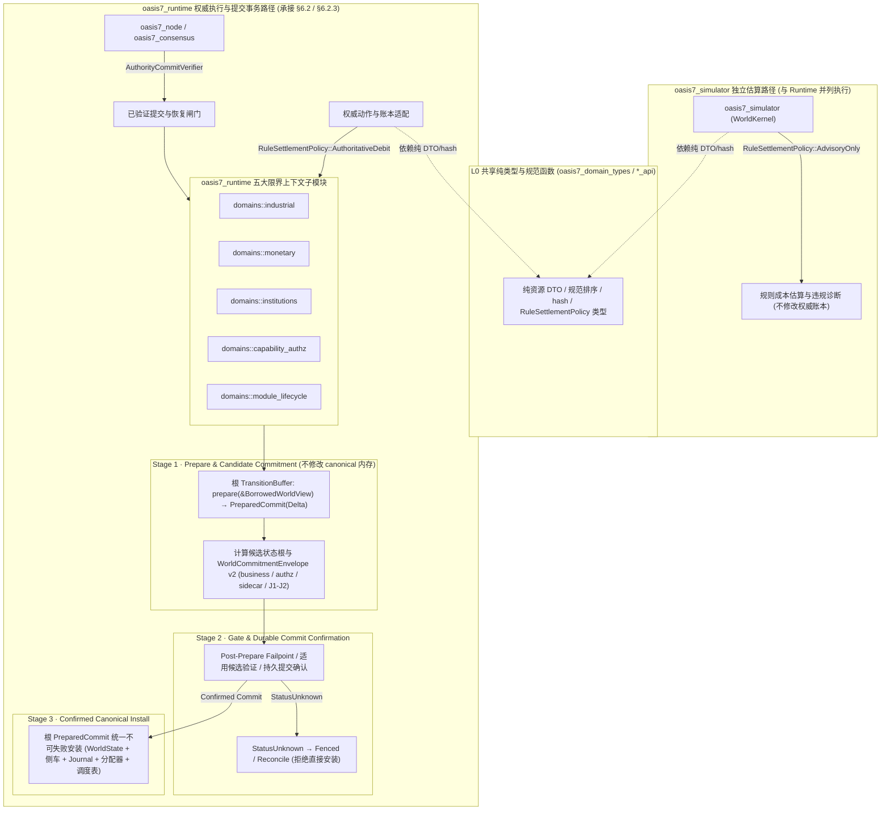

# world-runtime 架构状态、迁移证明与执行边界（分册）

- 主设计文档：[`design.md`](design.md)
- 本分册按 #6507 原样承接 `doc/world-runtime/design.md` 第 6 节（Architecture status, migration proof, and execution boundary），不改变既有架构契约、Trace 归属或验收义务。

## 6. Architecture status, migration proof, and execution boundary

The runtime uses four explicit status labels so that a protocol surface is not
mistaken for a completed end-to-end capability:

| Status | Meaning | Required evidence |
| --- | --- | --- |
| `current` | Present in the current production or compatibility path. | Code, persisted shape, or an existing regression identifies the path. |
| `partial` | Only some entrypoints, lifecycle stages, or identity scopes satisfy the target. | The missing command path, consumer, or identity scope is named. |
| `target` | Normative destination, not a current availability or release claim. | Invariants, ordering, and failure semantics are explicit. |
| `proven` | Target behavior is demonstrated by repeatable execution, rejection, snapshot, recovery, and replay evidence. | A rerunnable fixture/test and its receipt/state-root or migration evidence are available. |

The present architecture is therefore `current` for the Kernel boundary,
ordered action/replay, and persisted module identity; `partial` for
Institution migration, unified transaction coverage, and command-path instance
authorization. A local staged command path or a compatibility record does not
upgrade those surfaces to `proven`.

### 6.1 Institution Migration Test

The first migration proof follows product SC-32: a governed activation
boundary selects exactly one Alliance/EconomicContract pilot. Producer,
runtime, and WASM roles supply evidence; they do not replace governance
approval. The test is `proven` only when all of the following hold:

1. A governed manifest binds artifact hash, schema/version, stable
   `instance_id`, activation, owner/subject, and capability limits.
2. The command traverses the same permission, budget, quote/resolve,
   affordability, staged Kernel apply, receipt, and journal path as native
   actions. The module cannot write canonical `WorldState`, the canonical
   journal, or an external effect directly.
3. Accepted state, event, receipt, and checkpoint commitments are consistent;
   a confirmed precommit invariant, budget, persistence, or artifact failure
   has no partial business effect and publishes a stable rejected/fault
   disposition only when it can be committed. Unknown persistence status is
   reconciled before retry; postcommit maintenance cannot revoke the result.
4. Restart, snapshot restore, canonical journal replay, and adapter
   conformance reproduce the same state root/receipt for the same accepted
   input, while legacy shapes remain readable only through an explicit
   compatibility adapter.
5. Two instances of the same artifact, with different `instance_id` values,
   can execute concurrently without state, event, receipt, or descriptor
   cross-write. A command target may never fall back to another instance with
   the same `module_id`.
6. The `institution-migration-v1` evidence bundle binds manifest, inputs,
   roots, receipts, snapshot/replay/recovery, and legacy-conformance reports.
   Preview/stale/deny/no-effect outcomes debit nothing; an accepted effect has
   exactly one debit and receipt; retries and replay neither double-charge nor
   create replay credit.
7. Post-commit external effects first enter a durable outbox/effect ledger.
   `effect_id` is deterministically derived in the receipt domain from effect kind,
   canonical target/payload, and an effect ordinal; the ordinal only distinguishes
   intentionally repeated equal effects in one receipt. `(world_id,
   execution_receipt_id, effect_id)` is the idempotency key. Same-key/same-payload
   redelivery is deduplicated; same-key/different descriptor, intent, or payload
   fails closed as `effect_id_conflict` without overwrite or dispatch. Crash recovery
   may redeliver an unacknowledged record, while canonical replay never performs the
   external business effect again.

Until this test is proven, Alliance/EconomicContract remain compatibility
surfaces, War remains deferred, Governance remains a Kernel guardrail, and
open Institution extensibility remains `target`.

### 6.2 Unified ExecutionTransaction (architecture P0)

`ExecutionTransaction` (or an equivalent staged boundary) is an architecture
P0 because it establishes one state-transition meaning before further module
expansion. P0 here describes dependency ordering, not an assertion of an
active production incident and not a requirement for a one-shot `WorldState`
rewrite. The boundary covers every world-effecting `step()`/
`step_with_modules()` action, native compatibility action, module command,
tick directive, direct/trusted command, install/upgrade, and recovery or
migration write.

The transaction stages parent state, logical time, resource reservation/debit,
module instance state, pending effects, tick schedule, journal/event data, and
sequence counters. Quote/resolve may run as a read-only preflight, but it must
bind parent, manifest, input root, and freshness and cannot mutate world state.
Module calls and Kernel/schema/capability validation operate only on the staged
view. A successful transition publishes state, events, receipt, and execution
commitment at one commit point. A confirmed precommit invariant, budget,
artifact, serialization, or persistence failure discards the staged business
view; a rejected/fault disposition is published only if that disposition can
itself be committed. Persistence errors whose commit status is uncertain must
be resolved before rollback or retry; a postcommit maintenance error cannot
revoke the committed result. External non-rollbackable effects
are receipt-driven after commit through a durable outbox/effect ledger. Each
record binds the canonical effect descriptor, execution receipt, roots, intent
hash, dispatch/ack state, idempotency key, and observed external receipt. The
fixture covers commit-before-dispatch crash, dispatch-before-ack crash,
same-key/same-payload duplicate, same-key/different-payload conflict, duplicate
ack, restart redelivery, and replay with no external adapter call. Recovery may
redeliver an unacknowledged record; canonical replay rebuilds ledger state without
repeating the external business effect.

The migration is incremental: first route one existing command family and its
tick/replay fixtures through the boundary, then widen coverage while keeping
the legacy readers and deterministic ordering. This design does not promise a
big-bang ECS conversion, independent shard finality, cross-shard commit, or a
dynamic World Database.

#### 6.2.1 Explicit transaction and typed-delta model

Module-state updates and runtime-charge events use the prepared event-publication
boundary. Charge preparation owns one replacement payer cell and only touched
treasury entries, applies compute then electricity debits locally, and preserves
negative-fee/missing-payer/error ordering, saturating credits, zero-fee activity
timestamps, and shared-resource aggregation. Replay invokes the same pure
preparation followed by infallible installation. Publication hashes the prepared
entries through the existing borrowed `CommandStateOverlay`; it does not clone
`World` or `WorldState`. Consensus validation and the post-prepare failpoint precede
state, journal retention/backpressure, event id/era, and consensus installation.
`ModuleEmitted` remains a no-state event in the existing output order. This closes
these event seams only, not all nested operations or the root transaction.

`ModuleInstalled` and `ModuleUpgraded` prepare sparse instance/payer/treasury
replacements plus the module-keyed target and install-counter successor. Fee
validation retains priority over upgrade instance/owner/module/version checks.
The direct state reducer prepares legacy world-ledger/cache normalization only
after validation, so rejected events cannot leak compatibility migration writes.
The world reducer also prepares registry-backed schedule lookup before installing
anything; replay shares those preparations. Install state keys keep blank-to-module
and trimmed-nonblank compatibility, while nonblank schedule keys and upgrade lookup
remain raw. Inactive events remove schedules without requiring registry records;
active events require a record even when it has no tick subscription. A borrowed
projection merges the touched instance, target, material ledger/cache and fee
entries, including exactly one routed mailbox event, into the consensus root.
Publication installs only after consensus checks and the existing failpoint.
Rollback uses the same prepared state reducer and exact rollback validation
messages, preserving the historical absence of instance-key schedule updates.

Governed install/upgrade/rollback extend `PreparedGovernanceProposalApply` with
the final lifecycle event before installation. The tail checks its proposal id
and applied-manifest hash, prepares the owned instance delta against unchanged
state, and resolves scheduling against the prepared registry. Its borrowed state
projection uses the prepared manifest hash; event id/era, retained journal,
eviction accounting, and final consensus are extended locally. Both logical
post-prepare failpoints (governance and final lifecycle) precede any installation.
Only then are governance sidecars, cache invalidations, instance state and its
single mailbox event installed. Governance errors retain the caller's existing
`ActionRejected` conversion; lifecycle-tail errors propagate without installing
the governance batch. Local certificate policy/build ordering and explicit
certificate validation are unchanged. Proposal/shadow/approval prelude remains
outside this bounded commit; it is not full action/root atomicity.

Release completion supplies an owned typed context to the install path instead
of inferring its result from the last live journal entry. Both governed and
already-registered installs extend their unpublished envelopes with sorted
product, recipe, factory events and `ModuleReleaseApplied`. Each stage validates
its root/consensus candidate and logical failpoint before any canonical install.
The sparse release delta owns only changed profile/request/mapping entries,
affected agents and legacy world-material normalization, never a `World` or
`WorldState` clone. Its agent overlay begins with the fee-debited install cell
and install mailbox, so a shared installer/operator cannot overwrite the debit
or lose/duplicate events. Borrowed projections merge both instance and release
entries under the prepared manifest hash. Final request/status/mapping checks
retain their order without partial request mutation. Raw profile/final-status
reducers and publication reuse those preparations, preserving replay and direct
event semantics. Input-order prevalidation, profile overwrite rejection,
proposal-id-zero rejection for nonempty profiles, and empty-profile success are
unchanged. This adds release business completion, not prelude deduplication or
global action/root atomicity.

The three release precursors (`ModuleReleaseRequested`,
`ModuleReleaseAttested`, and `ModuleReleaseRolesBound`) also use the sparse
release projector for raw, live-action, and replay publication. It additionally
projects the request allocator and role-binding updates, while touched agent
cells carry activity and the routed projection supplies exactly the
operator/requester mailbox. Attestation mapping lookup remains late in reducer
error order but now fails only against the candidate. Role binding updates both
operator and a distinct target's activity while routing only to the operator.
Legacy world-material normalization and the final root are projected without a
`WorldState` clone before the publication failpoint.

Release review events use that same sparse request/mapping/agent preparation.
Shadowing validates request and status, then requires and clones the mapping
before changing either copy. Role approval preserves normalized-role,
required-role and existing-approver priority; rejection preserves terminal
status and nonblank-reason priority. Approval and rejection continue to update
a mapping only when one exists, while raw events still tolerate a missing actor
and therefore omit activity/mailbox delivery. The prepared request, optional
mapping, actor replacement and legacy material normalization drive the borrowed
root projection before journal, allocator, retention, consensus and failpoint
installation. Action handlers retain their stricter actor/policy validation and
continue to propagate a valid Shadow event's required-mapping reducer error.
This review-event boundary does not include request submission, attestation,
role binding or outer-action idempotency.

Marketplace listing and bid actions prepare their order and optional immediate
sale as one publication batch. The event-bound delta owns only affected agents,
one artifact's owner/listing/bid entries, fee-resource replacements, market
allocators and legacy world-material normalization. An absent staged listing or
bid entry means deletion; the borrowed serializer excludes it while preserving
unaffected entries and canonical key order. Raw listed/bid/sale reducers use the
same pure preparation before legacy normalization, so failed buyer lookup,
debit, seller credit or bid-reference validation cannot remove agents or change
ownership. Matching reads the staged fee-debited cells and updated order book;
listing price, highest-bid/lower-order-id selection and exact-tie vector order
remain unchanged. Every logical event stages its routed mailbox, journal
retention/allocator and consensus root and failpoint before one infallible
install. Artifact ownership does not transfer module instances or schedules.
This is a marketplace business boundary, not whole-World cloning or general
action idempotency; delist, cancellation, destruction and deployment are not
newly composed into it.

Artifact deployment extends the same one-hash sparse state preparation with
publisher fee settlement, owner replacement and listing/bid deletion. Source
and binary action validation still finish first; a validated owned registration
then holds the hash and immutable bytes beside the prepared deployed event.
Journal retention, cursor, consensus root and logical failpoint validate before
the event state and artifact set/byte map install. Standalone artifact
registration retains immediate validate-then-install behavior by using the same
owned registration. Same-hash redeployment therefore continues to charge the
fee, overwrite ownership and clear market orders while leaving the module cache
untouched. External source compilation is outside rollback. Because the
deployed event records only hash and byte length, event-only replay reconstructs
fee/owner/market state but not new byte content; durable bytes remain the
artifact persistence sidecar contract.

Marketplace teardown completes the one-hash sparse transition for delist,
bid-cancel and destroy events. Their validation, fee settlement, agent
activity, owner/listing/bid deletions, legacy world-material normalization,
journal retention, allocator and consensus root are prepared before one
infallible install. Raw destroy remains a canonical-state-only event and does
not remove artifact membership, bytes or cache entries.

The `DestroyModuleArtifact` action additionally carries a prepared retirement
sidecar bound to the identical destroyed-event hash. Only after publication
preparation succeeds does installation remove artifact membership and bytes
and reset the complete module cache while retaining its configured capacity.
Registry, instances and tick schedules are outside the retirement delta. A
failed tail installs neither canonical teardown nor sidecars, so retry charges
and publishes once. This does not change action validation priority, raw-event
sidecar compatibility, persistence, or general action idempotency.

The standalone `apply_module_changes` compatibility API now reuses the governed
lifecycle projector but owns a separate batch publication boundary. It keeps
the stable category order register, upgrade, activate, deactivate and the
stable module-id sort within each category, while projecting registry records,
artifact membership, tick schedules and targeted prepared-subscription cache
invalidations before allocating any durable event. Every `ModuleEvent` retains
the caller's proposal id and actor fields with no `caused_by` value. Journal
retention, event-id era and the final tick-consensus record install once after
all events validate; an empty changeset is a strict no-op. This does not alter
the raw single-`ModuleEvent` path or governed proposal application.

The target production boundary is an explicit `ExecutionTransaction` holding
a read-only canonical `World` base, a `TransitionBuffer`, and a `Live` or
`Replay` mode. `TransitionBuffer` is a typed overlay rather than a cloned
`World` or reflection/JSON patch. It groups deltas for world state, non-state
runtime authorities, rolling sequences, journal batches, pending/inflight
queues, schedules, replay-deterministic metrics, consensus, effects, and the
persistence plan. Scalar changes use typed value replacement and collection
changes use typed map/set operations. Wall-clock observability and process-local
caches never participate in deterministic commitments.

Every public world-effecting entrypoint creates exactly one root transaction.
Nested module routing, reducers, and `append_event` share that root buffer;
`append_event` is transaction-internal and never mutates canonical `World`
directly. A nested operation may create a lightweight savepoint containing
overlay mutation marks, event-batch length, sequence cursors, queue/schedule
operation marks, and deterministic-metric marks, but it cannot independently
commit. A child fault aborts the root. Only an existing domain rule that
explicitly permits a stable business rejection may restore a savepoint and
append that rejection inside the same root transaction.

The transaction base head binds at least the state root, manifest and module
registry roots, journal length and commitment, event id/era, logical time,
queue roots, tick-consensus head, and capability-authorization root. Prepare
performs every fallible validation, allocation, capacity check, commitment,
serialization, and persistence-staging operation against the base plus overlay.
It yields a `PreparedCommit`; installing that commit is a deterministic,
non-fallible typed write. A changed base head rejects the commit as stale and
discards the buffer. Public readers observe only the previous canonical
generation until publication.

#### 6.2.2 Disposition and idempotency contract

Execution returns an accepted, rejected, or faulted disposition when it can
durably form a stable outcome. Accepted atomically publishes all business
state, journal, sequence, queue/schedule, receipt, commitment, deterministic
metric, idempotency, and outbox records. Rejected represents a deterministic
input, authority, budget, resource, or freshness refusal and contains no
accepted business effect. Faulted represents traps, schema/artifact mismatch,
invariant failure, or confirmed precommit serialization/persistence failure
for which a stable fault disposition can be committed; it cannot be converted
into a recoverable domain rejection. Commit uncertainty is not itself a
durable fault disposition. If no stable disposition can be committed and
non-commit is confirmed, the API returns an infrastructure error and the old
canonical projection remains byte/semantically unchanged. If commit status is
unknown, publication stays fenced until the exact attempt is reconciled; if
commit is confirmed, its result remains authoritative.

Ordinary indexed saves
follow the [generation outcome contract](#runtime-generation-persistence-design).
An audit record for
a rejection or fault, when required, is part of that same root commit and is
never appended by a second best-effort transaction.

The first stateful Phase 1 queue slice fixes the public effect-emission
disposition more narrowly. Capability missing, expiry, or kind mismatch is a
preflight rejection with no intent/event allocation or audit. A deterministic
policy deny advances the intent allocator and atomically publishes exactly one
`PolicyDecisionRecorded(Deny)` disposition, without `EffectQueued`. After an
allow decision, queue admission, both journal events, rolling event/intent
sequences and eras, eviction metrics, and tick consensus are one prepared
batch: hard queue-full or a post-prepare infrastructure failure installs none
of them. A full queue may still deterministically evict an existing unlinked
intent, preserving the established bounded-queue rule; authorization-linked
intents are not evictable. Raw `EffectQueued` and `ReceiptAppended` now also use
a typed sidecar replacement for
pending/inflight queues and pending-effect eviction accounting before canonical
event publication. The raw seam preserves queue-full, FIFO eviction,
unknown-intent, duplicate-removal, journal, allocator, retention, and consensus
ordering, and installs only after the post-prepare failure boundary. These
slices do not make durable outbox or replay allocation part of the unified root
buffer yet.

The next Phase 1 stateful slice migrates public receipt ingestion away from a
cloned `World`. A typed prepared receipt delta validates the known intent,
previews the optional authorization-closure event, computes the authorization
audit/link/root overlay, signs or verifies against the virtual closure journal,
removes the pending or inflight intent, and prepares the final receipt event,
journal limit, event allocator, deterministic metrics, and one consensus
candidate. The install step is infallible. A signature, authorization,
consensus, or post-prepare failure therefore closes no link, consumes no queue
entry, and publishes no event or sequence. Existing event order, `CausedBy`,
receipt DTO, and replay-only reducer behavior remain compatible.

This receipt slice does not establish durable duplicate-receipt idempotency or
outbox acknowledgement. The current DTO lacks the approved
`(world_id, execution_receipt_id, effect_id)` identity and canonical descriptor
hash ledger, so same-receipt retry and conflicting-receipt rejection remain a
Phase 3 authority/schema migration rather than an inferred `intent_id` rule.

The first bounded CapabilityAuthorization slices cover public grant
registration, invocation-context installation, budget-account installation,
agent-identity installation, and proof-bearing authority/revocation
administration. For a System subject, the
optional `SystemIdentityInstalled` and required `InvocationContextInstalled`
events are prepared as one typed batch; `BudgetAccountInstalled` uses the same
batch with a typed budget-map projection, while `GrantRegistered` stages the
canonical grant JSON map. `AuthorityInstalledWithProof` reuses the canonical
reducer transition validator while staging the authority record, proof,
revocation, supersession, and finalized receipt projections; revoke,
supersede, and trust-root rotation delegate to this seam. Preparation projects
only the affected authorization maps, previews event ids and eras, retained
journal/backpressure accounting, the final authorization root, and one
tick-consensus candidate; installation then publishes them without a fallible
step. A post-prepare failure therefore publishes no system/agent identity,
context, grant, budget account, or authority transition and consumes no
allocator, journal, consensus, root, or deterministic metric state. Identical
installation remains a no-op, and committed events retain the existing replay
reducers and event order.

Raw agent-intent lifecycle publication uses a full-event-bound sparse
projection shared with replay. It clones only the affected agent cell and at
most one intent-ledger entry; completed transitions first bind their receipt to
the prospective event id and existing journal witness. The projected root
combines the candidate intent/ledger state with exactly one routed mailbox
event before allocator, journal, retention, consensus, and the post-prepare
failpoint are installed. Provider-advisory and historical no-op reducer
semantics remain intact, while the public multi-event chat workflows retain
their existing outer sequencing boundary.

Raw `CommandCommitted` replay-equivalent publication uses a separate,
full-event-bound prepared delta. It validates against the current state,
manifest, journal head, invocation context, authority state, and durable effect
queues while staging only the five maps it can change: grants, nonces,
authorization receipts, budgets, and effect links. Revocation and invocation
context maps remain borrowed inputs to the full authorization-root projection.
All link checks finish before those staged maps and the root are installed with
the event envelope. This path does not execute a command or replace the
`TrustedCommandStage` live command boundary.

Raw `EffectReceiptCommitted` likewise has a replay-equivalent, full-event-bound
prepared delta, but owns only authorization receipts and effect links. It
preserves the reducer's blank-field, missing-link idempotency, link-binding,
and audit lookup order, accepts the event's arbitrary non-empty effect receipt
id, and derives the full authorization root with the other five maps borrowed.
It neither consumes effect queues nor signs or appends an external receipt;
those remain coupled exclusively in specialized `ingest_receipt` publication.

The trusted capability-command executor and public direct module call/command
now use the same architectural seam without cloning canonical `World`: a
borrowed-base typed stage owns only the
module-state, agent/resource, queue, allocator, journal/backpressure, and
process-local cache projections touched by the command. Authorization budget,
grant, nonce, receipt, and effect-link candidates are validated alongside that
stage; state and authorization roots plus the single tick-consensus candidate
are computed before publication. A post-prepare failpoint precedes one
infallible install sequence, so sandbox/output, budget, receipt, effect, event
ids, journal, and consensus cannot become observably half-published. Direct
module failures discard the business stage before the existing standalone
`ModuleCallFailed` audit is atomically appended. This is a bounded Phase 2
migration, not yet the shared root `ExecutionTransaction` for
all nested command/event paths. Durable receipt/outbox/idempotency, persistence
generation commit, remaining public mutation surfaces, and full replay/restore
closure are still outstanding, so CapabilityAuthorization and the overall
ExecutionTransaction capability remain `partial`.

Each retryable public root operation binds a stable operation id to world,
parent identity, canonical input hash, manifest/activation binding, and target.
The same identity and binding returns the original disposition without new
events, debits, queues, or outbox records. Reuse with any different binding is
an idempotency conflict and fails closed. Nested operations inherit the root
identity and use a deterministic child path; provisional event ids are not
external retry identities. External effects retain
`(world_id, execution_receipt_id, effect_id)` as their durable idempotency key:
same key/same descriptor is a retry, while same key/different descriptor is a
conflict.

<a id="rejected-movement-settlement"></a>
##### Rejected movement: distance settlement versus independent progression (target, not implemented)

Trace refs: O7-REQ-5514d066-856a-49e9-9c34-ad0ea3408c99; this design covers the rejected-movement subset of [SC-7 physical truth](../product/world-rules-core-gameplay/prd.md#root-sc7-scale), not the whole cross-layer requirement.

A final rejected `MoveAgent` must have zero movement-distance debit and must not advance either canonical position or the storage-power module's position. A rule's preliminary allow is not a successful move. Successful settlement uses the authoritative `AgentMoved` outcome (including the final target after a supported rule modification), and charges each applicable movement-cost ledger once; it must not charge both the original proposal and the modified result. Runtime resource electricity and M1 battery are distinct ledgers, not interchangeable balances.

Current [`m1_power_storage`](../../crates/oasis7_builtin_wasm_modules/m1_power_storage/src/lib.rs) mixes harvest, distance debit and proposed-position advance in its pre-action output; [`step_with_modules`](../../crates/oasis7_runtime/src/world/step.rs) also applies rule decision costs before final domain admission. Neither constitutes the target settlement boundary. The implementation must separate movement-specific candidate deltas from independent progression: pre-action may evaluate affordability and stage/reserve the move's cost, but must not publish that debit or position before final success.

Commit the movement debit, canonical move and corresponding module position consistently; rejection discards/releases only movement-specific staged effects. A later domain rejection, another rule's deny or insufficient movement budget must not leave a battery or resource distance charge behind. Generic post-action timing alone is insufficient: publication must prove the outcome, source action/event identity and final position, and prevent a second charge through event routing, retry or recovery.

For M1 bootstrap, the movement cost providers `m1.rule.move`, `m1.mobility.basic` and `m1.power.storage` evaluate once after other pre-action rules resolve the final supported movement override. Only these movement-pricing deltas are withheld on a final domain rejection; general rule attempt costs retain their existing affordability/settlement behavior, separately from invocation metering. Their decisions join the same audit and merged verdict; a prior deny still permits the storage module's ordinary harvest but never distance settlement. This ordering is specific to builtin movement pricing and does not rerun arbitrary rule modules.

Storage version 0.2.0 adds an optional, backward-readable last-settled event id to the existing storage state, publishes only harvest before admission, and charges from an authoritative `AgentMoved` whose `from` matches its current position. Duplicate/stale outcomes do not charge again. Activation must reject unrecognized historical storage state and a new-format state whose stored positions disagree with canonical agents or whose levels violate storage bounds. The marker only recognizes initialized format; it is not proof that an administrator repaired historical debit or position drift. No automatic migration is provided: any future authorized migration must reconcile canonical position and historical battery accounting, rather than inserting a marker or resetting balances. No automatic reconstruction or compensation is implied.

This is **not** a rollback of every module state or the entire tick. Legitimate elapsed time, independently applicable harvest at the unchanged actual position, module-execution metering (compute/Data/Electricity under its existing contract), and rejection/rule audit remain governed by their own rules. Harvest must not use the rejected destination, disappear due to a wholesale state reset, or be executed a second time by settlement. A rejected move may therefore still change battery level through lawful harvest or incur a separately applicable invocation fee; consumers must not label either as movement-distance cost or promise that the whole balance is unchanged. Fault/commit uncertainty retains §6.2.2 handling; do not publish a partial success or infer rejection from a missing response.

Bootstrap storage 0.2.0 requires its version-specific artifact hash. An explicit release entry containing historical or other bytes is rejected rather than overridden or relabelled as the new version; historical by-hash identity lookup remains available.

Storage 0.2.0's raw event-id settlement marker supports event era 0 only. Live `AgentMoved` publication must reject a nonzero current allocation era when this version is active, including rollover during pre-action routing; it must not publish a canonical move that the battery reducer would mistake for an old duplicate. This is an explicit compatibility error with no movement publication, not a successful action or an automatic refund/migration. Operators need a qualified-outcome module version and approved migration to resume M1 movement beyond that boundary. Unrelated worlds retain rolling event IDs, and historical replay consumes recorded outcomes/state without rerunning the live boundary or module charging.

Migration must explicitly version and activate changed M1 code/subscriptions and any compatible state handling through existing module governance. [Bootstrap's](../../crates/oasis7_runtime/src/world/bootstrap_power.rs) same-version/already-installed behavior does not replace installed artifacts; merely rebuilding builtin WASM does not migrate live instances. Preserve historical module identity/state and event/receipt interpretation: restore/replay consumes the recorded historical outcome, does not rerun current charging logic, retroactively refund old failures, or charge old successes again. If old state cannot be safely migrated, block that activation with an explicit compatibility result rather than silently resetting battery or position. The optional last-settled outcome marker is the only state extension here; it prevents stale duplicate settlement after an agent returns to an earlier position. This document authorizes no automatic deployment or compensation.

Validation targets (not yet executed): extend the [power bootstrap fixtures](../../crates/oasis7_runtime/src/tests/power_bootstrap.rs) and module/step integration tests with sufficient battery plus another rule deny, insufficient battery, pre-action allow followed by domain rejection, success, zero-distance and modified-target outcomes. For each compare canonical position, module position/level, movement resource cost, independent harvest/metering and journal separately. Follow a rejection with a legal move to detect drift in the next distance/harvest origin. Test snapshot restore/replay, duplicate result handling and old/new installed versions without duplicate debit, harvest or audit; verify Viewer/API/Agent distinguish actual costs from estimates. These are proof obligations, not assertions that generic retry idempotency or complete root transaction coverage already exists.

#### 6.2.3 Replay, generation persistence, and durable outbox

Replay uses the same typed reducers through a root transaction but may only
consume existing canonical events. It validates event id/era, logical time,
parent, commitment, and order; it never creates an event or calls a sandbox,
LLM, effect adapter, or dispatcher. The complete journal suffix commits once;
validation or reconstruction failure before publication discards every reconstructed delta.
Persistence outcomes follow the [generation contract](#runtime-generation-persistence-design).
Effect events only rebuild ledger/outbox state.

Persistence publishes an immutable generation containing the snapshot,
journal, module store, sidecars, outbox, manifest, hashes, and completion
metadata. All files are staged, synced, and cross-validated before the atomic
latest-generation pointer/index replacement. Durable commit confirmation
includes the required index-file and parent-directory sync; observing the new
index after rename is not by itself durability evidence. Confirmed non-commit
leaves the old generation authoritative; after durable commit is confirmed,
recovery loads the complete new generation even if the process died before
in-memory installation. An uncertain replacement fences publication and
preserves the old and candidate recovery material until resolved. Installation
after confirmed commit contains no fallible work, and generation garbage
collection is outside the business commit seam. Missing, mixed, or
hash-inconsistent candidates are rejected rather than spliced; selecting a
healthy older candidate does not undo a newer commit or open serving.

External dispatch begins only after the durable generation commit. The outbox
uses at-least-once delivery with stable idempotency and independently atomic
lease/ack updates; it does not claim physical exactly-once behavior in an
external system. Receipt ingestion is a new root transaction that atomically
validates identity/signature/authorization linkage, updates outbox and
pending/inflight state, applies deterministic receipt effects, appends the
canonical receipt event, and advances commitments/sequences. Unknown or
conflicting receipts cannot consume a queue item before commit.

<a id="runtime-journal-suffix-recovery-design"></a>
##### Event-suffix control-state recovery

This target implements the [runtime continuation requirement](prd.md#runtime-journal-suffix-recovery).
Checkpoint C and target T bind the same world and legal historical versions; both are completed canonical cuts, with `C<T` for suffix acceptance.
A checkpoint taken between direct routing and final tick publication remains invalid. A complete T snapshot is not a substitute for the C→T fixture.

| Recovery lane | Source and execution boundary | Evidence boundary |
| --- | --- | --- |
| Complete-snapshot roundtrip | Load the already recorded T snapshot and its matching journal position. | Proves serialization/loading of T; no nonempty suffix claim. |
| WorldJournal event suffix | Apply recorded events after C through T using typed reducers, without action, sandbox, LLM or effect dispatch. | Must reconstruct J1/J2 from recorded facts and pass continuation checks. |
| Committed-input re-execution | The [storage replay lane](runtime/runtime-storage-footprint-governance.design.md#storage-history-dependency) executes ordered committed payloads with their historical bindings. | Proves that lane's deterministic result; cannot substitute for event-suffix evidence or replay external effects. |

The runtime owns the recovery projection and its installation. The two control records have separate producers and reducers:

| Obligation | Durable source → restored projection | Detailed owner contract |
| --- | --- | --- |
| J1 | Host allocation/submission provenance → action sequence/era and the associated preallocated queue boundary. Business event counts and maximum numeric IDs are not allocation evidence. | [Action allocator replay](runtime/runtime-numeric-safety.design.md#numeric-action-allocator-replay). |
| J2 | Successful host tick outcome → one stable instance's final absolute wake tick or explicit clear, even with no new module state. | [Module tick journal replay](runtime/runtime-integration.md#module-tick-journal-replay). |

Recovery validates the checkpoint, journal prefix/target binding, record version and required control-record coverage before it can expose a candidate.
C and its suffix must belong to the selected candidate's explicitly bound complete recovery material. Verified `C<T` recovery does not require a complete T snapshot; [G3 candidate reads](runtime/runtime-storage-footprint-governance.design.md#storage-generation-g3-design) forbid assembling independently selected disk generations and remain detached and read-only.
It stages C's business and control projections, consumes the suffix in canonical order, and validates each control transition with the same pure transition semantics used by its producer.
Allocation provenance is applied once per allocation, not once per emitted event; a preallocated ID is checked against its original allocation boundary.
Tick outcomes install their recorded final schedule, not a newly computed result from invoking the guest.
Each control record publishes with the mutations owned by its declared transaction; incomplete or conflicting groups fail without partial installation.
A prior allocation/enqueue transaction and later action consumption/fees remain separate boundaries, joined by provenance; a later step failure must not undo an already durable allocation.
The entire suffix follows the existing single-commit replay target. Validation or reconstruction failure before publication retains the original live world, checkpoint and journal for diagnosis.
If recovery also publishes a durable generation, [G1 outcome handling](#runtime-generation-persistence-design) governs confirmed commit and uncertainty; postcommit maintenance failure cannot restore the old World, and an unknown attempt stays fenced until reconciled.

Matching the current WorldState/tick root alone does not establish control-state completeness: action cursors and module schedules live outside that projection.
Recovery must also validate their provenance, transition continuity and target projection. This does not redefine the existing consensus state-root schema or assign serving authority to a new local digest.
Only a complete candidate can proceed to the existing [recovery service gates](design.md#runtime-recovery-design); historical reconstruction does not renew authority or reinterpret pending business requests.
Ordinary `World::from_snapshot`/load, supported signed rollback v2 and `oasis7_world_repair_rebuild --source-world-dir` share this contract.
The repair tool's generated-world bootstrap mode is a separate creation path; a repaired directory merely loading successfully does not prove J1 continuation.

<a id="runtime-journal-suffix-compatibility"></a>
##### Control-record compatibility and migration

The producer and reader must bind the control-record format version, its complete baseline checkpoint/journal position, and the required record set to the existing versioned recovery material.
This is a target persistence contract, not an already deployed DTO or a change to the optional WASM output ABI.
Activate a new record format only with compatible producers/readers and a verified complete baseline; preserve original history bytes/hashes and record explicit adapter provenance.
An old reader must reject an unsupported required record rather than silently skipping it. Retaining extra data is a safe fallback, but downgrade cannot reinterpret history written in the new format.

| Historical material | Permitted recovery outcome |
| --- | --- |
| Known complete finalized snapshot at T, with no missing-record interval to cross | Preserve existing loading compatibility and verify its control-state completeness. |
| Complete C control baseline plus a suffix conforming to the declared record version | Validate all required transitions and reconstruct T before continuation. |
| Legacy suffix missing records, with other sufficient and verified historical material | Use an explicit legacy adapter that identifies the material and proves the same control projection; never infer success from deserialization alone. |
| Legacy interval whose allocation or tick outcomes cannot be determined | Return the structured compatibility-fault/diagnostic outcome required by the existing compatibility contract; retain material and do not expose it for new effects. A separately verified complete checkpoint may provide another supported route. |
| A required new-format record is missing, conflicting or outside its bound group | Reject as incomplete/mismatched recovery input and leave the prior world unchanged. |

Old ModuleOutput omission means suspend only when decoding that actual output. Absence of a schedule record in an old journal is not evidence of suspend, no invocation or unchanged wake.
Likewise, an absent allocator record does not prove no allocation; `serde(default)` for an era/map only supports decoding and must not fabricate recovery evidence.
J1/J2 define their own record interpretation; one obligation passing never makes the other's legacy interval recoverable.
An explicit legacy adapter or alternative checkpoint does not bypass G3's source/consumption error rules or release a G1 write fence.
These changes preserve existing artifact/signature/finality checks, guest failure disposition and infrastructure-failure atomicity; they do not require a global ID ABI or consensus migration.

<a id="runtime-journal-suffix-validation"></a>
##### Independent continuation acceptance

The following are planned scenarios, not existing test names or executed results. Use one fixed candidate/world/manifest/authority and compare an uninterrupted control at T with C plus its genuine nonempty suffix.
Compare action cursor/era and applicable preallocated queue facts, instance schedules, business state and journal; then apply the same valid future inputs and compare disposition, job identity, invocation instance/tick/order and fees/settlement.
Fixtures must retain the existing signed stable C→T rollback path where specified; no T-snapshot substitution or relaxed negative checks is permitted.

| Planned case | Stimulus and decisive assertion | Existing source to extend; verification scope |
| --- | --- | --- |
| J1-CONTINUE | After C, settle recipe k by T; recover and complete another legal recipe once with the same next ID/era as control, without reusing k. | [Persistence recovery](../../crates/oasis7_runtime/src/tests/persistence_recovery_tests.rs) and [signed rollback v2](../../crates/oasis7_viewer_runtime/src/viewer/runtime_live/tests/authoritative_rollback_v2_exact_retry_tests.rs); local deterministic fixture, including supported signed C→T. |
| J1-BOUNDARIES | Independently cover multi-event action, business rejection, explicit/preallocated ID, rollover and checkpoint pending IDs; no lost/double cursor advancement. | [Numeric validation](runtime/runtime-numeric-safety.design.md#numeric-action-allocator-validation); required targeted cases. |
| J1-REPAIR | Rebuild from source journal, save, load again and submit a legal action; cursor and next outcome remain equal to control. | [Repair source-journal path](../../crates/oasis7_ops_tools/src/bin/oasis7_world_repair_rebuild.rs); no generated-bootstrap claim. |
| J2-WAKE/CLEAR | Real WASM returns WakeAfterTicks, Suspend and omitted directive in separate runs; compare restored schedule and subsequent calls/state/fees. | [Tick regressions](../../crates/oasis7_runtime/src/tests/module_tick_routing_transaction_regressions.rs) and supported signed C→T fixture; retain post-route checkpoint rejection/roundtrip coverage. |
| J2-INSTANCE | Cover Pure/no-new-state success and two instances with only one due; only the correct instance runs at the expected next tick. | [Host tick verification](runtime/runtime-integration.md#module-tick-journal-replay-validation); required targeted cases. |
| J-COMPAT/ATOMIC | Exercise each compatibility-matrix row, incomplete groups and existing precommit publication failures; replay guest/dispatcher invocation count is zero and no new charge is computed. Durable publication retains the G1 outcome classification. | Existing persistence/rollback/tick negatives plus new record cases; preserve event/intent allocator and signature/artifact/finality rejection assertions. |

Actual candidate, commands, per-obligation outcomes and unexecuted cases belong in the PR/test results. Documentation checks establish these mappings only, not runtime recovery or release readiness.

<a id="runtime-generation-persistence-design"></a>

**普通 indexed generation 保存合同（目标）**

本条承接 [Runtime 持久化要求](prd.md#runtime-generation-persistence-contract)，
细化已有 generation 提交点在普通 `World` 保存及 reserve/settle/release、余额更新等
附着持久化目录的事务中的含义。owner 为 runtime_engineer；审读基线为
`eng-cc/oasis7@27db6f894bd106e9a4fee9ee3062cd8fd86e1056`，缺陷入口为
[#4452](https://github.com/eng-cc/oasis7/issues/4452)。现有 staged command、authoritative
recovery 和认知生命周期的局部合同不证明这些普通入口已经覆盖；总体仍按 §6.2.4 标为 partial。

持久化调用必须把本次精确候选与原业务返回值一起保留，按
[G1 提交判定与安装](runtime/runtime-storage-footprint-governance.design.md#storage-generation-g1-design)
返回或传播 `NotCommitted`、`Committed`、`StatusUnknown` 的含义。只有确认未提交才允许
丢弃候选并继续使用旧 World；确认提交后安装同一候选并返回原 lease/receipt，维护错误单独报告；
未知时在普通持久化发布边界阻止旧 World 的后续写入，核对完成后才解除。沿用已有业务幂等 key，
同 key 重试不得新增扣账、lease 或 receipt；generation identity 不替代业务幂等 identity。

[G2 保留闭包](runtime/runtime-storage-footprint-governance.design.md#storage-generation-g2-design)
保护替代 index 提交前旧 index 的全部恢复依赖；
[G3 完整候选读取](runtime/runtime-storage-footprint-governance.design.md#storage-generation-g3-design)
让 snapshot/journal 组装和同代 metadata 校验共同决定候选是否可用；涉及事件后缀时还须满足
[J1/J2 控制状态完整性](#runtime-journal-suffix-recovery-design)，不能以材料可读代签重建，也不据此推断 G1 提交事实。
[提交核对与回退选择](runtime/runtime-storage-footprint-governance.design.md#storage-generation-cross-boundary-design)
分别回答是否提交、何者可读；后者不能代替前者，也不能绕过
[同世界恢复服务闸门](design.md#runtime-recovery-design)。这只细化本地 single-writer generation seam，
复用既有格式、root 和 operation key，不新增正式 authority、业务 ledger 或网络持久性承诺。
具体验证见 [G1/G2/G3 及交叉矩阵](runtime/runtime-storage-footprint-governance.design.md#storage-generation-validation-matrix)。

#### 6.2.4 Incremental delivery and proof levels

Implementation proceeds with Phase 0 plus five reviewable migration phases: (0) transaction/delta types,
savepoints, deterministic projection, failure injection, and a test-only
clone-backed oracle; (1) `append_event`, reducer, sequence, journal, schedule,
queue, commitment, consensus, and deterministic-metric staging; (2) step,
action, direct/trusted command, module lifecycle/routing/tick, observation, and
capability paths; (3) effects, receipts, durable outbox, and idempotency; (4)
atomic replay/restore; and (5) generation persistence and crash recovery.
Production clone-and-publish is removed only for a path whose replacement has
passed its failure-injection and replay gates.

Capability is `design-ready` after this contract and its test oracle are
frozen, remains `partial` while any public mutation entrypoint uses a legacy
boundary, becomes `target-implemented` only after every entrypoint is migrated,
and becomes `proven` only after execution, rejection, fault, replay, recovery,
idempotency, outbox, persistence, serde, and WASM compatibility evidence all
pass. No single staged step test or in-memory swap proves general atomicity.

<a id="module-instance-command-design"></a>
### 6.3 Command-path module-instance completeness

Instance identity is an authorization and addressing key, not merely a
persistence field. The stable logical key is `(world_id, module_id,
instance_id)`; `artifact_hash/schema_version/activation_epoch` is a separately
versioned binding at an execution height. Install, upgrade, tick, event routing,
and restore already preserve part of this identity; direct/trusted command lookup,
state updates, emitted events, receipt linkage, and machine descriptors remain
`partial` until every path carries the same target.

The target command path validates the logical key and active artifact/schema/
activation binding, owner/subject, capability, and budget before fixing the
instance target and binding digest into the staged command. Upgrades append a
version-lineage record keyed by execution height; restore/replay uses the
historical binding rather than today's artifact. State lookup, event, receipt,
snapshot, replay, and descriptor projection then use that fixed target. Missing,
conflicting, inactive, unauthorized, or state-mismatched targets fail closed
before the first effect; there is no global `module_id` fallback. Agent-facing
semantic interpretation and tool policy remain Agent/WASM authority; this
document only requires runtime to expose a verifiable instance-bound machine
descriptor input.

#### Compatibility routing and validation plan

This design accepts the instance-isolation obligation in
[REQ-DWE-001](../product/world-infrastructure/deterministic-world-execution.prd.md#req-dwe-001)
and [AC-DWE-001](../product/world-infrastructure/deterministic-world-execution.prd.md#ac-dwe-001),
through the [runtime command-path contract](prd.md#command-path-module-instance-completeness).
The following rules are targets for [#3555](https://github.com/eng-cc/oasis7/issues/3555),
not a claim that the current command paths already enforce them.

1. Both direct and trusted entrypoints resolve the target against the same active
   registry and instance view before invoking the sandbox. An explicit target
   must match its logical identity, active binding and authorization audience.
   A legacy module-id-only call resolves to the sole active instance when one
   exists and rejects multiple active instances before execution. The existing
   manifest-only singleton remains an explicit legacy compatibility case when
   no persisted instance exists: a named compatibility adapter validates its
   sole active manifest and existing legacy state binding, then freezes that
   legacy target. It must not select this route after an explicit-instance
   lookup or authorization failure, or when any instance makes the target
   ambiguous. Missing active bindings are rejected. This preserves old singleton
   callers without claiming that the legacy state shape is instance-complete.
2. Freeze the resolved instance state key and binding in the command stage.
   State lookup, output application and emitted events use that target. Trusted
   audience validation and execution cannot select different instances; a
   missing, stale or mismatched binding is rejected before the first effect.
3. Preserve the existing staged publication boundary for business state, events,
   resource effects and receipts. Failed commands discard these staged business
   projections; target-resolution and ambiguity rejection leave the journal
   unchanged. Existing sandbox failures retain their established disposition:
   where the entrypoint records `ModuleCallFailed`, it atomically records that
   audit once after discarding the business stage, without adding a second
   failure event. Reuse the existing instance-key and event/replay conventions; this
   bounded routing change must preserve the `wasm-1` wire ABI and persisted
   snapshot shape. It does not complete the broader receipt/catalog lineage or
   whole-runtime transaction migration by itself.

The implementation should extend the existing runtime test modules selected by
[testing-manual.md](../../testing-manual.md). Relevant current locations are
`crates/oasis7_runtime/src/tests/module_command_provenance.rs`,
`crates/oasis7_runtime/src/world/module_runtime_tests.rs` and the
`crates/oasis7_runtime/src/tests/capability_grant_v2.rs`,
`capability_grant_v2_regressions.rs` and `capability_grant_v2_recovery_regressions.rs`
tests in that same runtime test directory. Their
existence is not evidence that the following target cases already pass.

| Target case | Required input and assertion | Acceptance boundary |
| --- | --- | --- |
| Direct two-instance command | Same artifact, two active instances with distinct state; target each instance in turn and assert only its state and emitted events change. | No cross-instance write or event attribution. |
| Trusted target and audience | Two active instances; execute matching authorized commands against each in turn and assert only its state and emitted events change. Also exercise mismatched command/authorization targets and reject them before sandbox effects. | Authorization and execution bind the same instance, with no cross-instance writes. |
| Legacy ambiguity and missing target | Call the module-id-only entrypoint with two active instances, or with neither an active instance nor a valid legacy singleton binding; assert rejection with unchanged state, resources, journal and receipts. | No silent target substitution or partial publication. |
| Single-instance compatibility | Resolve one active instance, then separately exercise the existing manifest-only singleton through its explicit legacy adapter; compare established command results, output bytes and business effects. | Unique resolution and preserved legacy singleton behavior; no new snapshot fields. |
| Failure audit and replay compatibility | Exercise an existing sandbox failure and assert zero published business delta and exactly the established failure audit, then round-trip existing snapshot/wire fixtures and replay successful instance updates; repeat target rejection after restore. | Existing error disposition and formats remain readable; target attribution survives replay and broader migration proof remains separate. |

Run the affected direct/trusted and restore/replay regressions on the implementation
candidate, preserving the existing error-order and transaction tests. Record the
actual commands and results in its PR; documentation-only checks do not establish
instance isolation or release readiness.


### 6.4 Gradual subsystem state encapsulation

State ownership is split by stable boundaries without changing the canonical
timeline in one step. The implementation sequence is:

1. Name a subsystem owner and its staged read/write surface while retaining the
   existing `WorldState` compatibility representation.
2. Move module instance state and its journal/replay anchors behind that
   surface, then apply the same pattern to jobs, schedules, and other bounded
   subsystems only after focused determinism and persistence fixtures pass.
3. Persist keys with world/instance/schema identity and keep legacy adapters
   explicit; no subsystem may silently reconstruct state from process-local
   cache.
4. Measure replay, recovery, footprint, and long-run behavior at each step;
   rollback means reverting the bounded adapter/migration, not rewriting
   historical receipts.

This gradual path preserves fixed execution order and snapshot compatibility.
ECS, sharding, and dynamic database work may be future implementation options,
but are deliberately deferred and are not runtime promises in the current
design.

<a id="module-layering-and-core-contracts"></a>
### 6.5 Module Layering, Bounded-Context Submodules, and Core Abstraction Contracts (Target)

承接 [Workspace 五层依赖拓扑](../engineering/rust-governance/rust-engineering-contracts.design.md#workspace-layering-topology)、上文 `§6.2` `ExecutionTransaction` / `CommandStateOverlay` 与 `§6.4` 渐进子系统封装，本节固化四项长期演进契约与 `crates/oasis7` 伞包退役矩阵（均属目标设计，当前未落地，由 `#6025` 及其后续实现子任务分阶段推进）。



#### 6.5.1 `oasis7_runtime` 五大业务限界上下文子模块拆分

对齐 `doc/engineering/rust-governance/*` 与 `scripts/check-rust-file-size.sh`，`oasis7_runtime` 将现有散落在顶层与大文件中的 `Prepared*` 转移路径按业务限界上下文（Bounded Context）渐进收敛为 5 个高内聚子模块，替代机械式 `*_part2.rs` / `include!` 切分，同时保持既有公开路径、事件顺序与快照兼容：

| 限界上下文子模块 | 独占状态切片（Owned State Slice） | 归口事件与 Prepared 转移投影器 | 核心领域不变式 |
| --- | --- | --- | --- |
| `domains::industrial` | 工厂实体、待决/已结算配方作业、物流拓扑路径预留、材料与电力分类账、在途 SLA 计数器 | 工厂建造/折旧/维护/回收、配方启动与完成、直接转移、材料在途完成（§5 / §9） | 建造优先于配方阶段边界；先验校验在途路径容量与不可逆 sink 前的 `committed_recipe_origin` 因果链。 |
| `domains::monetary` | 主代币账户与锁仓桶、总供应量、节点积分账本、国库分配表、受限孵化池与 Agent Claim 周期游标 | 创世/转账/归属解锁、纪元增发、手续费结算、算力兑付、节点积分结算、孵化配额发放/到期与 Claim 续费/回收 | 负费率/缺失付款人拒绝优先；同一借用投影合并付款人扣减与国库增加，零克隆完成状态根重算。 |
| `domains::institutions` | 治理提案与影子报告侧车、联盟与战争状态表、经济契约账本、紧急制动（Emergency Brake）与身份罚没（Identity Penalty） | 提案创建/影子评估/批准入队/否决/终局应用、联盟/战争结算、契约开启/履约/到期、紧急制动启停、罚没申诉与裁决 | 契约到期先于提案终局、提案终局先于危机生成、战争按字典序逐笔重读结算（§5 Gameplay-cycle 顺序）。 |
| `domains::capability_authz` | `AUTHZ-01..18` 授权图谱、撤销链、调用上下文、预算账户、Nonce 表、授权回执与外部效果链接（Effect Links） | 系统/Agent 身份安装、调用上下文与预算账户注册、Grant 注册、带证明权威安装/撤销/轮换、`CommandCommitted` 与 `EffectReceiptCommitted` | 严禁越权回退至同 `module_id` 其他实例；失效、过期或类型不匹配在 Preflight 阶段零分配拒绝。 |
| `domains::module_lifecycle` | 模块注册表、WASM 工件集合与字节存储、市场挂单/竞价簿、实例状态表及 `J2` 模块唤醒调度表 | 工件部署与销毁退市、市场挂单/竞价/撮合撤单、`ModuleInstalled` / `ModuleUpgraded` / `ModuleRelease*` 生命周期及 `apply_module_changes` | 严格绑定 `(world_id, module_id, instance_id)` 三元组与高度激活清单（§6.3）；销毁操作原子清理工件字节与沙箱缓存。 |

#### 6.5.2 四大核心抽象契约（Long-Term Architectural Contracts）

1. **`StagedTransition` 两阶段无克隆原子演进契约（承接 `§6.2` `ExecutionTransaction`）**
   - 直接承接已落地的 `CommandStateOverlay` / 各 `Prepared*` 窄边界，并扩展 Phase 0 `TransitionBuffer`，不另造第二套事务体系：
   - **Stage 1（Prepare & Candidate Commitment）**：`prepare(&BorrowedWorldView<'_>, &TransitionContext) -> Result<PreparedCommit<Self::Delta>, TransitionReject>` 在只读借用视图与根 `TransitionBuffer` 上完成全部可失败的权限、余额、容量、签名、候选承诺/信封计算与持久化准备，不克隆 `World` 或 `WorldState`，发布前读者仅可见旧 generation。
   - **Stage 2（Gate & Durable Commit Confirmation）**：跨过 post-prepare failpoint 并完成适用共识验证与持久提交确认；若持久提交状态不明（`StatusUnknown`），必须按 `§6.2.3` 进入 fenced/reconcile 流程，严禁提前修改 canonical 内存状态。
   - **Stage 3（Confirmed Canonical Install）**：仅在 confirmed commit 后，由根 `PreparedCommit` 经受限根安装上下文（`RootInstallContext`）统一执行不可失败安装——`SubsystemDelta::apply_infallible(self, &mut RootInstallContext<'_>)` 写入业务状态切片的同时，由根事务一并安装治理/授权侧车、journal、allocator、队列与调度表。
   - 仅当全部公共入口完成 `StagedTransition` 接入并通过故障注入与回放回归后，外层 `step()` / `step_with_modules()` 才移除粗粒度整树 `World::clone()` 回滚边界。

2. **`WorldCommitmentEnvelope` 完整状态承诺信封契约（承接 `§6.2.3` 恢复缺口）**
   - 针对 `§5` 与 `§6.2.3` 指出的“治理侧车（`proposal`、`emergency_brake`、`identity_penalty`、`finality_epoch_snapshot`）与控制延续状态（`J1` 动作序列/纪元分配器、`J2` 模块唤醒调度表）游离于 `WorldState` 主根之外”的设计缺口，目标架构引入版本化的 `WorldCommitmentEnvelope`：
   - **明确阶段范围（遵循 `§6.2.3` 不改动现行共识根 schema 约束）**：本阶段 `WorldCommitmentEnvelope v2` **仅用于本地快照落盘与 `C -> T` 事件后缀恢复的完整性绑定**，不替换现有 `TickBlockHeader.state_root` / `TickExecutionDigest.state_projection_hash` 字段，也不触发共识协议迁移；未来如需将 v2 信封升级纳入 BFT 验证者投票承诺，须由 P2P 协议 owner 在独立设计中定义共识承诺字段与显式高度激活边界。

| 合同维度 | `WorldCommitmentEnvelope` 窄合同约定（Target） |
| --- | --- |
| 现有摘要映射（Legacy / v1 兼容视图） | `business_state_root` **直接复用**现有 `state_root_hash` 的完整投影 `SHA256(JSON(StateRootProjection { state, manifest_hash, policy_hash }))`（非裸 `WorldState`）；`authorization_root` **直接复用**现有独立授权根 `SHA256(canonical CBOR(CapabilityAuthorizationRootBody))`（保留对 `revocation.world_service_results` 的排除）。旧 hex 摘要进入 `Digest32` 时严格保留原 32 字节值；v1 仅作为这两项既有摘要的兼容视图，不将重新序列化的新信封冒充为原摘要。 |
| v2 Envelope Schema 与 Hash Domain | `WorldCommitmentEnvelope { schema_version: u16, business_state_root: Digest32, authorization_root: Digest32, governance_sidecar_root: Option<Digest32>, control_continuation_root: Option<Digest32> }`；v2 自身摘要使用独立 canonical 编码与 domain framing（`oasis7.world_commitment_envelope.v2`），与上述两项既有内部摘要分开定义。 |
| 实际绑定位置与 Owner | 本阶段由 `oasis7_world_state` 拥有编解码与摘要计算，`oasis7_runtime` 在版本化恢复材料（快照与 `C -> T` 恢复校验点）绑定并校验；现行 `TickBlockHeader.state_root` / `TickExecutionDigest.state_projection_hash` 保持原规范投影不变。 |
| 历史兼容与未知版本拒绝 | 读取旧快照（无 v2 扩展字段）沿用 `§6.2.3` 既有事件后缀恢复与兼容性校验；遇到未知 `schema_version` 或缺失必需侧车根的 v2 声明必须在版本化恢复校验入口显式拒绝（不依赖无 `deny_unknown_fields` 的可选元数据静默降级为 v1）。 |
| 未来升级至 BFT 承诺的前置 | 若后续纳入 BFT 投票承诺，须另行冻结：共识 header/digest 绑定字段、显式高度激活边界（`H / H+1`）、历史高度证明与 signed rollback 的 v1 验证保留，以及“同高度混用 v1/v2 解释必须拒绝”的负例回归。 |

3. **`RuleSettlementPolicy` 仿真与运行时规则结算策略契约**
   - 针对 [`doc/world-simulator/prd.md`](../world-simulator/prd.md#kernel-rule-cost-contract) 中 `WorldKernel` 仅在 `KernelRuleDecision.cost` 保留规则成本而不自动扣账、以及 `runtime::chain_resource` 与 `simulator::chain_resource` 分别维护状态派生的现状，目标架构定义 `RuleSettlementPolicy` 策略端口，并**显式继承 `§6.2.2` 既有费用边界**（被拒绝移动无距离费，一般尝试费、模块调用计量与独立采能分别遵循各自规则，不得被简化的二元模式压平）：
   - **最小接口签名草案（Target）**：
     ```rust
     pub enum RuleSettlementMode { AdvisoryOnly, AuthoritativeDebit }

     pub trait RuleSettlementPolicy {
         type SettlementOutput;
         fn mode(&self) -> RuleSettlementMode;
         fn evaluate_rule_cost(
             &self,
             ctx: &RuleSettlementInput<'_>, // payer, fee_kind, action_disposition, resource_snapshot, rule_cost
         ) -> Result<Self::SettlementOutput, RuleSettlementError>;
     }
     ```
   - `oasis7_simulator`（`AdvisoryOnly`）与 `oasis7_runtime`（`AuthoritativeDebit`）分别消费 `L0` 纯资源 DTO 与规范排序/哈希函数，在各自执行路径内调用该策略；落地并完成等价验证前，维持本文顶部声明的“Runtime 与 Simulator 并列执行”边界不变。

4. **`AuthorityCommitVerifier` 多共识权威提交验证端口**
   - 对接 [`doc/p2p/prd.md`](../p2p/prd.md) 的双权威演进路线，在 `oasis7_node` / `oasis7_consensus` 与 `oasis7_runtime` 之间定义统一的 `AuthorityCommitVerifier` 端口，包装并复用现存 typed verifier（Controlled 侧 `verify_formal_qualified` 产出的 `VerifiedFormalCommitV1` 与 BFT 侧 `VerifiedBftHeaderCertificateV3`），将**纯证明校验**（含单权威 decision + P/R proof-complete receipts 或 BFT header/QC 法定权重与 `H / H+1` 激活边界）与**外层持久闸门**（发起本地持久写入、处理本地提交状态与 `StatusUnknown`）分层解耦，确保 `oasis7_runtime` 不随共识 Profile 切换而派生第二套状态机：
   - **最小接口签名草案（Target）**：
     ```rust
     pub trait AuthorityCommitVerifier {
         fn verify_authority_commit(
             &self,
             trusted_head: &TrustedCommitAnchor,
             candidate: &CommitCandidateRef<'_>,
             proof: &AuthorityCommitProof,
         ) -> Result<VerifiedAuthorityCommit, AuthorityCommitReject>;
     }
     ```

| 端口 | Owner | 核心输入与输出 | 调用点与错误/兼容边界 |
| --- | --- | --- | --- |
| `RuleSettlementPolicy` | 策略契约与纯输入类型归 `L0`（`oasis7_domain_types` / `oasis7_agent_api`）；`AdvisoryOnly` 实现归 `oasis7_simulator`；`AuthoritativeDebit` 实现归 `oasis7_runtime` | 输入：付款主体、费用类别（移动距离/一般尝试/模块计量/采能）、动作裁决结果（Accepted/Rejected）、只读资源视图与规则成本；输出：Simulator 返回只读成本估算/诊断，Runtime 返回可合入根 `TransitionBuffer` 的费用 `SubsystemDelta` | 分别在 Simulator 决策合并路径与 Runtime `StagedTransition::prepare` 调用；严格继承 `§6.2.2`（被拒绝移动零距离费、负费率/缺付款人拒绝优先），不改变现行 `WorldKernel` 不自动扣账行为。 |
| `AuthorityCommitVerifier` | Trait 端口与结果类型归 `oasis7_consensus`（`L1`）；单权威与 BFT 验证实现归 `oasis7_consensus` / `oasis7_node`（包装 `VerifiedFormalCommitV1` / `VerifiedBftHeaderCertificateV3`）；`oasis7_runtime` 仅消费 `VerifiedAuthorityCommit` | 输入：可信历史锚点（高度/epoch/激活清单）、候选提交引用、权威证明（Controlled 侧 decision 签名 + Writer Epoch + P/R proof-complete receipts，或 BFT 侧高度/轮次 + `floor(2W/3)+1` 预提交证书）；输出：保留 decision / qualified commit 语义区分、已核验高度与激活边界（`H / H+1`）的 `VerifiedAuthorityCommit` | 在节点提交接入与恢复闸门（`Stage 2`）调用；纯证明验证（含 P/R receipts 校验）失败返回确定性 `AuthorityCommitReject`；发起持久写入与处理本地 `StatusUnknown` 由外层持久闸门独立负责，不得由纯验签器绕过。 |

<a id="crates-oasis7-retirement-matrix"></a>
#### 6.5.3 `crates/oasis7` 兼容伞包退役与测试归位矩阵

配合 [`testing-manual.md`](../../testing-manual.md) 的测试分层、`scripts/cargo-dev-architecture.py` 的依赖隔离门禁与 `scripts/plan-rust-required-scope.py` 的变更影响面收敛，`crates/oasis7` 当前真实残留源码与测试按以下职责矩阵逐步移交至合法 owner crate，期间禁止向 `crates/oasis7` 新增业务实现或跨组件集成测试：

| 现存真实路径与职责切片（`crates/oasis7`） | 迁移目标宿主 Crate / Tool | 目标层级 | 验收回归门禁 |
| --- | --- | --- | --- |
| `crates/oasis7/src/simulator/` 中不感知 World/Kernel 的 actor、continuation、provider 泛型原语 | `oasis7_agent_harness`（严守 `DES-AGC-001`，不引入 Runtime/Simulator/Service 依赖） | `L3` | `cargo test -p oasis7_agent_harness`、`scripts/cargo-dev-architecture.py` 及 `scripts/check-rust-file-size.sh` |
| `crates/oasis7/src/simulator/` 中仅依赖 Simulator 自身状态的确定性内核辅助 | `oasis7_simulator`（不含 host archives、agent runners 与模型 I/O） | `L2` | `cargo test -p oasis7_simulator`、`scripts/cargo-dev-architecture.py` 及 `scripts/check-rust-file-size.sh` |
| `crates/oasis7/src/simulator/` 中涉及 Runtime/`WorldKernel` 接线、lease/receipt 适配与混合 snapshot/archive（如 `async_agent_runner.rs` 接线部分、`persist.rs`） | `oasis7_world_service`、`oasis7_chain_runtime` 或组合宿主层（实施前按真实消费者确定唯一 owner） | `L3` / `L4` | 对应 owner crate 定向回归及 `scripts/cargo-dev-architecture.py` 边界检查 |
| `crates/oasis7/src/consensus_action_payload.rs`、`runtime_host*`、`world_service*`、`module_source_compiler.rs` | `oasis7_world_service`、`oasis7_chain_runtime`、`oasis7_runtime`（按各自所有权分流；迁往 `chain_runtime` 时须先切换消费者，避免与 `chain_runtime -> oasis7` 形成环） | `L3` / `L2` | 对应 owner crate 定向回归及 `scripts/cargo-dev-architecture.py` 边界检查 |
| `crates/oasis7/tests/` 全量集成测试（`incremental_*.rs`、`chain_pos_defaults_tests.rs`、`module_input_cbor.rs`、`module_lifecycle.rs`、`module_release_sla_triad.rs`、`module_state.rs`、`module_store.rs`、`module_subscription_filters.rs`、`wasm_executor.rs` 与 `tests/common`）及 `crates/oasis7/src/simulator/tests/` | 对应 owner crate 集成测试目录（`oasis7_world_state`、`oasis7_runtime`、`oasis7_world_service`）或 `tools/scenario_test_runner` | `L2` / `L3` / `L4` | 保留 `required`/`full`/`wasmtime` 等 feature 条件与实际 test discovery，并经 `scripts/plan-rust-required-scope.py` 与 `scripts/cargo-dev-architecture.py` 验收 |
