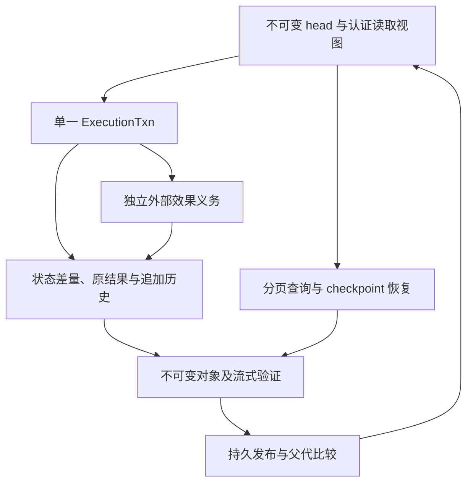

# 增量世界执行与有界历史工作集

- 生命周期：`active`；本文定义目标合同，不表示实现、性能验收或部署已完成。
- Owner role：`runtime_engineer`；共同审读：`producer_system_designer`、存储/P2P owner、`qa_engineer`。
- 审读基线：`nil-studio/oasis7@112a627e889cb0601ed368b2c0be204e39e7554a`；缺陷来源：[Issue #5197](https://github.com/nil-studio/oasis7/issues/5197)，关联磁盘重复表示问题 [#5196](https://github.com/nil-studio/oasis7/issues/5196)。生产采样与分配归因留在原 Issue，不由本文外推节省比例。
- 产品入口：[新格式适用范围](../../product/world-infrastructure/lossless-world-history-storage.prd.md#lws-incremental-world-scope)、[运行态增量执行合同](runtime-storage-footprint-governance.prd.md#storage-incremental-world-contract)。
- 关联设计：[运行态存储治理](runtime-storage-footprint-governance.design.md)、[正式世界无损存储](formal-world-storage-efficiency.design.md)、[Runtime 恢复](../design.md#runtime-recovery-design)。

## 1. 问题、目标与非目标

原执行路径让完整 Tick 历史成为可变 `World` 的拥有字段，恢复时展开归档，事务、快照和保存又复制或序列化该集合。落盘热窗口不能约束实际堆工作集。单独减少一个 `clone()`、压缩磁盘对象或增加 allocator 调整，不能消除每个提交随累计历史增长的工作量。

本设计直接定义新的增量执行格式：当前状态、控制状态和完整历史分别拥有可验证的根；一次提交只准备实际变更、必要索引路径和本次原结果；历史查询先定位再读取；事务、恢复、checkpoint、导入导出共用有界对象接口。普通提交不得无条件遍历、复制、重新编码或重新哈希全部历史。业务所需的旧请求去重、前驱与历史规则点查仍允许，但必须按索引和预算读取。

成功条件包括完整历史、同一新格式世界的恢复续跑、原请求/结果身份、unknown 外部效果义务和崩溃原子性。内存目标是工作集随当前活跃业务状态、事务变更和显式预算增长，而不是随累计归档条数增长。真实业务状态与完整历史的唯一新增内容仍有存储成本。

本路径不承接旧数据迁移、旧 Snapshot bytes/hash 等价、旧格式双写或旧二进制回退。它不通过建立新创世修复既有世界；已有世界的目录与材料保持原状。它也不改变 BFT 算法、既有正式协议的签名格式或服务权威，不从本地可读数据推导正式资格。新格式的启用边界见 [§6.1](#iex-format-boundary)。

## 2. 上游约束与相关角色

Runtime 拥有执行状态与事务；存储 owner 拥有不可变对象、索引、预算与 GC；原 authority/chain adapter 拥有提交资格、顺序、finality 和服务闸门；QA 分别验证确定性、完整恢复、失败语义和资源成本。产品适用，不使用产品 N/A。

### 2.1 需求承接与分配表

| 上游 requirement / product AC / professional acceptance（path#fragment） | 具体 obligation 与适用条件 | 本设计条款（path#anchor） | 外部 owner / dependency | 明确排除或未覆盖范围 |
| --- | --- | --- | --- | --- |
| Trace refs: O7-REQ-c33f4bee-41db-4558-9c49-80c4e0c016a1；[REQ-LWS-001](../../product/world-infrastructure/lossless-world-history-storage.prd.md#req-lws-001) | 新格式世界从合法初始锚保留全部原Tick、请求处置及可认证的历史定位 | [历史](incremental-world-execution.design.md#iex-history) | Runtime、存储及原 authority 的完整历史根 | 不导入或迁移既有旧格式世界，不以新世界替代旧世界 |
| Trace refs: O7-REQ-c33f4bee-41db-4558-9c49-80c4e0c016a1；[REQ-LWS-001](../../product/world-infrastructure/lossless-world-history-storage.prd.md#req-lws-001) | typed保留根覆盖原内容、工件/版本及全部恢复依赖并支持有界闭包遍历 | [存储](incremental-world-execution.design.md#iex-storage) | Runtime、存储及原 authority 的完整历史根 | 不导入或迁移既有旧格式世界，不以新世界替代旧世界 |
| Trace refs: O7-REQ-c33f4bee-41db-4558-9c49-80c4e0c016a1；[REQ-LWS-001](../../product/world-infrastructure/lossless-world-history-storage.prd.md#req-lws-001) | 在同一新格式世界恢复目标历史及当前已确认边界并保持完整原结果 | [恢复](incremental-world-execution.design.md#iex-recovery) | Runtime、存储及原 authority 的完整历史根 | 不导入或迁移既有旧格式世界，不以新世界替代旧世界 |
| Trace refs: O7-REQ-0ca67e20-ffdf-4741-aa8f-b7d827a8f11c；[REQ-LWS-002](../../product/world-infrastructure/lossless-world-history-storage.prd.md#req-lws-002) | 新格式明确自身codec/root身份并保护发布后的逻辑对象、请求与证明身份 | [格式](incremental-world-execution.design.md#iex-format-boundary) | 新格式 codec 与原授权/签名消费者 | 不承诺新旧格式 bytes、execution root 或编码兼容 |
| Trace refs: O7-REQ-0ca67e20-ffdf-4741-aa8f-b7d827a8f11c；[REQ-LWS-002](../../product/world-infrastructure/lossless-world-history-storage.prd.md#req-lws-002) | 新格式发布对象的物理共享/压缩保持精确原bytes/hash与引用 | [存储](incremental-world-execution.design.md#iex-storage) | 新格式 codec 与原授权/签名消费者 | 不承诺新旧格式 bytes、execution root 或编码兼容 |
| Trace refs: O7-REQ-46fb6d36-e9c9-41d5-98df-200b93d68670；[REQ-LWS-003](../../product/world-infrastructure/lossless-world-history-storage.prd.md#req-lws-003) | 历史下冷仍支持合法去重与前驱判断并以固定视图先seek后读 | [历史](incremental-world-execution.design.md#iex-history) | 所有历史消费者、profile 和授权读取 | 不承诺一次请求展开无限历史，也不取消业务必需冷点查 |
| Trace refs: O7-REQ-46fb6d36-e9c9-41d5-98df-200b93d68670；[REQ-LWS-003](../../product/world-infrastructure/lossless-world-history-storage.prd.md#req-lws-003) | 热窗按条数与字节治理工作集且资源不足不缩短历史保留 | [预算](incremental-world-execution.design.md#iex-budgets) | 所有历史消费者、profile 和授权读取 | 不承诺一次请求展开无限历史，也不取消业务必需冷点查 |
| Trace refs: O7-REQ-46fb6d36-e9c9-41d5-98df-200b93d68670；[REQ-LWS-003](../../product/world-infrastructure/lossless-world-history-storage.prd.md#req-lws-003) | append-only原历史与共享checkpoint保留完整内容及目标恢复路径，改变热密度不缩短承诺 | [存储](incremental-world-execution.design.md#iex-storage) | 存储、checkpoint producer和typed闭包验证 | 不要求逐高度展开完整snapshot，也不以checkpoint数量删除唯一历史 |
| Trace refs: O7-REQ-90d4c44a-8042-4f63-94fb-3389d8474e2c；[REQ-LWS-004](../../product/world-infrastructure/lossless-world-history-storage.prd.md#req-lws-004) | 提交三态与独立外部义务共同决定候选材料能否释放 | [事务](incremental-world-execution.design.md#iex-transactions) | typed walker、pin registry、原 effect 义务 | TTL、缓存淘汰或 txn abort 不是历史删除授权 |
| Trace refs: O7-REQ-90d4c44a-8042-4f63-94fb-3389d8474e2c；[REQ-LWS-004](../../product/world-infrastructure/lossless-world-history-storage.prd.md#req-lws-004) | 仅回收完整根、reader、unknown及rollback均不再需要的表示 | [存储](incremental-world-execution.design.md#iex-storage) | typed walker、pin registry、原 effect 义务 | TTL、缓存淘汰或 txn abort 不是历史删除授权 |
| Trace refs: O7-REQ-1d257860-b834-4e59-a785-5696ee5aa0f5；[REQ-LWS-005](../../product/world-infrastructure/lossless-world-history-storage.prd.md#req-lws-005) | 新格式启用沿用合法authority/profile且不能借持久格式绕过fence | [格式](incremental-world-execution.design.md#iex-format-boundary) | chain/P2P authority、ops 的真实故障域 | 本地提交不获得 BFT 资格；不变更既有正式网络协议 |
| Trace refs: O7-REQ-1d257860-b834-4e59-a785-5696ee5aa0f5；[REQ-LWS-005](../../product/world-infrastructure/lossless-world-history-storage.prd.md#req-lws-005) | 恢复仍满足原authority和适用独立持久/serving条件 | [恢复](incremental-world-execution.design.md#iex-recovery) | chain/P2P authority、ops 的真实故障域 | 本地提交不获得 BFT 资格；不变更既有正式网络协议 |
| Trace refs: O7-REQ-87c0cd77-0b20-4eba-90ff-5a492e85b3a0；[REQ-LWS-006](../../product/world-infrastructure/lossless-world-history-storage.prd.md#req-lws-006) | 不支持格式在任何bootstrap或回写前明确拒绝且保持原材料 | [格式](incremental-world-execution.design.md#iex-format-boundary) | 格式探测、runtime compatibility、操作 owner | 本路径不承接旧格式迁移/兼容；既有旧格式维护仍由原合同拥有 |
| Trace refs: O7-REQ-87c0cd77-0b20-4eba-90ff-5a492e85b3a0；[REQ-LWS-006](../../product/world-infrastructure/lossless-world-history-storage.prd.md#req-lws-006) | 同新格式结果不明时保护父/候选并恢复精确原操作 | [恢复](incremental-world-execution.design.md#iex-recovery) | 格式探测、runtime compatibility、操作 owner | 本路径不承接旧格式迁移/兼容；既有旧格式维护仍由原合同拥有 |
| Trace refs: O7-REQ-e835ca47-69bb-4bef-8791-83d2ae78f709；[REQ-LWS-007](../../product/world-infrastructure/lossless-world-history-storage.prd.md#req-lws-007) | 细粒度delta及独立intent覆盖全部影响确定性和后继执行的变化 | [事务](incremental-world-execution.design.md#iex-transactions) | reducer、调度、effect adapter 与独立 J1/J2 对照 | 普通事件日志、目标全快照往返或仅 root 相同不代替续跑 |
| Trace refs: O7-REQ-e835ca47-69bb-4bef-8791-83d2ae78f709；[REQ-LWS-007](../../product/world-infrastructure/lossless-world-history-storage.prd.md#req-lws-007) | checkpoint完整控制基线加连续delta提供每个目标的真实恢复路径 | [存储](incremental-world-execution.design.md#iex-storage) | reducer、调度、effect adapter 与独立 J1/J2 对照 | 普通事件日志、目标全快照往返或仅 root 相同不代替续跑 |
| Trace refs: O7-REQ-e835ca47-69bb-4bef-8791-83d2ae78f709；[REQ-LWS-007](../../product/world-infrastructure/lossless-world-history-storage.prd.md#req-lws-007) | checkpoint加非空后缀恢复J1/J2及原结果后能继续同一新工作 | [恢复](incremental-world-execution.design.md#iex-recovery) | reducer、调度、effect adapter 与独立 J1/J2 对照 | 普通事件日志、目标全快照往返或仅 root 相同不代替续跑 |
| Trace refs: O7-REQ-2d77214a-6c57-4794-bfeb-bb460187085c；[REQ-LWS-008](../../product/world-infrastructure/lossless-world-history-storage.prd.md#req-lws-008) | 并发消费者共享全局字节/CPU-IO额度且lease后续占用继续计费 | [预算](incremental-world-execution.design.md#iex-budgets) | Runtime/CAS/查询/导入导出/维护及 ops 额度 | 配置条数不能代签堆上限；不能通过清历史或重调模型减压 |
| Trace refs: O7-REQ-2d77214a-6c57-4794-bfeb-bb460187085c；[REQ-LWS-008](../../product/world-infrastructure/lossless-world-history-storage.prd.md#req-lws-008) | 资源不足或取消恢复时保留原请求、根和Unknown义务并可续传 | [恢复](incremental-world-execution.design.md#iex-recovery) | Runtime/CAS/查询/导入导出/维护及 ops 额度 | 配置条数不能代签堆上限；不能通过清历史或重调模型减压 |
| Trace refs: O7-REQ-cb320711-af0a-44f3-98d4-bc7e8c1d0916；[REQ-LWS-009](../../product/world-infrastructure/lossless-world-history-storage.prd.md#req-lws-009) | 固定S增长H及固定Δ增长S分开测量分配/RSS/CPU-IO和完整性 | [验证](incremental-world-execution.design.md#iex-validation) | QA、可复现 fixture、同候选与同环境 | 静态复杂度与目标预算不是已测节省比例，旧生产世界不因此视为已修复 |

### 2.2 与既有合同的关系

[运行态增量合同](runtime-storage-footprint-governance.prd.md#storage-incremental-world-contract)及其[验收](runtime-storage-footprint-governance.prd.md#storage-incremental-world-acceptance)规定本路径的产品/工程接受边界。本文直接实施增量对象模型，不以前述正式存储设计的旧字节兼容阶段或未来 Snapshot delta gate 作为步骤。新格式内部仍继承完整历史、原效果、权限、独立持久和预算义务。旧格式及已运行正式协议继续适用各自设计；不能把本路径的验证结果回填为它们的修复或迁移证据。

## 3. 当前状态、目标状态与差距

本节“当前”是固定源码审读，“目标”是本设计要求。源码存在、文档 active 与真实部署能力分别判断。

| 对象/能力 | 当前状态（基线） | 目标状态 | 差距/假设 | 证据或 owner |
| --- | --- | --- | --- | --- |
| 历史所有权 | 冷 Tick 被 hydrate 到 `Vec<TickConsensusRecord>`；拆分保存继续复制 | World 仅持有认证根、有限热尾部和 reader | 必须更换执行与所有历史消费者接口 | [归档实现](https://github.com/nil-studio/oasis7/blob/112a627e889cb0601ed368b2c0be204e39e7554a/crates/oasis7_runtime/src/world/persistence_tick_consensus.rs) |
| 提交原子性 | driver rollback clone 与 runtime staged clone 叠加 | 一个跨 runtime/driver 的 `ExecutionTxn` | 覆盖 bootstrap、service、simulator 及 effects 边界 | [driver hook](https://github.com/nil-studio/oasis7/blob/112a627e889cb0601ed368b2c0be204e39e7554a/crates/oasis7_chain_runtime/src/host/execution_bridge/driver_hook.rs)、[step](https://github.com/nil-studio/oasis7/blob/112a627e889cb0601ed368b2c0be204e39e7554a/crates/oasis7_runtime/src/world/step.rs) |
| 防陈旧检查 | prepared head 对多组完整字段及 Tick 集合重新 `hash_json` | 精确 base generation、根和 authority token 检查 | 必须封闭旁路可变访问，不能仅比较 time | [prepared base](https://github.com/nil-studio/oasis7/blob/112a627e889cb0601ed368b2c0be204e39e7554a/crates/oasis7_runtime/src/world/prepared_base_head.rs) |
| 提交根与 checkpoint | 完整 Snapshot CBOR 的 hash，模块 bytes/历史在其中；CAS owned 读取 | 新 domain 下的分根 head、分块状态与完整 delta | 新格式 root 与旧值不作等价要求 | [driver hook](https://github.com/nil-studio/oasis7/blob/112a627e889cb0601ed368b2c0be204e39e7554a/crates/oasis7_chain_runtime/src/host/execution_bridge/driver_hook.rs)、[CAS](https://github.com/nil-studio/oasis7/blob/112a627e889cb0601ed368b2c0be204e39e7554a/crates/oasis7_cas/src/store.rs) |
| 可复用基础 | typed projection、正式认证历史 reader、流式物理 codec 已有局部能力 | 在新路径复用相容接口与验证，消除整对象调用方 | reader/codec 的存在不证明消费者有界 | [formal history](https://github.com/nil-studio/oasis7/blob/112a627e889cb0601ed368b2c0be204e39e7554a/crates/oasis7_runtime/src/world/formal_retention.rs)、[流式 codec](https://github.com/nil-studio/oasis7/blob/112a627e889cb0601ed368b2c0be204e39e7554a/crates/oasis7_cas/src/local_blob_codec.rs) |

## 4. 边界与结构

| 组件 | 拥有的事实与职责 | 读写边界 |
| --- | --- | --- |
| `CommittedHead` / `WorldView` | 不可变世界身份、generation、六类根与 authority 绑定 | 可共享引用；不拥有完整冷历史，不提供绕过事务的 mutable 集合 |
| `ExecutionTxn` | 固定父 head 上的 reads、细粒度 writes、原请求关联和本次 append | 唯一写入者；嵌套 runtime 操作共用本 txn，不再 clone World |
| `HistoryReader` | 固定逻辑根与物理 generation 的认证查询 | 热命中或索引冷读；缺失、预算耗尽和不存在是不同结果 |
| `ObjectStore` / index | typed CAS、确定性树节点、段和 chunk | 不可变写入、流式读回验证；物理布局不能改变逻辑身份 |
| `CommitPublisher` | exact parent 比较、持久发布与提交三态 | 在原 writer fence 内发布 head；不授予额外网络权威 |
| `EffectObligationStore` | 外部 intent、原结果、unknown 及与 txn/head 的关联 | 可早于或晚于 world commit 持久化；其义务不随 txn abort 消失 |
| Checkpoint/transfer/GC | 固定根的有界遍历、恢复加速、pin 与可回收表示 | 不提交业务；未知或未验证材料阻止相应 sweep |



图中箭头表示材料依赖或交接，不表示每次读者都取得写权。publisher 返回 `Unknown` 时原 head 与候选均受保护，禁止继续提交下一高度；具体状态见 [§7](#iex-transactions)。

## 5. 关键运行流程

### 5.1 普通提交

1. 原 authority 校验世界、执行格式、连续 chain height、父 head 与请求身份；先查原请求处置，已提交返回原结果，unknown 进入核对，不创建新身份。
2. 固定 `base_generation + base_head_hash + authority_token`，取得提交资源额度，创建一个 txn。bootstrap、service intent、runtime step 和受同一提交约束的 simulator 状态都写同一 overlay。
3. reducer 通过 txn 点查 state/control/history，按键记录变更和旧值/前根约束；allocator、模块调度、原外部结果及派发义务按 §6.4 和 §7.2 保存。
4. 完成候选校验、编码、预算检查及根计算；只写新 chunk、变更路径和本次原内容，不构造完整 World/Snapshot 后再 diff。
5. 在固定 writer fence 内再次比较精确父代，持久化本次依赖和候选，执行 §7.1 发布。成功后以不可失败的根/视图切换安装内存 head。
6. checkpoint、归档封段和 GC 使用已发布根异步处理；失败作为维护状态报告，不把已提交业务改判成失败。回执丢失重试查询原 commit identity。

### 5.2 窄范围读取与长查询

读者先取得授权、head/generation pin 和预算，再由索引 seek 到首个匹配项。每页携带已验证范围和绑定原根的 continuation；后续提交或物理封段不能改变该视图。取消释放本次内存/读 pin，保留已经交给调用方的原请求身份与可验证进度。全历史审计、导出和闭包盘点允许总工作量随历史增长，但分批执行，不进入普通提交关键路径。

### 5.3 冲突、重试与取消

prepared candidate 的父代不匹配时拒绝安装，调用方重新读取同一原请求的处置后决定是否重试。不得把本地 stale guard 失败当成外部效果从未发生。发布前取消可 discard 尚未发布的纯内存差量；存在 durable intent 时保留原 obligation；发布开始后取消只能中断等待并核对同一提交，不能报告 `Aborted`。资源和错误合同见 [§8](#iex-budgets)。

## 6. 接口与数据合同

以下类型名是目标设计，落地时由新格式 codec 定义确切 wire schema。实现必须覆盖生产者、读取者、兼容探测、checkpoint、查询与测试入口，不能只修改 writer。

<a id="iex-format-boundary"></a>
### 6.1 新格式身份与启用边界

Trace refs: O7-REQ-0ca67e20-ffdf-4741-aa8f-b7d827a8f11c；O7-REQ-1d257860-b834-4e59-a785-5696ee5aa0f5；O7-REQ-87c0cd77-0b20-4eba-90ff-5a492e85b3a0；承接 [REQ-LWS-002](../../product/world-infrastructure/lossless-world-history-storage.prd.md#req-lws-002)、[REQ-LWS-005](../../product/world-infrastructure/lossless-world-history-storage.prd.md#req-lws-005)、[REQ-LWS-006](../../product/world-infrastructure/lossless-world-history-storage.prd.md#req-lws-006)，适用范围见 [新格式产品边界](../../product/world-infrastructure/lossless-world-history-storage.prd.md#lws-incremental-world-scope)。

审读基线的 `world-format.json` 使用 selector API `oasis7.runtime.world-persistence-selector/v1`，无标记旧格式为 0，JSON/sidecar 当前格式为 1；新设计使用未占用的 format 2，不重解释 0/1。目标 selector 为：

```json
{
  "api_version": "oasis7.runtime.world-persistence-selector/v2",
  "format_version": 2,
  "execution_format": "oasis7.runtime.incremental-execution/v1",
  "codec": "oasis7.runtime.incremental-cbor/v1",
  "hash_algorithm": "blake3-256",
  "schema_revision": 1
}
```

新 selector/schema family 与既有 `snapshot-delta.v1`、正式 record/Frozen/BFT 版本独立，禁止只增加既有 record version 就改变其解释。新对象 domain 统一以 `oasis7.runtime.incremental-execution/v1/` 开头；具体角色按 §6.2 分离。首版逻辑 digest 使用 BLAKE3-256；head、manifest、commit/proof 的签名/验证输入显式绑定 format family、schema、hash algorithm 和 world/chain/genesis，不能把新 root 传给旧 `StateRootProjection` verifier。writer、replica、restore、query 与 compatibility probe 均核对支持能力，不能只证明一个整数在 read_versions 内。

新世界只能在显式 create/activation 请求下、空且受控的目标根中建立。初始 manifest 绑定 `world_id`、`chain_id`、`genesis_ref`、执行格式、初始 roots、模块/规则/原生执行环境及原 authority profile；激活沿用所属 authority 的合法创世/服务流程。既有 BFT durable mode fence 仍有效，不能通过选择新持久格式绕过。

open/import 先以有界 header 识别格式，再选择 decoder。0/1、缺 selector 且存在任意世界/record/identity 材料、未知 family/版本返回 `UnsupportedFormat`；格式已识别但损坏返回 `InvalidFormat`/`IntegrityError`。这些结果都发生在 bootstrap、清理、恢复回写前。不得自动删目录、替换 identity、降级猜格式、恢复空世界或生成新 genesis；正常 open 对完全空目录返回 `Uninitialized`，也不自动 create。

本首版面向显式新格式创建的世界和它们的同格式 checkpoint/导入恢复。它不将已运行旧协议网络改成新协议；若后续需进入既有正式网络，必须由该网络的版本/激活合同明确接纳新执行根与 verifier。本文不宣称该接入已完成，也不要求为本路径先改写既有 BFT 共识。

### 6.2 分根状态与确定性编码

`CommittedHeadV1` 保存 identity、chain height、simulation tick、Tick record sequence、parent head、authority context、六类 roots、delta ref、request/result refs 和 schema。根包含各自 domain、版本、计数与范围；空树使用该 domain 下唯一空值编码的 digest，不能用空字符串、零值或其他树的空根替代。

| 根 | 完整内容 | 增量与读取单位 |
| --- | --- | --- |
| `state_root` | 当前业务实体、余额/资源、模块状态、cognition 业务数据、有效世界规则 | 稳定 entity/field key；大 value 分块，不把整个 WorldState 或 cognition JSON 当单叶 |
| `control_root` | allocator/era、队列、调度、权限/nonce/预算、治理与回滚控制、请求关联及仍有效的终态索引 | 独立控制对象/有序队列元素；更新精确键和必要树路径 |
| `history_root` | 已确认 `CommitFacts`、Tick、原请求处置与历史版本的有序定位、修订及完整 payload 引用；不包含本高度的最终 head/envelope | 分页认证索引和不可变段；每次只追加本次事实或显式修订 |
| `journal_root` | 按 `(event_era,event_id)` 和提交内 ordinal 排序的原事件及因果关系 | 追加有界事件块与索引路径；总计数、首尾与连续性进入承诺 |
| `artifact_root` | 原 WASM/native bytes、模块 binding、manifest、policy/schema/ABI 与必要执行环境依赖 | 内容寻址原工件及 chunk descriptor；未变化工件不复制 |
| `effect_root` | 已纳入世界的 intent、原 response/receipt、幂等与 unknown/consumed 状态及因果链接 | 原 effect identity 对应记录；未纳入 head 的独立义务另由 §7.2 保护 |

新 typed codec 固定字段顺序和版本，整数采用最短合法 CBOR 编码，禁止 indefinite-length 容器、重复 key、未知必填字段和非规范整数。根metadata只使用整数/bytes/文本；业务schema确需浮点时使用有限IEEE-754 binary64的固定64位编码，保留有符号零，拒绝NaN/Infinity及替代宽度编码。opaque 原 bytes 使用 byte string；文本采用原 UTF-8，不在读取时归一化。可变映射按 schema 的 canonical key 字节顺序编码，不能使用 `HashMap` 遍历顺序。实现冻结 golden vectors 和 codec revision；解码后重编码不相等的对象拒绝作为该版 canonical 对象。

状态/控制及历史定位采用确定性 radix 索引：canonical key 是带类型和长度边界的稳定二进制键；数值范围分量使用固定宽度大端序。节点按 nibble 有序分支，路径压缩规则、空分支、叶子边界和 key 最大长度固定在 schema，树形由键集合唯一决定，不由插入顺序、宿主分页、压缩或缓存淘汰决定。首版 key 最大 512 bytes，索引页 canonical bytes 最大 64 KiB；超大 value 转独立 chunk refs。相同最终键值集合必须产生相同 root，所有新增/删除的路径节点须经 verifier 重算。

这些索引是新 family 的类型，不更改既有 formal business-index v1/v2 的 node_writes 合同。可复用实现中的相容 hash、reader 和物理 codec，但必须按新类型独立验证。物理压缩/pack 只改变 locator；逻辑 digest 哈希 domain 与原 canonical bytes，不能哈希物理文件名或压缩输出。

### 6.3 无环根计算顺序与 Tick 边界

本次 `commit_identity` 由 world/chain 身份、parent head、chain height 与原 ordered-input/request 标识确定，独立于本次输出；同 identity 的不同候选内容必须报冲突。当前提交的控制、请求处置和 effect 消费关联使用该 identity，最终 head 由外部已提交 head/height 索引解析。凡进入下列较早阶段的 typed 对象，均不得引用尚待计算的本次 root、delta 或 head；不能通过另一个对象间接形成自指。

1. 事务执行后先确定 `state_root`、`control_root`、`journal_root`、`artifact_root`、`effect_root`。这些树内的本次记录不引用本次 execution-result root、history root、delta ref 或最终 head；Journal 包含业务事件，不包含自指提交事件。
2. 计算 `execution_result_root = H(result-domain, identity, height, tick, 五类根, committed_input_ref)`。该 root 不含本次 Tick、`history_root`、delta ref 或最终 head。
3. 当前高度的 `CommitFacts` 记录 commit identity、原输入/结果和上下文，不含本次 delta ref、history root 或最终 head。如本提交产生 Tick，Tick record 引用 `execution_result_root`、原输入/事件范围、前一 Tick hash 与独立 Tick sequence；验证后与 CommitFacts 一起封存，再更新 `history_root`。行政提交可以推进 chain height 而不产生 Tick；禁止用 `Vec.len()`、simulation tick 或 archive count 猜 chain height。业务时间的推进由输入/运行规则决定，schema 显式记录推进前后值。
4. `ExecutionDeltaV1` 绑定 parent head、前后 roots、chain height、tick/sequence 边界、所有 typed 更新与本次原内容引用；其 bytes/hash 不含最终 head hash。计算 delta ref 后，再计算包含六类 roots、delta ref 与 parent 的最终 `head_hash`。
5. 最终 `CommitEnvelope` 由 publisher/authority 在外部 head/height 定位索引发布，绑定本次 head 与适用证明，不反写进自身 history 树；后继提交可引用前一完整 head。checkpoint manifest 在 head 发布后绑定该精确 head/roots，checkpoint 索引是恢复加速索引。初始 activation envelope 同样在初始 roots 之外绑定它们；artifact 树中的 genesis 配置与该 envelope 分离。任何这些外层对象都不得回写较早阶段已哈希的内容。

`execution_result_root` 与 `head_hash` 名称/角色必须在接口中区分；对外 execution commitment 使用新 family 明确约定的 head，不能沿用旧 Snapshot hash 的名称含义而隐式切换。请求序、事件序、Tick sequence、chain height 和物理 generation 分别校验，不要求它们数值相等。

### 6.4 完整 delta 与细粒度可变访问

每个已持久化字段必须有且只有一个主责 root 和明确的增量编码。实现应以当前持久类型的穷尽字段清单/编译期枚举及 round-trip 对照发现遗漏；不能用 serde 默认值补出未记录的恢复状态。除了原有明确的进程缓存/遥测，所有影响确定性决策、持久输出或下一次执行的字段都属于覆盖范围。

| 类别 | 必须覆盖的写入与恢复内容 |
| --- | --- |
| 业务与 cognition | entity 创建/修改/删除、余额/资源/资产、module state、cognition 及工业/物流/治理业务结果；按稳定对象/子路径拆分大集合 |
| J1 allocator | action/event/intent/proposal 的 next 值、era、分配/预分配 provenance、消费顺序与 rollover；不能从最大 ID 推断 |
| J2 调度 | 稳定 module instance 的绝对 wake tick 或明确 clear、`module_tick_schedule`、`scheduler_cursor`；Pure 调用及无 state 改变的调度同样记录 |
| 队列与效果 | pending action/effect 的入队、消费、取消，inflight、retry、原 intent/request/result、receipt links 和 unknown disposition |
| 权限与去重 | grants/revocation、capability nonce、authorization receipt/context/root、budget accounts、effect receipt links、原请求终态及冷前驱索引 |
| 世界配置与版本 | manifest、module registry/binding、artifact/native environment refs、policy、release security、chain resource context、治理 finality/identity/emergency 状态 |
| 回滚与治理幂等 | rollback authority、consumed nonce、nonce outcomes、既有补偿/处置关联；业务回滚不删除已发生外部效果 |
| 历史与边界 | 原输入/结果、Tick/Journal append、显式历史修订、所有计数与范围、确定性 runtime 指标/背压字段；进程耗时等非确定性遥测不进入共识根 |

每条 mutation 包含 typed key、operation、expected prior value hash 或不存在证明、new value/chunk refs；删除使用显式 tombstone。txn 内多次写同一 key 合并为确定的最终状态 mutation，全部业务事件及必要调用/处置仍保留原序。不能用最终 map diff 代替过程事实，也不能先生成完整 owned WorldState 再计算 diff。

所有 reducer、授权、调度、模块输出和 snapshot 消费者改用 `TxnView` 的读取/写集接口。大对象提供按 chunk/稳定字段更新接口；若一个操作确实改写整个大 value，成本按该实际变更量计费。`Arc<World>` 或 `Arc<Vec<History>>` 的首次写时全复制不符合此合同。必须分别验证历史规模 H 增长和当前状态 S 增长下固定小变更的成本。

<a id="iex-history"></a>
### 6.5 历史 reader、不可变段与分页索引

Trace refs: O7-REQ-c33f4bee-41db-4558-9c49-80c4e0c016a1；O7-REQ-46fb6d36-e9c9-41d5-98df-200b93d68670；承接 [REQ-LWS-001](../../product/world-infrastructure/lossless-world-history-storage.prd.md#req-lws-001)、[REQ-LWS-003](../../product/world-infrastructure/lossless-world-history-storage.prd.md#req-lws-003)。

`HistoryView` 只保存 `world identity + head/history_root + generation pin + counts/boundaries`；索引根不嵌入全部 segment descriptor。目录、内部节点和叶分页存储，range 先 seek 后读取重叠段。热尾部同时受条数与实际解码/计费字节约束；达到任一上限便持久封段并移出热拥有集合。封段失败时保留已承诺材料并背压新写，不扩大热窗直到 OOM。

段只包含已确认原记录，绑定 namespace、schema、首尾 key、count、前段/边界证明、payload length/hash。单段最多由 64 KiB 页和独立大 payload chunk 组成，不能为一个大记录突破整段缓冲预算。Append 只更新尾部页与必要索引路径，不重写已有全部段，也不将全目录复制进新 manifest。

按 chain height、Tick sequence、simulation tick、原 request/effect identity、事件身份建立各自 typed 索引；多索引在同一 txn 中发布，同一 record 的 count 和定位必须一致。查询较早 request/nonce/控制链必须走同一认证 reader；下冷不改变“已存在、已消费或不可重试”的判定。损坏、缺依赖、超预算分别返回错误，不返回 `None` 冒充不存在。

准备阶段的 candidate、传播证书和权威裁定仍遵守原业务合法性。已提交历史不就地修改；合法修订/补充证明作为新记录引用原 record hash，并更新新 generation 的有效视图。查询可明确选择原始提交事实或在指定 head 的有效版本。不能为实现不可变段而取消合法裁定，也不能以 replace 覆盖旧已承诺内容。

分页 token 绑定 world、查询范围/方向、exact history root、索引 schema、最后完整验证 key 与权限 scope；服务器验证 token 完整性。续传在同一逻辑视图进行，物理迁移须继续提供受 pin 的旧代或验证等价新 locator。跨页释放内存不释放恢复义务；过期 token 可重新申请同根读取，不自动切到 latest。每页的 record、proof/index 和输出 bytes 均计费。

### 6.6 跨组件接口

| 接口 | producer → consumer | identity/version | ordering/idempotency | success/error | 大小与兼容边界 |
| --- | --- | --- | --- | --- | --- |
| `Open/Create` | host → format/authority adapter | selector、world/genesis、family | open 不 create；原 activation 身份 | `Uninitialized`、`UnsupportedFormat`、验证成功或明确损坏 | 有界 header；仅支持新族 |
| `Begin/PrepareTxn` | driver → Runtime | parent generation/head、request、authority token | 单 writer；嵌套操作共享 txn | prepared candidate、stale、预算/语义错误 | 写集、树路径及效果额度预留 |
| `Publish/ResolveCommit` | Runtime → publisher | exact parent/candidate/commit ID | 同 ID 同内容；冲突拒绝 | `Aborted` / `Committed` / `Unknown` | 不以网络超时决定未提交 |
| `ReadHistoryPage/Lookup` | query/reducer → reader | root、namespace、key/cursor、scope | 固定视图；同 cursor 重试 | page/不存在证明/具体错误 | 索引页、记录和输出共享字节预算 |
| `Put/GetVerifiedStream` | Runtime/恢复 → CAS | typed schema、logical hash/length | 不可变写；完成校验后发布 | verified object 或长度/hash/预算错误 | 分块、压缩/解压均有累计上限 |
| `Register/ResolveEffect` | txn/dispatcher → obligation store | 原 request/attempt/idempotency key | 原身份核对；禁止未知时新 ID 重发 | durable intent/result/unknown | 不随 world abort 删除义务 |
| `Checkpoint/Restore` | maintenance/host → roots/delta reader | exact head、C/T、checkpoint schema | 固定切面；校验连续后缀 | 验证进度、完整恢复或 blocked | chunk 分页；不返回完整历史 Vec |
| `Pin/Retire/GC` | reader/维护 → root registry | typed root、generation、operation | 与发布/retire fence 线性化 | pin、可回收、blocked/unknown | 持久根分批 mark；索引/seen set 也有预算 |

## 7. 状态、事务与持久化

<a id="iex-transactions"></a>
### 7.1 单事务与持久发布状态机

Trace refs: O7-REQ-90d4c44a-8042-4f63-94fb-3389d8474e2c；O7-REQ-e835ca47-69bb-4bef-8791-83d2ae78f709；承接 [REQ-LWS-004](../../product/world-infrastructure/lossless-world-history-storage.prd.md#req-lws-004)、[REQ-LWS-007](../../product/world-infrastructure/lossless-world-history-storage.prd.md#req-lws-007)。

`ExecutionTxn` 的内存状态为 `Open → Prepared → Publishing → Resolved`；对调用方的提交结果只使用下表三态。业务拒绝是一个可被成功提交的原结果，与存储提交失败区分。

| 结果 | 证明条件 | 内存/重试/材料处理 |
| --- | --- | --- |
| `Aborted` | 能证明发布点未成立，且该 exact candidate 没有 authority 的已提交结果 | 丢弃纯世界差量；保留独立 effect obligation；原请求查询后才可合法重试 |
| `Committed` | exact candidate 的依赖已达到适用持久条件，提交记录已耐久发布并读回匹配 | 安装新 head；返回原 receipt；缓存/GC 失败不反转结果 |
| `Unknown` | rename/目录同步/回执或authority核对中断，无法证明前两态 | fence 当前 writer，不提交下一高度；保护父/候选/intent，核对同一 commit ID |

本地发布顺序固定为：持久化新 typed objects/chunks → 验证本次闭包及继承父根 → 持久化 candidate manifest → 在 writer fence 内比较 exact parent → 原子发布带校验和的 head selector → 同步目录并读回。适用独立持久 profile 的必要回执必须在成功确认前成立，具体资格仍归原 authority。进程内指针 swap 不是 durable commit point。

head selector 只包含有限身份/引用，不内嵌对象目录。若发布前已有同 commit ID，必须内容完全相同；同 height 不同父/候选返回冲突。发布开始后错误不可统一映射为回滚：恢复依据 exact selector/commit/authority evidence 判定三态，已知提交不能因缓存坏或较旧状态健康而改选父代。

防陈旧 guard 比较 `world_id + generation + head_hash + authority token` 以及 txn 自身单调 revision；同 txn 的 prepared 子操作绑定该 revision。所有影响持久/确定性结果的变更必须经 txn，旁路修改视为实现缺陷。guard 不重新序列化 state/history，不只检查 tick，不依赖进程缓存是否命中。

### 7.2 外部 intent 与 unknown 的独立义务

优先采用“提交 outbox 后再派发”的外部动作。执行中必须取得外部结果的操作，在调用前先耐久记录原 input bytes、request/attempt/idempotency identity、父 head、authority、模块/规则版本、可恢复 continuation 与已分配的 IDs。该 intent 完成读回后才允许派发。原 response/receipt 一到达便按原身份持久化，再供 txn 消费；事务中途失败不能删除它。

同步外调与 outbox dispatcher 统一执行 write-ahead 派发协议：首次物理发送前，先在独立 ledger 持久化并读回同一原 effect identity 的 `DispatchedOrUnknown` 标记，绑定原 intent、attempt、authority 和单调 sequence；标记未成功持久化时不得发送。标记已落盘但尚未发送、发送成功但 receipt 未落盘，在恢复时均按可能已发送处理。缺少后置 dispatch/receipt 记录不能证明外部动作未发生；任何无法证明未派发的 intent 都转入同身份 unknown 核对，不能当成全新调用重发。

obligation 至少区分 `IntentDurable`、`DispatchedOrUnknown`、`ResultDurable`、`ConsumedByCommit`、明确的拒绝/取消处置。`ConsumedByCommit` 以 §6.3 的 commit identity 关联消费提交，其最终 head 通过已提交索引核对，避免 effect root 自指。它是独立受 pin 的恢复根，world `Aborted` 不蕴含 effect `未执行`。unknown 时查询外部系统对原幂等身份的结果；无法核对就保持 blocked/unknown，不换 nonce、重新调模型或把结果补为默认值。外部系统没有相应幂等/查询能力时不承诺物理恰好一次。

只有属于同一原 request/attempt/context 的结果才能被消费。恢复已完成前置阶段时使用 durable continuation，不能重做 action prologue、折旧、费用结算或已完成 validator 调用。成功 head 引用原 intent/result 与 disposition；未被消费的 obligation 仍保留在独立根中，GC 不根据 txn 目录年龄处理。

提交后的 dispatcher 先完成上述耐久派发标记，再将实际派发、响应丢失和 receipt 事实追加到独立幂等 operational ledger；这些事实作为绑定原 effect identity 的输入，由后继 `ExecutionTxn` 纳入新的 `effect_root`。ledger 记录有单调 sequence、原 head/intent 引用和完整原 bytes；它不就地修改已发布 root 指向的对象，也不自行取得世界提交权。查询须区分已提交的 effect 状态与尚待世界确认的投递事实，恢复先对账原 ledger 再决定下一转换。

### 7.3 进程内原子性与故障隔离

提交前保留父 head 的 immutable view；失败丢弃 overlay，不需要恢复完整 World 副本。发布前完成所有可失败校验和安装资源预留，发布后的内存安装只交换已准备引用。若进程在这之间崩溃，下次从 durable head 恢复；不能返回“失败且可随意重做”。共享模块编译缓存和统计可置于事务外，但不得携带可改变业务判断的未提交可变状态。

<a id="iex-storage"></a>
### 7.4 分块 CAS、checkpoint 与完整闭包

Trace refs: O7-REQ-c33f4bee-41db-4558-9c49-80c4e0c016a1；O7-REQ-0ca67e20-ffdf-4741-aa8f-b7d827a8f11c；O7-REQ-90d4c44a-8042-4f63-94fb-3389d8474e2c；O7-REQ-e835ca47-69bb-4bef-8791-83d2ae78f709；承接 [REQ-LWS-001](../../product/world-infrastructure/lossless-world-history-storage.prd.md#req-lws-001)、[REQ-LWS-002](../../product/world-infrastructure/lossless-world-history-storage.prd.md#req-lws-002)、[REQ-LWS-004](../../product/world-infrastructure/lossless-world-history-storage.prd.md#req-lws-004)、[REQ-LWS-007](../../product/world-infrastructure/lossless-world-history-storage.prd.md#req-lws-007)。

逻辑存储以 typed 对象/页/chunk 为单位。首版 value 的 canonical 编码长度不超过 4 KiB 时直接存叶，超过时使用 chunk-tree，选择不随运行预算变化。大值通过有序 chunk 树绑定总长、范围和各块 hash；descriptor 本身分页，不能用一个无界 chunk 列表替代无界 history Vec。可变大 state value 以 typed chunk-tree root 作为该版身份，微更新只重算变更 chunk 和路径，不要求每次重算整值 flat hash；外部原工件/响应的完整内容 hash 在首次导入时流式计算并保存，内容不变便复用。

首版 canonical chunking 从 value 的 canonical bytes 的 offset 0 开始，按固定 1 MiB 边界切分，只有最后一块可以不足 1 MiB；长度恰为整倍数时不添加空尾块。descriptor 以固定宽度大端 offset 为 key，按 §6.2 的确定性 radix 规则承诺每块长度/hash 与总长。单块 hash 及 descriptor 使用各自 typed domain，空值只使用明确的 canonical 空表示。相同 value 必须在不同 I/O 缓冲大小、并发和合法更新顺序下形成相同 chunk/tree root；物理 pack、压缩和定位不能改变逻辑分块。payload chunk 上限为 1 MiB、索引页上限为 64 KiB；缓冲可小于这些对象，预算不足时流式处理、使用受预算的临时文件或背压，不能重分逻辑 chunk 来规避格式规则。

`PutVerifiedStream` 在私有 staging 中边编码、边计算逻辑 digest、边压缩写入；完成长度/hash、文件同步和无覆盖发布后才返回可引用 ref。`GetVerifiedStream` 校验声明长度和解压累计字节，未验证对象不得作为 authoritative reducer 输入；可以先写受预算控制的临时文件/对象，校验完再逐页消费，不要求返回一个完整 Vec。range 返回的材料仅在其独立 chunk/proof 验证成立后可用，不能把未覆盖整对象的 hash 当验证完成。

checkpoint 保存固定 head 的六根、完整控制基线、必要 typed closure 与格式信息，复用不变 chunks，不重新打包全历史。checkpoint producer 按配置的最大后缀高度/累计 delta bytes 产生加速点；该配置限制恢复工作量而不限制历史保留。若无法及时写新 checkpoint，在后缀预算耗尽前背压新提交，保留既有完整恢复路径。每个历史目标 T 均可定位 `C ≤ T` 的 checkpoint 和连续 `(C,T]` delta；恢复契约见 §10。

所有保留根与引用边由 typed walker 枚举：genesis/authority/commit 链、六类树、delta base/target、原请求结果、模块/native 环境、字典/recipe/frame、独立 effect obligations、checkpoint/rollback、进行中导入导出及 reader pins。未知 schema、缺边、错 hash 或未闭合父链阻止相应回收。历史根可通过认证索引递归保护全部承诺历史，不在内存列出每个 height。

GC 分批 mark/sweep，持久化有界游标与工作页；visited 集、根清单、索引页也纳入预算。root 发布、pin 获取和 generation retire 使用同一 fence/epoch 线性化，reader 必须先 pin 后读。删除前核对新增根/引用/义务差集，不能仅检查本轮开始时的集合。读者仍持有的旧代、Unknown candidate 和未解决 effect 不能退休；可回收的是无根引用对象或已验证等价物理副本，不能删除唯一历史内容。

导入/导出固定 head 与 operation identity，逐页发送 typed manifest 和已验证对象，receiver 在隔离目标中校验原逻辑 hash、连续性及完整闭包。断点绑定 exact root/format 与已验证范围；失败重试不重计已完成对象，不换世界。完成验证后才可通过原 authority 安装；导出不收集所有 pinned ref 的完整 bytes 到 bundle Vec。跨故障域各自验证/持久化，不以同机 hardlink 或一个域的读取成功代签另一个域。

## 8. 部署、安全与运行约束

### 8.1 运行边界

新格式 reader/writer、查询、checkpoint、compatibility probe、备份/恢复和维护工具必须同时声明支持该 family。只读工具不得为了探测而写 selector 或补文件。存储根、锁文件、对象路径沿用受控目录与原权限；未知 symlink/越界路径、对象类型或授权 scope 均拒绝。已有正式节点、旧 writer 和旧数据不因升级二进制而自动转入新路径。

<a id="iex-budgets"></a>
### 8.2 全局字节预算、背压与取消

Trace refs: O7-REQ-46fb6d36-e9c9-41d5-98df-200b93d68670；O7-REQ-2d77214a-6c57-4794-bfeb-bb460187085c；承接 [REQ-LWS-003](../../product/world-infrastructure/lossless-world-history-storage.prd.md#req-lws-003)、[REQ-LWS-008](../../product/world-infrastructure/lossless-world-history-storage.prd.md#req-lws-008)。

一个进程级 `RuntimeResourceBudget` 统一发放可追踪 reservation；commit、读取、checkpoint、decode、导入导出、归档和 GC 的并发额度相加受全局上限约束。不得给各线程单独一个“最大 N MiB”后将总量留空。reservation 随数据所有权/Arc lease 转移，淘汰缓存后仍被读者持有的内存继续计费。

| 预算维度 | 计费内容与执行点 | 耗尽行为 |
| --- | --- | --- |
| 热历史/索引 | hot record 的实际容量、strings/nodes、index/segment descriptor、reader pin 元数据 | 封段/淘汰可替代缓存；未持久成功则背压，不丢原内容 |
| 事务 | overlay、changed chunks、prepared guard、Merkle/radix 路径、结果及待发布对象 | 调用外部系统前预留；无法容纳则明确拒绝/等待，不能先执行再 OOM |
| 编解码/传输 | 输入、输出、解压峰值、proof、encoder scratch、并发 borrowed/owned buffer | 有界流式推进或返回可续传 `BudgetExceeded` |
| 历史查询/恢复 | seek pages、验证栈、cold decoded bytes、delta 累计输入、输出页 | 保留根与进度，区分 unavailable/invalid/not-found；不全量兜底 |
| CPU/IO/磁盘 | 单步 decoded/hashed bytes、节点数、deadline、读写量、临时磁盘与发布预留 | 分批让出/限速，提交或恢复受阻；不改变已确认结果 |
| 后台维护 | GC mark 页/seen set、压缩批次、待回收清单和旧代 pins | 延后维护，报告 backlog/retained，不扩大业务热集合 |

配置声明全局额度、各类保留额度、单操作上限和并发数。实施验收在固定机器/进程组合上冻结值与依据，不从 4 GiB 标称内存直接推导进程可用额度，也不在设计中预报 RSS 降幅。应用计费预算不等于 RSS：allocator retained/fragmentation、线程栈、WASM/模块缓存及映射分别度量；无法约束的部分必须给出独立上界或隔离策略。

资源申请采用固定顺序或在阶段开始一次预留所需上界，避免 worker 持有全部 decode token 再互等 publication token。为发布结果核对、释放与进度持久化保留恢复额度；后台任务不能耗尽这部分。未知大小输入按 bounded chunk 逐段申请，达到累计限制停止而非先分配后检查。

取消/超时在页面或对象边界释放未发布 buffer，持久化已有验证进度并释放普通 read lease。已发外部请求、已开始 head 发布或 unresolved obligation 的 pin 不因超时消失；其内存可转为小型持久引用，义务本身仍在。错误至少携带原 operation/request identity、固定 root、限制维度、已验证范围、重试/续传条件与当前提交三态，禁止把暂时资源不足伪装成历史不存在。

### 8.3 可观测性

status 分别报告 total/hot/archived records、hot decoded bytes、index/cache/reader-held bytes、txn/codec/decode reservations、当前与峰值 in-flight bytes、queue/backpressure、cold pages/bytes、changed nodes/bytes、checkpoint/delta depth、GC backlog、active pins、Unknown commit/effect 数及进度。RSS/PSS、live allocated、allocator retained 和应用预算另列，不能用一项代替另一项。指标采集自身有界，不为打印统计遍历全历史或输出私有内容。

## 9. 质量与容量

令 H 为累计历史、S 为当前活跃业务/控制状态、Δ 为本提交实际变更及原结果、B 为已配置工作预算。目标是历史热驻留不随 H 展开；提交成本由 Δ、必要业务冷读和索引路径决定。索引深度和真实业务计算可以增长，不能把该目标写成所有提交严格 O(1)。全历史导出/审计具有 O(H) 总 IO，受 B 约束的分批空间与普通提交分开测量。

| 场景 | 环境、规模与资源 | 预期响应 | 指标/阈值来源 | 验证入口 | 当前范围 |
| --- | --- | --- | --- | --- | --- |
| 固定 S 增长 H | 合成 13,792、55,168、220,672 Tick，固定当前业务状态/模块/请求负载，同 Linux 机器与 allocator/profile | load/idle/commit/save/checkpoint/range 各阶段不展开全部历史 | hot count/bytes 与 reservation 硬预算；history deep-clone=0；处理页/字节与本次范围一致 | V-IEX-SCALE | 目标，未运行 |
| 固定 Δ 增长 S | 相同少量 entity/key 变更，增加不相关活跃实体和大 cognition 子树 | 不 clone/重编码整个 S；只改涉及的对象/路径 | changed bytes/nodes 与真实 Δ 对账；必要业务扫描单独归因 | V-IEX-DELTA | 目标，未运行 |
| 历史窄读/并发 | 热窗外旧 request、跨段 range，commit/封段/GC 并发 | 固定视图，无遗漏/重复；只读交叠页和必要证明 | seek/read/decode 计数、全局 bytes、结果完整性 | V-IEX-HISTORY | 目标，未运行 |
| 恢复与续跑 | C<T，真实非空 delta、allocator rollover、Pure/wake/clear、unknown effect | 重建完整状态/控制并执行相同下一输入 | 独立 J1/J2、请求结果、调用/费用/派发对照 | V-IEX-CONTINUE | 目标，未运行 |
| 资源压力 | 上限/越界、并发 export/checkpoint/commit、慢盘/满盘、取消 | 明确背压/进度，已提交及未知材料保持 | 配置预算、live/peak/retained、延迟与IO证据 | V-IEX-BUDGET | 目标，未运行 |

每组记录固定 source/tested tree、生成参数、seed、硬件/文件系统、cgroup/内存、线程/allocator、warm/cold 状态和采样窗。分阶段收集 live heap、分配总量/次数/栈、峰值 RSS/PSS、allocated/retained、CPU、logical bytes 与实际设备 IO、p50/p95/p99。多轮 commit/save 记录高峰与低谷，区分正常波动、保留内存和不可达泄漏。

与旧实现比较可使用相同业务输入的合成世界，比较业务/控制投影和原请求效果；新旧格式 root 不要求相等，也不把这种基准称为旧世界迁移。各性能阈值由适用预算和基线噪声先冻结，不能测试后选择有利阶段。生产 RSS 的剩余份额继续按 allocation profile 归因；新格式通过不自动关闭旧生产缺陷 #5197/#5196。

## 10. 兼容、迁移与回滚

<a id="iex-recovery"></a>
### 10.1 同新格式世界的恢复与继续执行

Trace refs: O7-REQ-c33f4bee-41db-4558-9c49-80c4e0c016a1；O7-REQ-1d257860-b834-4e59-a785-5696ee5aa0f5；O7-REQ-87c0cd77-0b20-4eba-90ff-5a492e85b3a0；O7-REQ-e835ca47-69bb-4bef-8791-83d2ae78f709；O7-REQ-2d77214a-6c57-4794-bfeb-bb460187085c；承接 [REQ-LWS-001](../../product/world-infrastructure/lossless-world-history-storage.prd.md#req-lws-001)、[REQ-LWS-005](../../product/world-infrastructure/lossless-world-history-storage.prd.md#req-lws-005)、[REQ-LWS-006](../../product/world-infrastructure/lossless-world-history-storage.prd.md#req-lws-006)、[REQ-LWS-007](../../product/world-infrastructure/lossless-world-history-storage.prd.md#req-lws-007)、[REQ-LWS-008](../../product/world-infrastructure/lossless-world-history-storage.prd.md#req-lws-008)。

恢复先识别格式、世界身份与原 authority，再判定 durable head/unknown publication。候选材料可读不决定哪一个提交已成立。已知当前 head 损坏时不得静默回退到较旧健康 head 并开放写入；只可保留可信只读边界并按原恢复合同补材料。原二进制不支持新族时明确拒启；软件回退限于仍支持同一新格式/语义的已知版本。

恢复目标 T 时，选择有认证索引证明的 checkpoint C，校验身份、head、六类根、控制基线与所需 chunks；按严格连续 `(C,T]` 应用 delta，逐条检查 expected prior roots/keys、height/tick 边界、原输入/结果、after roots 及最终 head。缺字段、重复/跳过、错序、schema 不支持或依赖缺失均失败，不从默认值、最新模块缓存或重新外调补齐。C=T 的全状态往返只能证明 checkpoint 读取；完整增量验收必须使用 C<T 且不直接加载 T 的完整当前状态树作为替代。

恢复可按当前 head 直接挂载分页状态，或通过 checkpoint 加 delta 验证重建，二者分别报告证据。恢复过程不 hydrate 冷 Tick/Journal；只加载必要当前状态页、索引路径和有界后缀。新导入第一次安装前完整流式验证所需闭包；本地提交在已验证父根上只验证新增依赖。普通重启不为重复证明已认证根而扫描全部旧历史，但 full-history audit 的范围/进度与 current-head verification 分开显示；发现历史缺失/损坏后按原服务闸门隔离受影响能力。

重建后以相同下一输入与未中断对照运行：核对 J1 allocator/era/预分配、J2 stable instance wake/clear、pending/inflight/control、原 request 去重、权限/预算、模块/原生版本、next result 与费用。原已确认效果派发次数为零；未知结果按原 effect identity 核对，不物理重试补造。只剩 durable candidate 时继续该 candidate；仅有持久 input/continuation 时按已保存原材料恢复；两者都不足则 blocked。

### 10.2 启用、退出和旧材料边界

实施从新格式 create/activation 到同格式 open/query/commit/checkpoint/recovery 的完整闭环交付，不增加“先保旧 bytes 再改增量”的前置阶段。功能开关不能将已写新格式的世界切回旧 decoder；禁用新写时仍保留同格式只读/恢复能力或明确拒启。删除一个测试世界、导入旧生产材料或为已有世界建立新创世均不由本设计授权。

已有旧格式世界的维护、迁移和关闭决定保持独立。新格式 reader 对其返回 `UnsupportedFormat` 并给出检测到的 family/version 与只读原因，原文件不变。恢复新格式备份必须保留其 world/genesis 和历史原内容，不能把它作为另一个世界的相同身份新创世。

## 11. 验证设计与可追溯性

<a id="iex-validation"></a>
本节 V-IEX-* 是待实现的验证场景 ID，不是已存在/已运行的命令。实现 PR 必须绑定实际 test/manual source、准确版本、命令/步骤、环境和原始产物。文档检查只验证结构与引用。

Trace refs: O7-REQ-cb320711-af0a-44f3-98d4-bc7e8c1d0916；承接 [REQ-LWS-009](../../product/world-infrastructure/lossless-world-history-storage.prd.md#req-lws-009)与[运行态增量验收](runtime-storage-footprint-governance.prd.md#storage-incremental-world-acceptance)。

### 11.1 验证映射表

| 上游 requirement / product AC / professional acceptance（path#fragment） | 本设计条款（path#anchor） | 独立 obligation 与适用条件 | 准确验证方法、test/manual source 或 ID、scenario/layer、candidate/environment 要求或选择规则 | evidence target | 未证明范围 |
| --- | --- | --- | --- | --- | --- |
| Trace refs: O7-REQ-c33f4bee-41db-4558-9c49-80c4e0c016a1；[REQ-LWS-001](../../product/world-infrastructure/lossless-world-history-storage.prd.md#req-lws-001) | [历史](incremental-world-execution.design.md#iex-history) | 新格式全部原历史/请求可按精确head查询且缺证拒绝 | N/A: reason=本轮仅设计且新格式尚未实现；scope=仅暂缺本行可执行test/manual source，目标验证义务不豁免；owner_role=runtime_engineer/qa_engineer；evidence_ref=[验证状态](incremental-world-execution.design.md#iex-validation)；re-evaluate=实现PR须补真实测试或手册入口并执行适用场景；目标方法=V-IEX-HISTORY：全范围计数/定位和旧Tick、nonce、control、result跨热窗核对；跨段并发读取；fixed source合成新世界与实际文件系统 | 原bytes/hash、完整范围、原请求身份及缺证错误 | 不证明旧格式迁移或未测网络故障域 |
| Trace refs: O7-REQ-c33f4bee-41db-4558-9c49-80c4e0c016a1；[REQ-LWS-001](../../product/world-infrastructure/lossless-world-history-storage.prd.md#req-lws-001) | [存储](incremental-world-execution.design.md#iex-storage) | 所有typed引用边均可读且没有hash-only或dangling历史 | N/A: reason=本轮仅设计且新格式尚未实现；scope=仅暂缺本行可执行test/manual source，目标验证义务不豁免；owner_role=runtime_engineer/qa_engineer；evidence_ref=[验证状态](incremental-world-execution.design.md#iex-validation)；re-evaluate=实现PR须补真实测试或手册入口并执行适用场景；目标方法=V-IEX-CLOSURE：遍历所有typed根和依赖；注入坏段、错hash、缺工件/字典/父对象；验证stream导入导出同原内容 | 全对象覆盖、闭包缺失清单、原bytes/hash及拒绝结果 | 不证明旧格式迁移或未测网络故障域 |
| Trace refs: O7-REQ-c33f4bee-41db-4558-9c49-80c4e0c016a1；[REQ-LWS-001](../../product/world-infrastructure/lossless-world-history-storage.prd.md#req-lws-001) | [恢复](incremental-world-execution.design.md#iex-recovery) | 恢复身份、目标head与原结果完整且材料不足不补造 | N/A: reason=本轮仅设计且新格式尚未实现；scope=仅暂缺本行可执行test/manual source，目标验证义务不豁免；owner_role=runtime_engineer/qa_engineer；evidence_ref=[验证状态](incremental-world-execution.design.md#iex-validation)；re-evaluate=实现PR须补真实测试或手册入口并执行适用场景；目标方法=V-IEX-CONTINUE/CLOSURE：固定C/T和原world/genesis；原工件缺失、较旧健康head及目标损坏分别恢复；核对原请求结果 | 目标身份/head、恢复内容差分、隔离与原结果记录 | 不证明旧格式迁移或未测网络故障域 |
| Trace refs: O7-REQ-0ca67e20-ffdf-4741-aa8f-b7d827a8f11c；[REQ-LWS-002](../../product/world-infrastructure/lossless-world-history-storage.prd.md#req-lws-002) | [格式](incremental-world-execution.design.md#iex-format-boundary) | 新版canonical确定性和无环根不被解释为旧Snapshot承诺 | N/A: reason=本轮仅设计且新格式尚未实现；scope=仅暂缺本行可执行test/manual source，目标验证义务不豁免；owner_role=runtime_engineer/qa_engineer；evidence_ref=[验证状态](incremental-world-execution.design.md#iex-validation)；re-evaluate=实现PR须补真实测试或手册入口并执行适用场景；目标方法=V-IEX-CODEC：跨进程/支持平台golden vectors；合法updates不同顺序同根；空根/重复key/非规范编码拒绝；检查root无环与family绑定 | codec向量、根依赖、身份绑定与拒绝结果 | 不要求新旧format root或bytes相同 |
| Trace refs: O7-REQ-0ca67e20-ffdf-4741-aa8f-b7d827a8f11c；[REQ-LWS-002](../../product/world-infrastructure/lossless-world-history-storage.prd.md#req-lws-002) | [存储](incremental-world-execution.design.md#iex-storage) | chunk/pack转换不改变已发布内容且可变chunk树更新确定 | N/A: reason=本轮仅设计且新格式尚未实现；scope=仅暂缺本行可执行test/manual source，目标验证义务不豁免；owner_role=runtime_engineer/qa_engineer；evidence_ref=[验证状态](incremental-world-execution.design.md#iex-validation)；re-evaluate=实现PR须补真实测试或手册入口并执行适用场景；目标方法=V-IEX-CODEC：同值不同buffer、4 KiB/1 MiB前后及整倍数尾块；raw/压缩/pack逐字节读回；变更chunk路径同根 | 原对象差分、边界向量、逻辑hash及物理表示结果 | 不要求新旧format root或bytes相同 |
| Trace refs: O7-REQ-46fb6d36-e9c9-41d5-98df-200b93d68670；[REQ-LWS-003](../../product/world-infrastructure/lossless-world-history-storage.prd.md#req-lws-003) | [历史](incremental-world-execution.design.md#iex-history) | 窄读不全量hydrate/filter且合法冷前驱不丢 | N/A: reason=本轮仅设计且新格式尚未实现；scope=仅暂缺本行可执行test/manual source，目标验证义务不豁免；owner_role=runtime_engineer/qa_engineer；evidence_ref=[验证状态](incremental-world-execution.design.md#iex-validation)；re-evaluate=实现PR须补真实测试或手册入口并执行适用场景；目标方法=V-IEX-HISTORY：13,792/55,168/220,672 Tick跨段窄读；与commit/封段/GC并发；检查decoded records/pages和所有权 | 页/字节计数、无重复/遗漏、合法前驱/去重结果 | 不是所有workload冷读取为零的承诺 |
| Trace refs: O7-REQ-46fb6d36-e9c9-41d5-98df-200b93d68670；[REQ-LWS-003](../../product/world-infrastructure/lossless-world-history-storage.prd.md#req-lws-003) | [预算](incremental-world-execution.design.md#iex-budgets) | 热尾与索引工作集有界且超限不删除承诺内容 | N/A: reason=本轮仅设计且新格式尚未实现；scope=仅暂缺本行可执行test/manual source，目标验证义务不豁免；owner_role=runtime_engineer/qa_engineer；evidence_ref=[验证状态](incremental-world-execution.design.md#iex-validation)；re-evaluate=实现PR须补真实测试或手册入口并执行适用场景；目标方法=V-IEX-SCALE/BUDGET：固定S三档H；热count/bytes触顶、封段失败、慢读者持有淘汰项；检查原历史仍可读 | bounded hot/index/reader-held bytes、背压和完整性 | 不是所有workload冷读取为零的承诺 |
| Trace refs: O7-REQ-46fb6d36-e9c9-41d5-98df-200b93d68670；[REQ-LWS-003](../../product/world-infrastructure/lossless-world-history-storage.prd.md#req-lws-003) | [存储](incremental-world-execution.design.md#iex-storage) | 历史封段及checkpoint共享只改变工作集/物理表示，完整原内容与恢复路径保持 | N/A: reason=本轮仅设计且新格式尚未实现；scope=仅暂缺本行可执行test/manual source，目标验证义务不豁免；owner_role=runtime_engineer/qa_engineer；evidence_ref=[验证状态](incremental-world-execution.design.md#iex-validation)；re-evaluate=实现PR须补真实测试或手册入口并执行适用场景；目标方法=V-IEX-SCALE/CLOSURE：三档H下改变热窗和checkpoint密度；逐对象核对append-only原历史、共享chunks与每目标C至T路径；封段/checkpoint失败后保留原材料 | 原历史计数/bytes/hash、checkpoint/delta闭包、bounded工作集与拒绝结果 | 不证明旧格式迁移或允许按checkpoint数量删历史 |
| Trace refs: O7-REQ-90d4c44a-8042-4f63-94fb-3389d8474e2c；[REQ-LWS-004](../../product/world-infrastructure/lossless-world-history-storage.prd.md#req-lws-004) | [事务](incremental-world-execution.design.md#iex-transactions) | world abort不删除effect义务且Unknown禁止误判/重做 | N/A: reason=本轮仅设计且新格式尚未实现；scope=仅暂缺本行可执行test/manual source，目标验证义务不豁免；owner_role=runtime_engineer/qa_engineer；evidence_ref=[验证状态](incremental-world-execution.design.md#iex-validation)；re-evaluate=实现PR须补真实测试或手册入口并执行适用场景；目标方法=V-IEX-FAULT：对象/文件fsync、head rename/目录fsync/回执前后kill；提交后缓存失败；intent/result各边界重启 | exact commit结果、原请求回执、义务保留及无重复调用 | 进程错误注入不代替真实跨域耐久 |
| Trace refs: O7-REQ-90d4c44a-8042-4f63-94fb-3389d8474e2c；[REQ-LWS-004](../../product/world-infrastructure/lossless-world-history-storage.prd.md#req-lws-004) | [存储](incremental-world-execution.design.md#iex-storage) | typed GC与pin/retire竞态不丢原内容或正在读取的代 | N/A: reason=本轮仅设计且新格式尚未实现；scope=仅暂缺本行可执行test/manual source，目标验证义务不豁免；owner_role=runtime_engineer/qa_engineer；evidence_ref=[验证状态](incremental-world-execution.design.md#iex-validation)；re-evaluate=实现PR须补真实测试或手册入口并执行适用场景；目标方法=V-IEX-GC：reader与retire并发、新root插入、Unknown candidate和独立effect持有、mark/sweep取消重启；实际文件系统验证 | 保留闭包/pin差分、净回收、原内容与恢复结果 | 进程错误注入不代替真实跨域耐久 |
| Trace refs: O7-REQ-1d257860-b834-4e59-a785-5696ee5aa0f5；[REQ-LWS-005](../../product/world-infrastructure/lossless-world-history-storage.prd.md#req-lws-005) | [格式](incremental-world-execution.design.md#iex-format-boundary) | 格式支持不授予提交权且旧writer/BFT fence仍拒绝 | N/A: reason=本轮仅设计且新格式尚未实现；scope=仅暂缺本行可执行test/manual source，目标验证义务不豁免；owner_role=runtime_engineer/qa_engineer；evidence_ref=[验证状态](incremental-world-execution.design.md#iex-validation)；re-evaluate=实现PR须补真实测试或手册入口并执行适用场景；目标方法=V-IEX-AUTHORITY：错误world/genesis/parent/profile、新格式声明但旧verifier、旧writer和BFT fence对抗输入 | authority拒绝、格式/身份绑定与无越权写入 | 本地fixture不证明既有BFT接入已完成 |
| Trace refs: O7-REQ-1d257860-b834-4e59-a785-5696ee5aa0f5；[REQ-LWS-005](../../product/world-infrastructure/lossless-world-history-storage.prd.md#req-lws-005) | [恢复](incremental-world-execution.design.md#iex-recovery) | 可读材料不代签正式资格或故障域独立性 | N/A: reason=本轮仅设计且新格式尚未实现；scope=仅暂缺本行可执行test/manual source，目标验证义务不豁免；owner_role=runtime_engineer/qa_engineer；evidence_ref=[验证状态](incremental-world-execution.design.md#iex-validation)；re-evaluate=实现PR须补真实测试或手册入口并执行适用场景；目标方法=V-IEX-AUTHORITY：需独立持久的配置在真实独立域失一域演练；错误authority/已知head损坏时检查恢复与serving隔离 | 故障域拓扑/持久证据、恢复与serving判定 | 本地fixture不证明既有BFT接入已完成 |
| Trace refs: O7-REQ-87c0cd77-0b20-4eba-90ff-5a492e85b3a0；[REQ-LWS-006](../../product/world-infrastructure/lossless-world-history-storage.prd.md#req-lws-006) | [格式](incremental-world-execution.design.md#iex-format-boundary) | 旧/未知格式拒绝和显式create/open分类准确 | N/A: reason=本轮仅设计且新格式尚未实现；scope=仅暂缺本行可执行test/manual source，目标验证义务不豁免；owner_role=runtime_engineer/qa_engineer；evidence_ref=[验证状态](incremental-world-execution.design.md#iex-validation)；re-evaluate=实现PR须补真实测试或手册入口并执行适用场景；目标方法=V-IEX-FORMAT：0/1、无标记有材料、未知tag、损坏新selector、空目录open和显式create；前后目录bytes对照 | Unsupported/Invalid/Uninitialized分类、零隐式写入 | 不提供旧世界迁移或旧binary回退 |
| Trace refs: O7-REQ-87c0cd77-0b20-4eba-90ff-5a492e85b3a0；[REQ-LWS-006](../../product/world-infrastructure/lossless-world-history-storage.prd.md#req-lws-006) | [恢复](incremental-world-execution.design.md#iex-recovery) | Unknown发布可核对且软件回退只使用仍支持同族的版本 | N/A: reason=本轮仅设计且新格式尚未实现；scope=仅暂缺本行可执行test/manual source，目标验证义务不豁免；owner_role=runtime_engineer/qa_engineer；evidence_ref=[验证状态](incremental-world-execution.design.md#iex-validation)；re-evaluate=实现PR须补真实测试或手册入口并执行适用场景；目标方法=V-IEX-FAULT/FORMAT：发布结果未知后重启解析同commit ID；较旧健康head不得覆盖已知新提交；支持同族版本回退 | 原identity/commit判定、受保护材料与恢复结果 | 不提供旧世界迁移或旧binary回退 |
| Trace refs: O7-REQ-e835ca47-69bb-4bef-8791-83d2ae78f709；[REQ-LWS-007](../../product/world-infrastructure/lossless-world-history-storage.prd.md#req-lws-007) | [事务](incremental-world-execution.design.md#iex-transactions) | 单txn不遗漏控制字段或复做已完成外部阶段 | N/A: reason=本轮仅设计且新格式尚未实现；scope=仅暂缺本行可执行test/manual source，目标验证义务不豁免；owner_role=runtime_engineer/qa_engineer；evidence_ref=[验证状态](incremental-world-execution.design.md#iex-validation)；re-evaluate=实现PR须补真实测试或手册入口并执行适用场景；目标方法=V-IEX-DELTA：全持久字段覆盖；多事件/拒绝/预分配/rollover、pending/inflight/nonce、result先落盘后abort；未中断对照 | 全字段覆盖、txn写集差分、原请求/费用/调用记录 | C=T或仅root对照不代签续跑；不承诺外部物理恰好一次 |
| Trace refs: O7-REQ-e835ca47-69bb-4bef-8791-83d2ae78f709；[REQ-LWS-007](../../product/world-infrastructure/lossless-world-history-storage.prd.md#req-lws-007) | [存储](incremental-world-execution.design.md#iex-storage) | checkpoint和delta closure完整且后缀预算不通过丢材料满足 | N/A: reason=本轮仅设计且新格式尚未实现；scope=仅暂缺本行可执行test/manual source，目标验证义务不豁免；owner_role=runtime_engineer/qa_engineer；evidence_ref=[验证状态](incremental-world-execution.design.md#iex-validation)；re-evaluate=实现PR须补真实测试或手册入口并执行适用场景；目标方法=V-IEX-CONTINUE/CLOSURE：C<T并禁止读取T完整state捷径；故意缺delta/chunk/工件或跳序；checkpoint生产受阻后检查背压 | checkpoint/delta对象清单、闭包与缺项拒绝、完整路径 | C=T或仅root对照不代签续跑；不承诺外部物理恰好一次 |
| Trace refs: O7-REQ-e835ca47-69bb-4bef-8791-83d2ae78f709；[REQ-LWS-007](../../product/world-infrastructure/lossless-world-history-storage.prd.md#req-lws-007) | [恢复](incremental-world-execution.design.md#iex-recovery) | 恢复与未中断执行的控制状态和下一合法效果一致 | N/A: reason=本轮仅设计且新格式尚未实现；scope=仅暂缺本行可执行test/manual source，目标验证义务不豁免；owner_role=runtime_engineer/qa_engineer；evidence_ref=[验证状态](incremental-world-execution.design.md#iex-validation)；re-evaluate=实现PR须补真实测试或手册入口并执行适用场景；目标方法=V-IEX-CONTINUE：两instance/Pure/wake/clear、allocator era/预分配/rollover、pending/inflight、原response遗失；独立J1/J2对照 | J1/J2分项差分、next输入结果/费用、原已确认效果0重派 | C=T或仅root对照不代签续跑；不承诺外部物理恰好一次 |
| Trace refs: O7-REQ-2d77214a-6c57-4794-bfeb-bb460187085c；[REQ-LWS-008](../../product/world-infrastructure/lossless-world-history-storage.prd.md#req-lws-008) | [预算](incremental-world-execution.design.md#iex-budgets) | 上限/越界/取消提供真实进度且不靠全量兜底或清历史 | N/A: reason=本轮仅设计且新格式尚未实现；scope=仅暂缺本行可执行test/manual source，目标验证义务不豁免；owner_role=runtime_engineer/qa_engineer；evidence_ref=[验证状态](incremental-world-execution.design.md#iex-validation)；re-evaluate=实现PR须补真实测试或手册入口并执行适用场景；目标方法=V-IEX-BUDGET：逐维上限/越界、慢消费者/解压大输入、checkpoint/export/commit并发、满盘、阶段间取消；固定process预算 | reservations/live heap、队列/进度、限制维度与背压 | RSS尚未归因部分单列，不由entry数量证明总堆 |
| Trace refs: O7-REQ-2d77214a-6c57-4794-bfeb-bb460187085c；[REQ-LWS-008](../../product/world-infrastructure/lossless-world-history-storage.prd.md#req-lws-008) | [恢复](incremental-world-execution.design.md#iex-recovery) | 有界恢复中止不改变提交结果且从原进度继续 | N/A: reason=本轮仅设计且新格式尚未实现；scope=仅暂缺本行可执行test/manual source，目标验证义务不豁免；owner_role=runtime_engineer/qa_engineer；evidence_ref=[验证状态](incremental-world-execution.design.md#iex-validation)；re-evaluate=实现PR须补真实测试或手册入口并执行适用场景；目标方法=V-IEX-BUDGET/CONTINUE：恢复/导入每页取消、deadline/累计bytes耗尽、Unknown期间预算不足；原operation/root续传到完成 | 续传token/root、已验证范围、义务pins与最终恢复结果 | RSS尚未归因部分单列，不由entry数量证明总堆 |
| Trace refs: O7-REQ-cb320711-af0a-44f3-98d4-bc7e8c1d0916；[REQ-LWS-009](../../product/world-infrastructure/lossless-world-history-storage.prd.md#req-lws-009) | [验证](incremental-world-execution.design.md#iex-validation) | 资源改善与正确性使用同source/环境且不外推旧生产修复 | N/A: reason=本轮仅设计且新格式尚未实现；scope=仅暂缺本行可执行test/manual source，目标验证义务不豁免；owner_role=runtime_engineer/qa_engineer；evidence_ref=[验证状态](incremental-world-execution.design.md#iex-validation)；re-evaluate=实现PR须补真实测试或手册入口并执行适用场景；目标方法=V-IEX-SCALE/DELTA：§9同环境分阶段A/B、多轮高低谷、allocation stack/设备IO；p50/p95/p99、cold/warm与未测项 | 固定fixture/source/config、原始profile/曲线、对象与语义对照 | 不外推生产节省比例，不关闭旧生产根因归因工作 |

### 11.2 故障与完整性接受

每个故障点分别检查 durable commit 三态、内存 head、原 request/intent/result、reader pins 与 GC 根。必须覆盖外调前 intent 未落盘、intent 已落盘但派发标记未完成、派发标记已耐久而尚未发送、已经发送但后置派发事实/receipt 未落盘、响应丢失、result 已落盘未纳入 head、head 发布后回执丢失，以及重启后的同身份核对。同步外调和 outbox 两条入口均执行这些窗口；缺少 receipt 不得变成“未发生”的结论。外部调用次数与费用记录由独立 fake/受控 provider oracle 核对，不能由被测代码自报。

分配回归必须先检出原实现的全历史物化路径，再验证新路径达到合同；新格式与旧格式hash差异属于预期，不将golden替换当语义验证。资源通过和正确性通过分别记录；任一缺失不能宣布优化完成。真实部署与独立故障域无法执行时准确保留未验证范围。

## 12. 决策、长期风险与未决问题

| 决策 | 选择与理由 | 代价/残余风险 | Owner 与复核触发 |
| --- | --- | --- | --- |
| 直接新格式 | 新分根/增量格式，无旧对象兼容层，消除全量snapshot提交义务 | 旧世界不能由本路径恢复；需要明确新创建/部署选择 | Runtime/产品；新增旧世界维护需求时另行定范围 |
| 一次提交一个txn | immutable head加细粒度overlay，统一driver/runtime原子性 | reducer/授权/调度必须完整改造，旁路mutable访问会破坏guard | Runtime；新增持久字段或执行入口 |
| 确定性radix与chunk | 对象粒度更新，root不依赖存储分页或更新顺序 | 索引路径/元数据有成本，大value更新仍按实际Δ计费 | 存储；codec/key/页上限变化 |
| history与control分开 | 原历史完整保留，当前判断用认证点查/有效索引 | 所有冷前驱消费者须处理Unavailable而非默认不存在 | Runtime/QA；新增去重/控制状态类别 |
| effect独立义务 | world abort不能抹除真实外部动作 | 外部系统不可核对时持续blocked/unknown | effect owner；新增provider或幂等能力变化 |
| 有界恢复与预算 | checkpoint/delta、流式验证和统一reservation | 背压会影响可用性；真实S/历史仍需容量规划 | ops/QA；部署资源/负载变化 |

首版格式身份、root顺序、页/chunk硬上限和恢复语义由本文固定；各部署的全局内存/并发/CPU-IO额度、checkpoint后缀预算及延迟目标，由Runtime/ops依据§9同负载证据在实现/部署配置中定案。缺少适用预算时不得启用无界默认值。新增字段、codec、authority adapter、执行环境或消费者都触发对应覆盖/闭包/确定性/预算验证。

本文交付新格式的系统合同与验证方法。实现PR、CI和部署记录承载实际完成范围；旧世界问题、性能归因或生产处置没有因文档或新格式fixture通过而自动完成。
